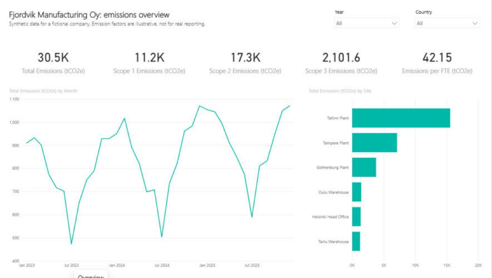
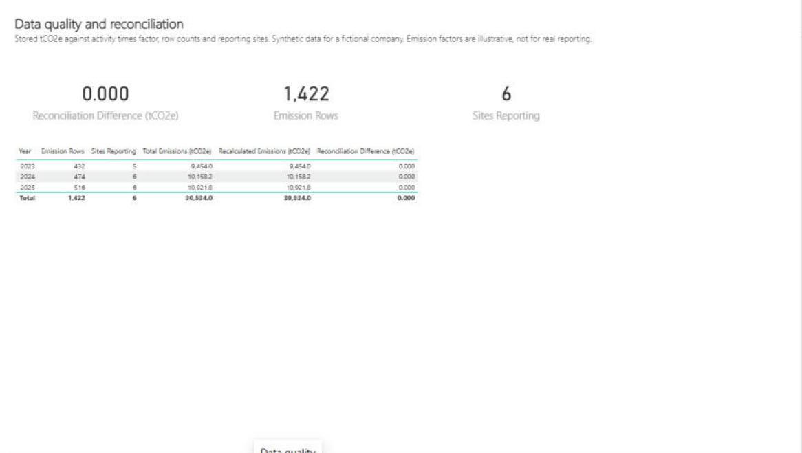

# Fjordvik Power BI: a tested, version-controlled semantic model

A Power BI semantic model and three-page report for Fjordvik Manufacturing Oy, a
**fictional** manufacturer with six sites in Finland, Sweden and Estonia. The model is
saved as a Power BI Project (PBIP): plain text files in git, written in Tabular Model
Definition Language (TMDL) and the Power BI enhanced report format (PBIR). Every Data
Analysis Expressions (DAX) measure is reconciled against an independent Python
calculation by automated tests.

> **Synthetic data only.** No real company, client or person is described. The emission
> factors are **illustrative**, not cited, and must not be used for real reporting.



## Problem

Corporate Power BI models drift: measures get edited in place, nobody can say which
version a report used, and a number that looks right is never checked against a second
route to the same answer. Access is often all-or-nothing. The questions a reviewer asks
of a semantic model are: is it under version control, do its measures reconcile, who can
see what, and is it documented well enough to certify?

## Approach

- **Model as code.** The whole model (tables, relationships, measures, security roles)
  and the report pages are text files, so every change shows up as a readable git diff.
- **A star schema** on the shared Fjordvik dataset: three dimensions (date, site, source)
  and two fact tables (emissions, site metrics), with single-direction relationships.
- **Fourteen measures** in one `_Measures` table, grouped in four display folders
  (Emissions, Intensity, Time comparison, Data quality), each with a description and a
  format string.
- **Grain handled explicitly.** Full-time equivalent employees (FTE) is a level, so
  `Average FTE` sums sites within each month and averages the months; summing FTE over a
  year would make emissions per FTE twelve times too small.
- **Like-for-like year-on-year change.** Only site-months with emissions in both years
  count. Without this, Tartu Warehouse (opened July 2024) shows +136.5% for 2025 instead of
  +10.7%, and the company shows +7.5% instead of +2.9%.
- **No date-table shortcut.** The date table has one row per month, which Power BI will
  not mark as a date table (it needs every day). The prior-year measure shifts month keys
  in plain DAX instead of using `SAMEPERIODLASTYEAR`.
- **Row-level security (RLS).** Three roles (Finland, Sweden, Estonia) each filter
  `dim_site` by country; the filter flows to both fact tables.
- **In-model reconciliation.** `Reconciliation Difference (tCO2e)` compares stored tCO2e
  with activity times factor, row by row, on the Data quality page.
- **Governance documents:** [naming conventions](docs/naming-conventions.md), a generated
  [data dictionary](docs/data-dictionary.md), and a
  [certification checklist](docs/certification-checklist.md).

## Architecture

```
fjordvik-data (tagged release) ──sync_data.py──> data/*.csv  (checksums verified)
                                                    │  Power Query, en-US locale
                                                    ▼
FjordvikEmissions.SemanticModel/definition/   TMDL: tables, relationships, measures, roles
FjordvikEmissions.Report/definition/          PBIR: 3 pages, 19 visuals (from build_report.py)
                                                    │
               Power BI Desktop (local engine) <────┘
                       ▲
  tests/test_measures_live.py ──run_dax.ps1──┘  31 DAX queries, compared with tests/expected.py
```

| Page | Shows |
| --- | --- |
| Overview | Total and scope 1, 2 and 3 emissions, emissions per FTE, monthly trend, emissions by site; year and country slicers |
| Sites | Per site: emissions, per FTE, per million euros, like-for-like change; scope 2 by month and site (Tampere's solar panels show in its summer 2025 dip) |
| Data quality | Reconciliation difference, row count and sites reporting, by year |

## How to run

You need Power BI Desktop (free, Microsoft Store) and Python 3.10 or newer with pytest.

1. Clone the repository. If it is not at `C:\Users\reece\Projects\fjordvik-powerbi`,
   change the `DataFolder` value in
   `FjordvikEmissions.SemanticModel/definition/expressions.tmdl` (or in Desktop:
   **Transform data > Edit parameters**) to your `data` folder.
2. Open `FjordvikEmissions.pbip` in Power BI Desktop. It opens without data; select
   **Refresh now** on the yellow bar.
3. Run the tests:

```bash
python -m pytest
```

The offline tests always run. The 31 live measure tests run when Power BI Desktop has the
model open and refreshed; otherwise they are skipped.

To change the report, edit `scripts/build_report.py` and run it; to refresh the data
dictionary after a model change, run `scripts/build_data_dictionary.py`. Close Desktop
**without saving** before regenerating files it has open.

## Test evidence

```
python -m pytest -q
....................................................................................................
100 passed in 9.55s
```

| Test file | What it proves |
| --- | --- |
| `test_measures_live.py` (31) | Every measure, run as DAX against the open model, matches an independent Python calculation from the CSVs: totals by year, scope, site and country; the scope measures under a conflicting filter (blank); reconciliation; revenue, average FTE and both intensities; blank per-euro intensity for the head office; prior year (blank for 2023); like-for-like change for the company, for Tartu and across all years; row and site counts; and each security role, including that the Sweden role sees nothing when filtered to Finland |
| `test_model_files.py` (66) | Table and column names match the shared schema; every measure has a description, format string and display folder, carries its unit in its name, divides with `DIVIDE()`, and contains no typed-in rates (only unit conversions and the date-key shift); three country roles; every field used by a visual exists in the model; page and visual names follow the PBIR rules; the report files are exactly what `build_report.py` writes |
| `test_docs.py`, `test_data.py` (3) | The data dictionary matches the model; the data matches the fjordvik-data checksums |

The tests were checked by planting mistakes: a typed-in factor (`* 0.95`) in a measure and
a misspelt measure name in a visual were both caught. Writing the like-for-like test
exposed a real fault in the first version of the change measure, which compared Tartu's
12 months of 2025 with its 6 months of 2024.



## Ownership

| Role | Who (fictional) |
| --- | --- |
| Business owner | Fjordvik Group Sustainability Manager |
| Technical owner | Data and AI Specialist |

## Limitations

- **Not published.** Endorsement, certification, scheduled refresh and RLS membership
  live in the Power BI Service; the [certification checklist](docs/certification-checklist.md)
  shows what would be reviewed.
- **Local file source.** The data comes from CSV files through a folder parameter. A
  production model would read a database or lakehouse, with a gateway for refresh.
- **Monthly grain** and illustrative emission factors (see fjordvik-data).
- **Live tests need Desktop open.** In a team, the same DAX queries would run in CI
  (continuous integration) against a published model through the XMLA endpoint.
- Report layout is functional rather than polished; formatting is left at defaults.

## Next steps

- Publish to a Power BI workspace, assign RLS members, and run the live tests against the
  XMLA endpoint.
- Add a Power Automate flow that refreshes the model after each monthly data load
  (fjordvik-power-automate).
- Re-pin the data to the fjordvik-data `v1.0.0` tag once it is created.

## Licence

Code: MIT ([LICENSE](LICENSE)). Data: Creative Commons Attribution 4.0 (CC BY 4.0)
([data/LICENSE-DATA.md](data/LICENSE-DATA.md)).
