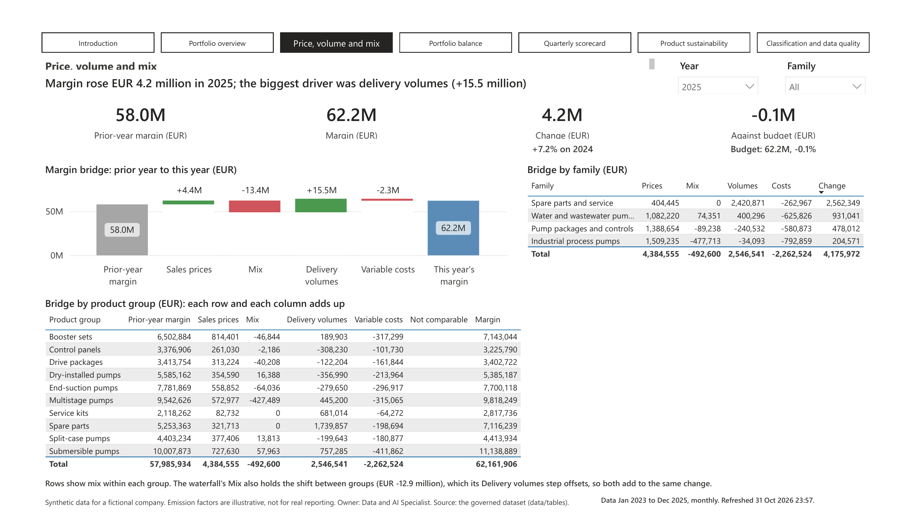
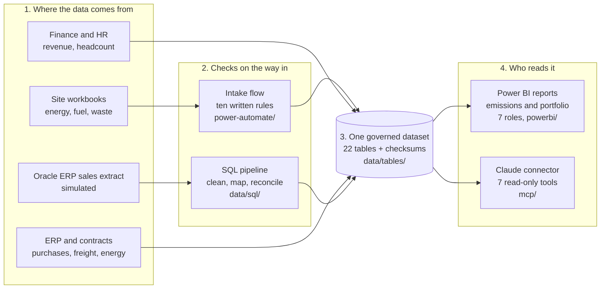

# Fjordvik: monthly emissions reporting with Power Automate, Power BI and Claude

Fjordvik Manufacturing Oy makes electric pumps and pump systems for water utilities,
industry and buildings, from six sites in Finland, Sweden and Estonia
([company profile](docs/company-profile.md)). Every month each site sends a spreadsheet
of the fuel, energy, refrigerant, flights and waste it used, and the sustainability team
turns those, with purchasing, freight and energy contract data, into the company's
greenhouse gas figures. Customers increasingly ask for the whole footprint: market-based
scope 2 and the scope 3 emissions of what Fjordvik buys, ships and sells. Product
management needs the other half of the picture: what each product sells, earns and emits
in use, scored each quarter from one set of figures that reconciles to finance. Done by
hand, that is slow, error-prone and hard to trust: a unit slip makes a line 1,000 times
too big, copies of the central file drift, and country managers see all or nothing.

This project automates and governs that routine. Power Automate flows collect and check
each site's file against ten written rules, one Power BI model with two reports (emissions
and product portfolio) gives management, country managers and product managers one tested
set of figures, and a Claude connector answers plain-language questions from the same data. It covers 36 months, January 2023 to
December 2025: scope 1, location-based and market-based scope 2, and scope 3 categories
1, 3, 4, 5, 6, 9 and 11, with every category not yet calculated listed with its reason; and
product sales from a simulated Oracle ERP extract, cleaned and reconciled by SQL, with
price, volume and mix against last year and budget, portfolio balance and a quarterly
scorecard.

> **Synthetic data only.** Fjordvik Manufacturing Oy is a fictional company, and this is a
> portfolio project. No real company, client or person is described. The emission factors
> are **illustrative**, not cited, and must not be used for real reporting.

| Folder | What it shows | Tests |
| --- | --- | --- |
| [`data`](data) | The governed dataset: 22 tables with fixed names, checksums and quality tests, and the SQL that cleans the simulated ERP extract | 60 |
| [`mcp`](mcp) | A Model Context Protocol (MCP) server that gives Claude seven read-only tools over the data (Python, DuckDB), in Claude Desktop or over HTTP with sign-in and per-role access | 76 |
| [`powerbi`](powerbi) | A Power BI Project: one semantic model in Tabular Model Definition Language (TMDL), 134 Data Analysis Expressions (DAX) measures, seven row-level security roles, and two reports on it (emissions, 10 pages; portfolio, 7 pages) | 727 (154 need Power BI Desktop open) |
| [`power-automate`](power-automate) | Power Automate intake and reminder flows with ten written rules, designed and tested offline | 26 |

Each folder has its own README with the problem, approach, architecture, test evidence
and limitations. [docs/learning-guide.md](docs/learning-guide.md) sets out the business
need and the data, then explains how each part was built and why each main decision was
made. The [process map](https://voneeci.github.io/fjordvik/docs/process-map.html) shows the
whole monthly process, from energy being used to the Power BI reports, with the owner,
tool, data and checks for each step (source: [docs/process-map.html](docs/process-map.html)).

## What the reports look like

Every page title is a sentence worked out from the data, every headline number sits beside
last year (and budget, for the portfolio), and each page opens on the latest full year.
**[See all 17 pages, full size](powerbi/docs/report-pages.md).** Every DAX measure behind
them is explained in the [measure guide](powerbi/docs/measure-guide.md): what it is, its
formula, where it is shown and an example value.

[](powerbi/docs/report-pages.md)

## How the parts fit



| Step | What happens | Where |
| --- | --- | --- |
| 1. Data arrives | Each month, sites upload a workbook of what they used; finance, HR, purchasing, logistics and the ERP send their exports | Described in [data/README.md](data/README.md) |
| 2. Checks | Site files pass ten written rules before they are loaded; the ERP sales extract is cleaned by SQL and must add up to finance revenue to the cent | [power-automate](power-automate), [data/sql](data/sql) |
| 3. One dataset | Everything lands in 22 tables with fixed names, and a manifest of checksums proves nobody edited them by hand | [data/tables](data/tables) |
| 4. Reading it | The two Power BI reports and the Claude connector read the same files, so they always show the same numbers | [powerbi](powerbi), [mcp](mcp) |

## How to run it on your own computer

Everything in this repository runs on a normal Windows laptop, with free software, and
no account or company system. The data is synthetic, so nothing needs a login.

### 1. What you need

| Software | Needed for | Where to get it |
| --- | --- | --- |
| Python 3.10 or newer | The tests and the data generator in every folder | [python.org](https://www.python.org/downloads/) (tick **Add python.exe to PATH** when installing) |
| Git (optional) | Downloading with `git clone` | [git-scm.com](https://git-scm.com/downloads), or use Download ZIP instead |
| Power BI Desktop (optional, free) | Opening the report and running the live measure tests | Microsoft Store |
| Claude Desktop (optional) | Asking Claude questions through the connector | [claude.ai/download](https://claude.ai/download) |

### 2. Download the project

Either clone it with Git:

```powershell
git clone https://github.com/voneeci/fjordvik.git
cd fjordvik
```

Or, without Git: on the [repository page](https://github.com/voneeci/fjordvik) select
**Code**, then **Download ZIP**, unzip it, and open PowerShell in the unzipped `fjordvik`
folder.

### 3. Run each part's tests

Each of the four folders has its own Python virtual environment, so they never interfere.
Open PowerShell in the folder, then run its block. The first run downloads the packages
it needs; after that, only the last line is needed.

**data** (the dataset, the SQL and the generator):

```powershell
cd data
python -m venv .venv
.venv\Scripts\python -m pip install -e ".[dev]"
.venv\Scripts\python -m pytest -q
```

**mcp** (the Claude connector):

```powershell
cd mcp
python -m venv .venv
.venv\Scripts\python -m pip install -e ".[dev]"
.venv\Scripts\python -m pytest -q
```

**powerbi** (the model, its measures and both reports):

```powershell
cd powerbi
python -m venv .venv
.venv\Scripts\python -m pip install pytest
.venv\Scripts\python -m pytest -q
```

**power-automate** (the intake rules):

```powershell
cd power-automate
python -m venv .venv
.venv\Scripts\python -m pip install pytest openpyxl
.venv\Scripts\python -m pytest -q
```

Each should end with a line such as `60 passed`: 60 for data, 76 for mcp, 26 for
power-automate, and 573 for powerbi (with 154 skipped until Power BI Desktop is open).
On macOS or Linux, use `.venv/bin/python` in place of `.venv\Scripts\python`.

### 4. Open the Power BI reports

1. Open `powerbi\FjordvikEmissions.pbip` (emissions) or `powerbi\FjordvikPortfolio.pbip`
   (product portfolio) in Power BI Desktop, one at a time; both read the same model.
2. The report reads the CSV files through a parameter that points at the author's folder.
   Select **Transform data**, then **Edit parameters**, and set **DataFolder** to your
   copy's `data\tables` folder, for example `C:\Users\you\fjordvik\data\tables` (no
   backslash at the end).
3. Select **Refresh** on the Home tab. The Introduction page explains every page.
4. With a report open and refreshed, run the powerbi tests again: the 154 live tests now
   run too, comparing every measure with an independent Python calculation.
5. Close Power BI Desktop with **Don't save** if you only wanted to look; saving rewrites
   the project files.

### 5. Optional: regenerate the data, or use Claude

- To rebuild the synthetic data, extract and SQL output from the settings in
  `data/src/fjordvik_data/config.py`, run `.venv\Scripts\python -m fjordvik_data --out tables`
  in the `data` folder ([data/README.md](data/README.md) explains it).
- To ask Claude questions about the data, follow
  [mcp/README.md](mcp/README.md#connect-it-to-claude-desktop).
- To see how a company would share the connector, with sign-in and a role per person, follow
  [mcp/README.md](mcp/README.md#run-it-over-http-with-sign-in).

## History

The four parts were built as separate repositories from 12 to 16 October 2026 and
combined here on 30 October 2026 with their full git history (`git subtree`), so every
original commit keeps its hash. The old repositories are archived on GitHub.

## Licence

Code: MIT (the `LICENSE` file in each folder). Data: Creative Commons Attribution 4.0
(CC BY 4.0) ([data/LICENSE-DATA.md](data/LICENSE-DATA.md)).
