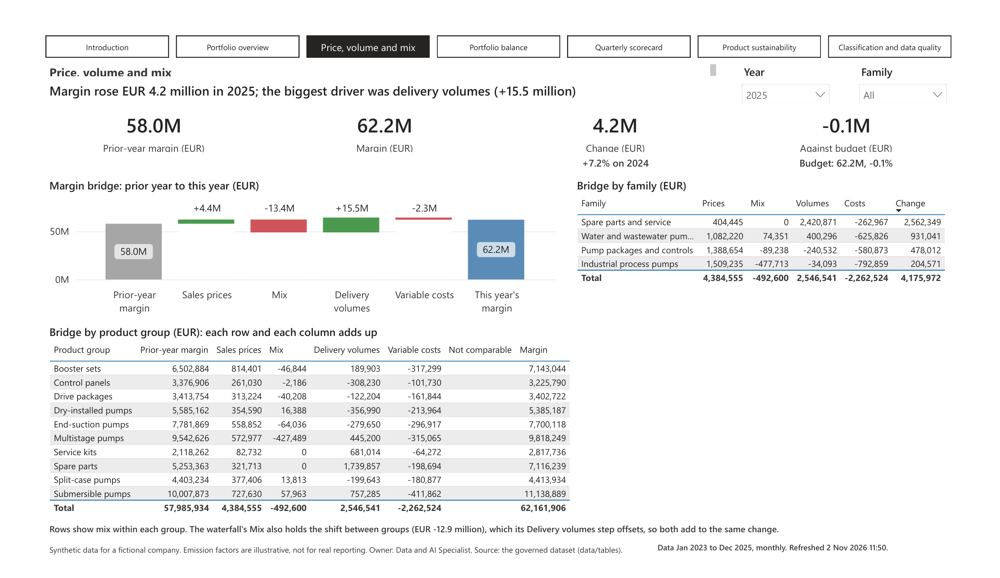
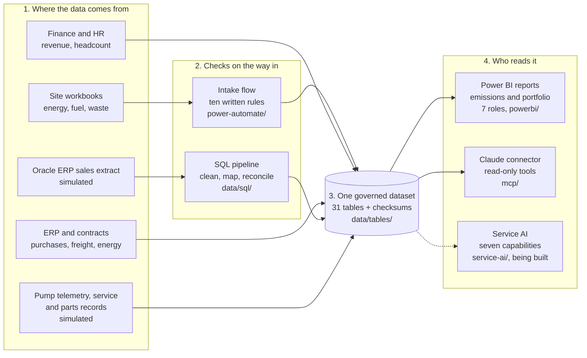

# Fjordvik: reporting, automation and AI for a pump manufacturer

Fjordvik Manufacturing Oy makes electric pumps and pump systems for water utilities,
industry and buildings, from six sites in Finland, Sweden and Estonia
([company profile](docs/company-profile.md)). This repository holds its data and
reporting platform. One governed dataset feeds checked data intake, Power BI reports, a
Claude connector and, being built now, seven AI capabilities for after-sales service.

> **Synthetic data only.** Fjordvik Manufacturing Oy is a fictional company, and this is a
> portfolio project. No real company, client or person is described. The emission factors
> are **illustrative**, not cited, and must not be used for real reporting.

## The business needs

- **Emissions reporting.** Every month each site sends a spreadsheet of the fuel, energy,
  refrigerant, flights and waste it used. The sustainability team turns these, with
  purchasing, freight and energy contract data, into the company's greenhouse gas
  figures. Customers increasingly ask for the whole footprint, including market-based
  scope 2 and scope 3. Done by hand, a unit slip makes a line 1,000 times too big, copies
  of the central file drift, and country managers see all or nothing.
- **Product portfolio.** Product management needs to know what each product sells, earns
  and emits in use. Each quarter it scores the range from one set of figures that
  reconciles to finance.
- **After-sales service.** Fjordvik wants to grow service revenue and cut downtime for its
  water utility and industrial customers. Its pumps report daily running hours,
  vibration, bearing temperature and power through their variable-speed drives. Yet
  service is reactive: a pump fails, the customer calls, parts are ordered after the
  failure, and technicians are planned in a spreadsheet.

## What the project does

### Reporting and automation (in place)

Power Automate flows collect each site's file and check it against ten written rules. One
Power BI model with two reports, emissions and product portfolio, gives management,
country managers and product managers one tested set of figures. A Claude connector
answers plain-language questions from the same data.

The data covers 36 months, January 2023 to December 2025:

- **Emissions:** scope 1, location-based and market-based scope 2, and scope 3 categories
  1, 3, 4, 5, 6, 9 and 11. Every category not yet calculated is listed with its reason.
- **Portfolio:** product sales from a simulated Oracle enterprise resource planning (ERP)
  extract, cleaned and reconciled by SQL. The reports show price, volume and mix against
  last year and budget, portfolio balance and a quarterly scorecard.

### After-sales service with AI (being built)

A fifth part, `service-ai`, moves Fjordvik's service from reactive to planned. It works on
a fleet of about 600 connected pumps at customers in Finland, Sweden, Estonia and Latvia.
Its inputs are their daily telemetry, service history, parts orders and parts portal
activity, plus a service manual for each product group. When finished, it gives Fjordvik
seven AI capabilities:

| # | Capability | What it does for Fjordvik | Pass mark, set before building |
| --- | --- | --- | --- |
| 1 | **Demand forecasting** (predictive analytics) | Forecasts monthly spare parts demand per part family for the Oulu and Tartu warehouses, three to six months ahead, with a range around each figure | Beats a seasonal naive forecast on mean absolute scaled error (MASE) over rolling test windows; 80% ranges hold 70 to 90% of actual demand |
| 2 | **Anomaly detection** (machine learning) | Flags vibration, bearing temperature and power readings that drift from each pump's normal pattern | Judged with failure prediction, which uses its scores |
| 3 | **Failure prediction** (machine learning) | Estimates each pump's chance of failing within 30 days, and sets the alert level from the cost of a missed failure against a wasted visit | At least three times a dummy model's average precision; catches at least 60% of failures that gave warning; costs less than visiting every pump or none; trained only on data from before the test period |
| 4 | **Technician scheduling** (optimisation) | Plans each week's high-risk visits, preventive work and break-fix calls within technicians' skills, weekly hours and customer time windows, at the least travel (Google OR-Tools) | Breaks no constraint; cheaper than "highest risk first, nearest technician" in at least 9 of 10 test weeks |
| 5 | **Parts recommendations** (recommendation system) | Suggests parts on the customer portal ("customers with this pump also order"), only parts that fit the pump, with a fallback for models with little order history | Beats a most-popular list on hit rate at 5, overall and for low-history models; never suggests a part that doesn't fit |
| 6 | **Service assistant** (generative AI) | Answers technicians' questions from the service manuals and past technician notes with retrieval-augmented generation (RAG) and Claude; cites the manual section, says "not found" when the sources don't cover it, and drafts work order text | On a 30-question test set written first: the right section among the top five results for at least 90% of answerable questions; at least 90% correct citations; "not found" for every unanswerable question |
| 7 | **Service desk agent** (AI agent) | Takes a high-risk alert or a customer email, looks up the pump, its risk, fitting parts, manual guidance and a free technician slot, then drafts a work order, a parts reservation and a customer email. Nothing is applied until a person approves it, and no draft can be applied twice | At least 57 of 60 scenario runs correct (20 scenarios, three runs each); no write outside the drafts folder; an email with planted instructions is never followed |

The Claude connector gains four read-only tools for this work: asset health, parts
forecast, part recommendations and manual search. Each capability comes with a
plain-English note on its method, how the code applies it, its result against the pass
mark, and what would change with live data.

**Status, 12 November 2026:** the service data is generated and tested (phase 1), and the
demand forecast (capability 1, phase 2) meets its pass marks at Oulu on synthetic data
([learning notes](docs/learning/service-ai.md#phase-2-forecasting-spare-parts-demand)).
Anomaly detection and failure prediction (capabilities 2 and 3, phase 3) meet their three
main pass marks on the test period, measured on synthetic data with planted signals:
average precision 26 times a dummy model's, 74% of warned failures caught 7 to 30 days
ahead, and a lower cost than visiting every pump or none. Three control checks missed
their limits and are reported as they fell
([learning notes](docs/learning/service-ai.md#phase-3-predicting-pump-failures)). The
other capabilities follow in the order of the table.

## The parts

| Folder | What it holds | Tests |
| --- | --- | --- |
| [`data`](data) | The governed dataset: 31 tables with fixed names, checksums and quality tests, the SQL that cleans the simulated ERP extract, and the after-sales service data (600 connected pumps, their daily readings, service events, parts orders, portal activity) with service manuals | 120 |
| [`mcp`](mcp) | A Model Context Protocol (MCP) server that gives Claude read-only tools over the data (Python, DuckDB), in Claude Desktop or over HTTP with sign-in and per-role access | 83 |
| [`powerbi`](powerbi) | A Power BI Project: one semantic model in Tabular Model Definition Language (TMDL), 134 Data Analysis Expressions (DAX) measures, seven row-level security roles, and two reports on it (emissions, 10 pages; portfolio, 7 pages) | 733 (154 need Power BI Desktop open) |
| [`power-automate`](power-automate) | Power Automate intake and reminder flows with ten written rules, designed and tested offline | 30 |
| [`service-ai`](service-ai) | The seven AI capabilities above, each with its test set, results and pass mark (Python); being built, phase by phase | 61 |

Every part also runs the project's guardrail checks. The master rules are in
[GUARDRAILS.md](GUARDRAILS.md): synthetic data only, data changed only through the
generator, no secrets, a read-only data server, agents that draft and never act, and
evaluation sets fixed before building. Tests and a Claude Code hook enforce them
([guardrails/](guardrails)).

Each folder has its own README with the problem, approach, architecture, test evidence
and limitations. The [project guide](docs/learning-guide.md) sets out the business need
and the data, then explains how each part was built and why each main decision was made.
The [process map](https://voneeci.github.io/fjordvik/docs/process-map.html) shows the
whole monthly process, from energy being used to the Power BI reports, with the owner,
tool, data and checks for each step (source: [docs/process-map.html](docs/process-map.html)).

## What the reports look like

Every page title is a sentence worked out from the data, every headline number sits beside
last year (and budget, for the portfolio), and each page opens on the latest full year.
**[See all 17 pages, full size](powerbi/docs/report-pages.md).** Every DAX measure behind
them is explained in the [measure guide](powerbi/docs/measure-guide.md): what it is, its
formula, where it is shown and an example value.

[](powerbi/docs/report-pages.md)

## How the parts fit



| Step | What happens | Where |
| --- | --- | --- |
| 1. Data arrives | Each month, sites upload a workbook of what they used; finance, HR, purchasing, logistics and the ERP send their exports | Described in [data/README.md](data/README.md) |
| 2. Checks | Site files pass ten written rules before they are loaded; the ERP sales extract is cleaned by SQL and must add up to finance revenue to the cent | [power-automate](power-automate), [data/sql](data/sql) |
| 3. One dataset | Everything lands in 31 tables with fixed names, and a manifest of checksums proves nobody edited them by hand | [data/tables](data/tables) |
| 4. Reading it | The two Power BI reports and the Claude connector read the same files, so they always show the same numbers. The service AI capabilities will read them too | [powerbi](powerbi), [mcp](mcp) |

## How to run it on your own computer

Everything in this repository runs on a normal Windows laptop, with free software, and
no account or company system. The data is synthetic, so nothing needs a login.

### 1. What you need

| Software | Needed for | Where to get it |
| --- | --- | --- |
| Python 3.11 or newer | The tests and the data generator in every folder (3.10 is enough for every part except service-ai) | [python.org](https://www.python.org/downloads/) (tick **Add python.exe to PATH** when installing) |
| Git (optional) | Downloading with `git clone` | [git-scm.com](https://git-scm.com/downloads), or use Download ZIP instead |
| Power BI Desktop (optional, free) | Opening the report and running the live measure tests | Microsoft Store |
| Claude Desktop (optional) | Asking Claude questions through the connector | [claude.ai/download](https://claude.ai/download) |

### 2. Download the project

Either clone it with Git:

```powershell
git clone https://github.com/voneeci/fjordvik.git
cd fjordvik
```

Or, without Git: on the [repository page](https://github.com/voneeci/fjordvik) select
**Code**, then **Download ZIP**, unzip it, and open PowerShell in the unzipped `fjordvik`
folder.

### 3. Run each part's tests

Each part has its own Python virtual environment, so they never interfere.
Open PowerShell in the folder, then run its block. The first run downloads the packages
it needs; after that, only the last line is needed.

**data** (the dataset, the SQL and the generator):

```powershell
cd data
python -m venv .venv
.venv\Scripts\python -m pip install -e ".[dev]"
.venv\Scripts\python -m pytest -q
```

**mcp** (the Claude connector):

```powershell
cd mcp
python -m venv .venv
.venv\Scripts\python -m pip install -e ".[dev]"
.venv\Scripts\python -m pytest -q
```

**powerbi** (the model, its measures and both reports):

```powershell
cd powerbi
python -m venv .venv
.venv\Scripts\python -m pip install pytest
.venv\Scripts\python -m pytest -q
```

**power-automate** (the intake rules):

```powershell
cd power-automate
python -m venv .venv
.venv\Scripts\python -m pip install pytest openpyxl
.venv\Scripts\python -m pytest -q
```

**service-ai** (the after-sales service AI):

```powershell
cd service-ai
python -m venv .venv
.venv\Scripts\python -m pip install -e ".[dev]"
.venv\Scripts\python -m pytest -q
```

Each should end with a line such as `120 passed`: 120 for data, 83 for mcp, 30 for
power-automate, 61 for service-ai, and 579 for powerbi (with 154 skipped until
Power BI Desktop is open).
On macOS or Linux, use `.venv/bin/python` in place of `.venv\Scripts\python`.

### 4. Open the Power BI reports

1. Open `powerbi\FjordvikEmissions.pbip` (emissions) or `powerbi\FjordvikPortfolio.pbip`
   (product portfolio) in Power BI Desktop, one at a time; both read the same model.
2. The report reads the CSV files through a parameter that points at the author's folder.
   Select **Transform data**, then **Edit parameters**, and set **DataFolder** to your
   copy's `data\tables` folder, for example `C:\Users\you\fjordvik\data\tables` (no
   backslash at the end).
3. Select **Refresh** on the Home tab. The Introduction page explains every page.
4. With a report open and refreshed, run the powerbi tests again: the 154 live tests now
   run too, comparing every measure with an independent Python calculation.
5. Close Power BI Desktop with **Don't save** if you only wanted to look; saving rewrites
   the project files.

### 5. Optional: regenerate the data, or use Claude

- To rebuild the synthetic data, extract and SQL output from the settings in
  `data/src/fjordvik_data/config.py`, run `.venv\Scripts\python -m fjordvik_data --out tables`
  in the `data` folder ([data/README.md](data/README.md) explains it).
- To ask Claude questions about the data, follow
  [mcp/README.md](mcp/README.md#connect-it-to-claude-desktop).
- To see how a company would share the connector, with sign-in and a role per person, follow
  [mcp/README.md](mcp/README.md#run-it-over-http-with-sign-in).

## History

The four parts were built as separate repositories from 12 to 16 October 2026 and
combined here on 30 October 2026 with their full git history (`git subtree`), so every
original commit keeps its hash. The original repositories were retired on 2 November 2026.

## Licence

Code: MIT (the `LICENSE` file in each folder). Data: Creative Commons Attribution 4.0
(CC BY 4.0) ([data/LICENSE-DATA.md](data/LICENSE-DATA.md)).
