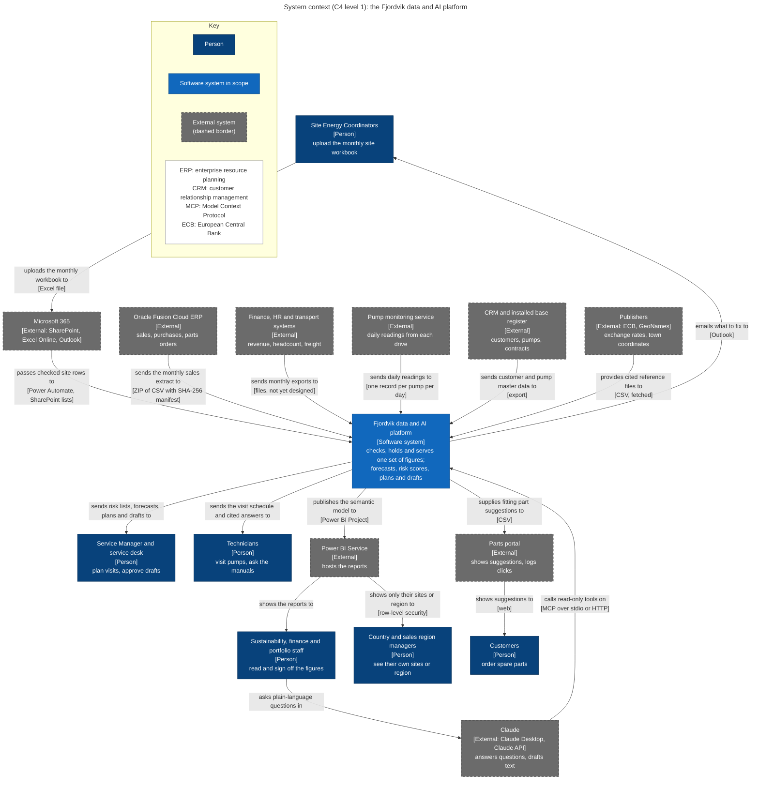
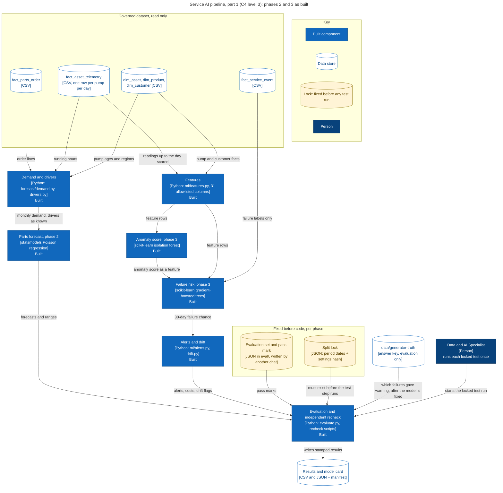
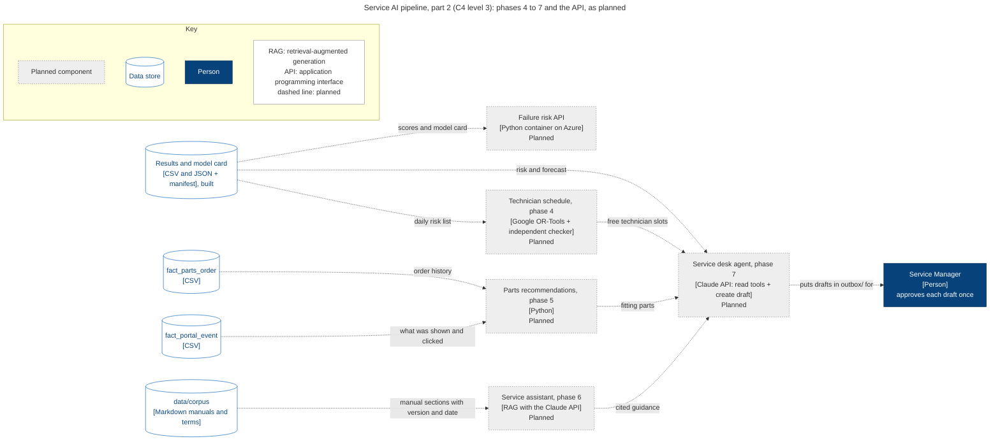

# Solution architecture

Fjordvik needs one platform that takes in its sites', ERP and service data, checks it,
holds it once, and serves the same figures to its reports, a Claude connector and its
service AI. This page shows the shape of that platform in the C4 model: the system in its
context (level 1), its containers (level 2) and the service AI's components (level 3).
It then sets out the interfaces between parts, the environments, operations, and where the
project stands against the data product delivery map. It is station 02 of that map.

Why the platform exists is in the [business case](business-case.md); what it must do is in
[requirements.md](requirements.md); the choices behind it are in the
[decision log](decision-log.md); the threats it faces are in the
[threat model](threat-model.md); the data it holds is in [data-model.md](data-model.md).

> **Synthetic data only.** Fjordvik Manufacturing Oy is a fictional company, and this is a
> portfolio project. No real company, client or person is described; roles are job titles,
> not people. The emission factors are **illustrative**, not cited.

**How to read the diagrams.** Each diagram has a title naming its type and scope, and its
own key. Every box gives its name, its type in square brackets with its technology, what
it does, and whether it is built, designed or planned; the status is written in the box,
so the diagrams read in black and white too. Every arrow says what it does in the
direction it points, with the format or protocol in square brackets. Solid lines run
today; dashed lines are designed or planned. Each diagram was last checked against the
code at the commit named under it.

## Level 1: system context

Who uses the platform, and which systems it depends on.

Last checked against the code: commit `f036850`, 19 November 2026. In this repository
every external system is simulated: the data generator in `data` writes what each one
would send, in its shape.

## Level 2: containers

The applications and data stores inside the platform, the technology of each, and how
they connect.

```mermaid
---
title: "Containers (C4 level 2): inside the Fjordvik data and AI platform"
---
flowchart LR
    classDef built fill:#1168bd,color:#ffffff,stroke:#0b4884
    classDef designed fill:#ffffff,color:#0b4884,stroke:#1168bd,stroke-dasharray:6 4
    classDef planned fill:#eeeeee,color:#333333,stroke:#777777,stroke-dasharray:2 3
    classDef external fill:#6b6b6b,color:#ffffff,stroke:#333333
    classDef note fill:#ffffff,color:#333333,stroke:#999999

    subgraph KEY["Key"]
        direction TB
        KB["Built: runs and is tested here"]:::built
        KD["Designed: written design, not running"]:::designed
        KP["Planned or gap: no design or code yet"]:::planned
        KE["External system"]:::external
        KA["A"] -->|"runs today"| KB2["B"]
        KC["A"] -.->|"designed or planned"| KD2["B"]
        KN["Cylinder: data store<br/>RLS: row-level security<br/>TMDL, PBIR: Power BI model and report formats<br/>MCP: Model Context Protocol"]:::note
    end

    subgraph SRC["Sources, simulated here"]
        WB["Site workbooks<br/>[External: Excel]"]:::external
        X["ERP extract<br/>[External: ZIP of CSV + SHA-256 manifest]"]:::external
        EXP["Finance, HR, transport, CRM<br/>and monitoring exports<br/>[External: files]"]:::external
    end

    FLOW["Intake and reminder flows<br/>[Container: Power Automate]<br/>check rules R1 to R10<br/>Designed"]:::designed
    LISTS[("SharePoint lists<br/>[Container: SharePoint Online]<br/>sites, sources, factors, emissions, intake log<br/>Designed")]:::designed
    SQL["SQL pipeline<br/>[Container: DuckDB SQL]<br/>checks, cleans, maps, reconciles<br/>Built"]:::built
    STG[("Staging database<br/>[Container: engine not chosen]<br/>holds the cleaned extract<br/>Designed")]:::designed
    LOAD["Production load<br/>[Container: not designed]<br/>fills the governed dataset<br/>Gap"]:::planned
    GEN["Data generator<br/>[Container: Python]<br/>stands in for every source, demo only<br/>Built"]:::built
    DS[("Governed dataset<br/>[Container: 31 CSV files + manifest.json]<br/>the one copy every reader uses<br/>Built")]:::built
    SM["Semantic model<br/>[Container: Power BI, TMDL]<br/>134 measures, 7 RLS roles<br/>Built, not published"]:::built
    REP["Emissions and portfolio reports<br/>[Container: Power BI, PBIR]<br/>17 pages<br/>Built, not published"]:::built
    MCP["Claude connector<br/>[Container: Python, MCP SDK, DuckDB]<br/>7 read-only tools<br/>Built, local only"]:::built
    SAI["Service AI jobs<br/>[Container: Python, scikit-learn, statsmodels]<br/>parts forecast, failure risk<br/>Built"]:::built
    RES[("Service AI results<br/>[Container: CSV and JSON + manifest]<br/>scores, forecasts, model card<br/>Built")]:::built
    LATER["Scheduler, recommender, assistant, agent<br/>[Container: Python, OR-Tools, Claude API]<br/>phases 4 to 7<br/>Planned"]:::planned
    GRD["Guardrails and tests<br/>[Container: Python, pytest, Claude Code hook]<br/>check names, checksums and rules<br/>Built"]:::built

    WB -->|"triggers on upload<br/>[Excel file in SharePoint]"| FLOW
    FLOW -->|"writes accepted rows to<br/>[SharePoint connector]"| LISTS
    X -->|"is checked and loaded by<br/>[files]"| SQL
    SQL -->|"writes clean sales to<br/>[SQL]"| STG
    LISTS -.->|"would feed<br/>[not designed]"| LOAD
    STG -.->|"would feed<br/>[not designed]"| LOAD
    EXP -.->|"would feed<br/>[not designed]"| LOAD
    LOAD -.->|"would write<br/>[not designed]"| DS
    GEN -->|"writes tables, extract and corpus to<br/>[CSV, demo only]"| DS
    DS -->|"provides tables to<br/>[CSV via the DataFolder parameter]"| SM
    SM -->|"provides measures and roles to<br/>[same model]"| REP
    DS -->|"is loaded into memory by<br/>[CSV, checksums checked first]"| MCP
    DS -->|"is read in place by<br/>[CSV]"| SAI
    SAI -->|"writes stamped results to<br/>[CSV, JSON]"| RES
    RES -.->|"will feed four planned read-only tools in<br/>[CSV]"| MCP
    RES -.->|"will feed<br/>[CSV]"| LATER
    GRD -->|"checks names and checksums of<br/>[pytest, before each commit]"| DS
```

Last checked against the code: commit `f036850`, 19 November 2026.

| Container | Technology | Status | Part | Notes |
| --- | --- | --- | --- | --- |
| Intake and reminder flows | Power Automate cloud flows | Designed; rules tested offline in Python | power-automate | [Flow design](../power-automate/docs/flow-design.md); building them needs a Microsoft 365 tenant |
| SharePoint lists | SharePoint Online | Designed; seed workbooks built | power-automate | [Lists](../power-automate/docs/sharepoint-lists.md) |
| SQL pipeline | DuckDB SQL | Built | data | Stops the load on any failed check |
| Staging database | Not chosen | Designed | data, powerbi | [Refresh design](../powerbi/docs/refresh-design.md#the-route) |
| Production load | Not designed | **Gap** | none | No route yet from the SharePoint list, the staging database and the monthly exports into the dataset in production; a central data lake is being researched |
| Data generator | Python | Built | data | Demo only: it stands in for every source |
| Governed dataset | CSV files with a SHA-256 manifest | Built | data | The contract every reader depends on |
| Semantic model and reports | Power BI Project (TMDL and PBIR) | Built; not published | powerbi | Desktop reads the CSV files |
| Claude connector | Python, MCP SDK 2.x, DuckDB | Built; local only | mcp | Stdio, or Streamable HTTP on 127.0.0.1 with OAuth 2.1 sign-in |
| Service AI jobs and results | Python (pandas, statsmodels, scikit-learn) | Phases 2 and 3 built | service-ai | Each result stamped with data checksum, commit and model version |
| Scheduler, recommender, assistant, agent | Google OR-Tools; Python; retrieval-augmented generation (RAG) with Claude; an agent with an outbox | Planned | service-ai | Phases 4 to 7 |
| Guardrails and tests | Python, pytest, a Claude Code hook, a pre-commit check | Built | guardrails, every part | [GUARDRAILS.md](../GUARDRAILS.md) |

## Level 3: the service AI pipeline

The service AI is where most of the remaining build sits, so it gets its own view: from
the governed dataset through each phase's model to the decisions people take, with the
locks set before any test run and the places where a person approves. Each capability
reads the dataset in place and never writes under `data/` (rule A5).

The second part shows what phases 4 to 7 and the failure risk API will build on those
results. Nothing in it exists yet.

Last checked against the code: commit `f036850`, 19 November 2026. The answer key in
`data/generator-truth/` is read only by the evaluation step, after the model is fixed,
and never by a model, the connector or an agent (rule D10). The planned connector tools
(asset health, parts forecast, part recommendations, manual search) read the committed
results and stay read-only (rule A1).

### Machine learning operations parts

Kreuzberger, Kühl and Hirschl (2023, IEEE Access) name nine technical parts a machine
learning system needs. Each is shown or ruled out here:

| Part | In Fjordvik today | Status |
| --- | --- | --- |
| Source code repository | One git repository; every result names the commit it ran on | Present |
| Continuous integration and delivery | None: tests run by hand | Missing; [ADR-028](decision-log.md#adr-028-continuous-integration-on-every-push) proposed |
| Workflow orchestration | Scripts run by hand (`scripts/run_forecast.py`, `scripts/run_ml.py`) | Not needed for one-off phase runs; needed once a deployed model retrains on a schedule |
| Feature store | Features rebuilt from the governed dataset on each run, point-in-time tested (rule D11) | Not needed: one model family, small data |
| Model training infrastructure | The laptop, Python with pinned libraries and seeded generators (rule G10) | Present |
| Model registry | Results stamped with model version, commit and data checksum, with a checksum manifest; `results/ml/model_card.json` | Partial: files, not a registry |
| Machine learning metadata store | `eval/*/split_lock.json`, `eval/*/test_runs.jsonl`, `eval/*/evaluation.json` and the result manifests | Present, as files |
| Model serving | None | Planned: the failure risk API on Azure |
| Monitoring | The phase 3 drift monitor, run offline on the test period | Partial: live monitoring comes with the API |

## Interfaces and contracts

| # | From | To | Form | Contract and check |
| --- | --- | --- | --- | --- |
| I1 | Site workbook | Intake flow | Excel table "Submission" | Rules R1 to R10, [intake-rules.md](../power-automate/docs/intake-rules.md); the Python reference is tested |
| I2 | Intake flow | SharePoint Emissions list | List rows with factor and tCO2e | [sharepoint-lists.md](../power-automate/docs/sharepoint-lists.md); whole file or nothing |
| I3 | Oracle ERP | SQL pipeline | Monthly ZIP of CSV with a SHA-256 manifest | Manifest check stops the load; [refresh design](../powerbi/docs/refresh-design.md) |
| I4 | SQL pipeline | Governed dataset | `fact_sales`, `fact_data_issue` | Sales plus quarantine equal finance revenue to the cent |
| I5 | Governed dataset | Every reader | Table and column names; row counts and checksums | `data/tests/test_schema.py` (names never renamed, rule D4); each part's `tests/test_data.py` |
| I6 | Governed dataset | Semantic model | CSV through the `DataFolder` parameter | `powerbi/tests/test_data.py` |
| I7 | Claude connector | Claude | MCP tools over stdio or Streamable HTTP | Read-only annotations; OAuth 2.1 and a role check per tool over HTTP (rules A1, A2) |
| I8 | Service AI results | Claude connector (planned tools) | Committed CSV and JSON with a manifest | The layout map names `service-ai/results/` as what mcp reads |
| I9 | Agent | Approve command | Draft in `outbox/` with a version 4 UUID | Applied once, only by a person (rules A3, A4) |
| I10 | Corpus | Search index | Manual chunks with version and date | A changed manual rebuilds its chunks (rule D17) |
| I11 | Finance and HR | Governed dataset | Monthly export | **Not designed** ([data README](../data/README.md#where-the-data-comes-from)) |

## Environments

Today there is one environment: a Windows laptop with synthetic data. Power BI Desktop
reads the CSV files, the connector listens on 127.0.0.1 only, and every part's tests run
without keys or network. Nothing is published.

Proposed target (decision [ADR-026](decision-log.md#adr-026-four-environments-with-separate-credentials), awaiting Reece):

| Environment | Where | Data | Credentials | Purpose |
| --- | --- | --- | --- | --- |
| Development | The laptop | Synthetic | None needed; keys from environment variables for live model runs | Build and test |
| Continuous integration | GitHub Actions on every push | Synthetic | None: tests are keyless | Run every part's tests and the guardrail checks |
| Test | A Microsoft 365 trial tenant and a Power BI test workspace | Synthetic | Separate test accounts | Build the flows, publish the model, run the live tests, user acceptance |
| Production | Fjordvik's own tenant and staging database | Fjordvik's own | Separate; never in this repository | Live use; out of scope for a portfolio project |

ISO/IEC 27001:2022 control 8.31 asks for development, test and production to be kept
apart; the delivery map adds continuous integration as the fourth.

## Security design

Summarised from the [threat model](threat-model.md): synthetic data only; no secrets in
git (keys from environment variables); row-level security in Power BI mirrored by role
checks in the connector; a read-only connector with three guards on its SQL tool; agents
that draft and never act; text from documents treated as data, never instructions; and a
Claude Code hook with guardrail tests that catch common mistakes before they land.

## Non-functional targets

In [requirements.md](requirements.md#non-functional-requirements): correctness against
independent calculations, refresh and visual times, reliability of failed loads,
reproducible models, security, safety, accessibility and maintainability.

## Operations and support

Designed today: a failed SQL check keeps last month's figures; a failed Power BI refresh
emails the owner and four in a row turn the schedule off; every intake run is logged in
IntakeLog with Accepted, Rejected or Failed; open data issues sit in `fact_data_issue`
with an owner and an action; the drift monitor flags a sensor that changes against the
same month in earlier years.

Not designed yet: who supports the platform after handover, at what hours, and how a
technician reports a false alert; when a model is retrained and who approves the new
version; a backup and a tested restore. These belong to stations 06 and 09.

## Where Fjordvik stands on the delivery map

The map has eleven stations, from the business case (00) to continuous improvement (10).
Status on 19 November 2026, at commit `790589d`:

| Station | Status | Evidence or gap |
| --- | --- | --- |
| 00 Business case | First edition, not signed | [business-case.md](business-case.md); licence prices missing |
| 01 Discovery and requirements | First edition, G1 not taken | [requirements.md](requirements.md); no workshops; transition requirements new |
| 02 Solution architecture | This page, not reviewed | Environment strategy proposed; production load route not designed |
| 03 Data modelling | Model built; G2 partly met | [data-model.md](data-model.md); history handling proposed |
| 04 Build in slices | Strong, two gaps | Locked pass marks, independent review, saved evidence; no continuous integration, no user demos |
| 05 Migration and cutover | Not started | Reconciliation strong; no runbook, rehearsal, rollback or communication plan |
| 06 Testing stages | Component and system tests only | No user or operational acceptance; nothing published to test |
| 07 Go-live | Not started | Release package and go/no-go not written |
| 08 Hypercare | Not started | |
| 09 Handover | Partial | Handover notes per phase; no runbook with a measured restore time |
| 10 Continuous improvement | Designed for the scorecard only | Quarterly scorecard cycle; no benefits review |

### Follow-up tasks for stations 04 and 05

Recorded here, to start once this architecture is agreed (Reece, 19 November 2026):

1. **Continuous integration.** A GitHub Actions workflow that runs every part's tests and
   `guardrails/check.py` on every push, keyless (the 154 live Power BI tests stay manual).
   A new `.github/` folder needs a layout map entry from Attena first (rule L1).
2. **Demos.** Hold the open portfolio milestone M5: each page reviewed with two Product
   Managers, recorded as acceptance evidence.
3. **Cutover runbook.** One runbook for the move from the central spreadsheet and the
   service planning spreadsheet: steps, owners, timings against the monthly close, and
   go/no-go criteria (transition requirements TR1 to TR6).
4. **Rehearsal.** A clean-room rebuild from a tagged release in an empty folder, which
   the delivery map accepts as the lean cutover rehearsal, with reconciliation to the
   finance totals.
5. **Rollback plan and communication plan.** What happens if the first live close fails,
   and who tells the sites, controllers and technicians, when.

## Change history

- 19 November 2026: first edition, during the architecture pause (Reece asked).
