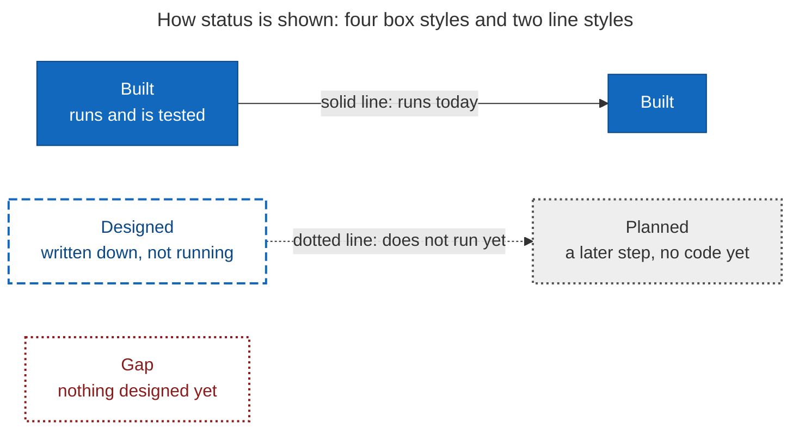
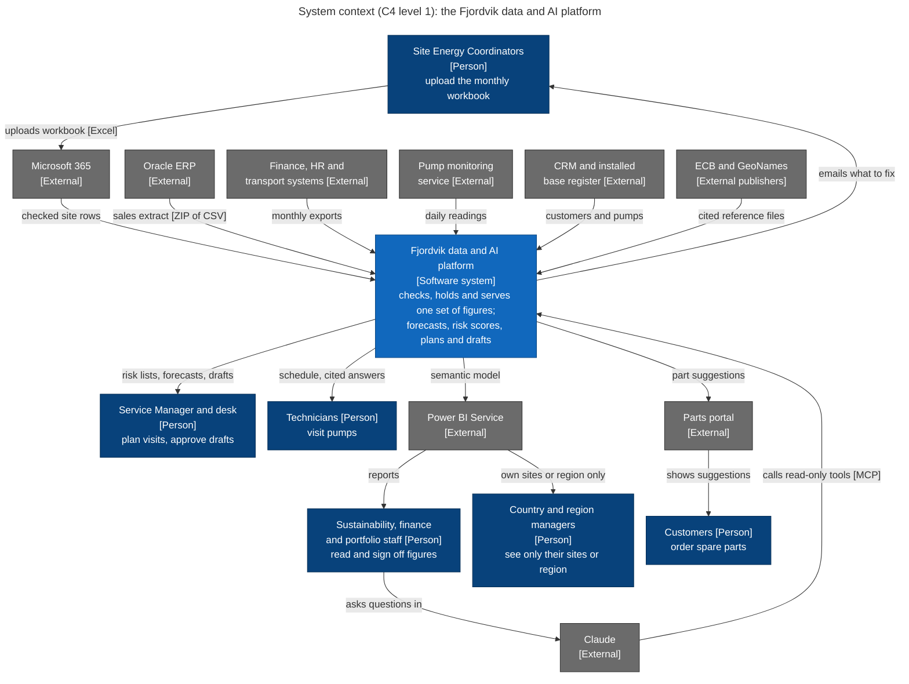
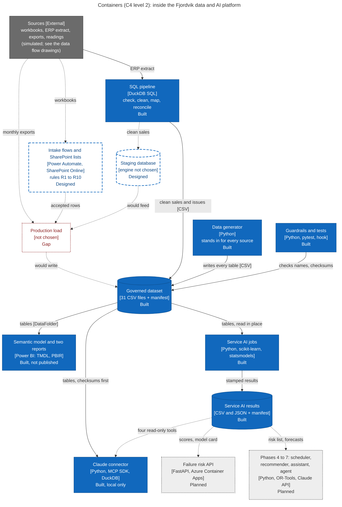
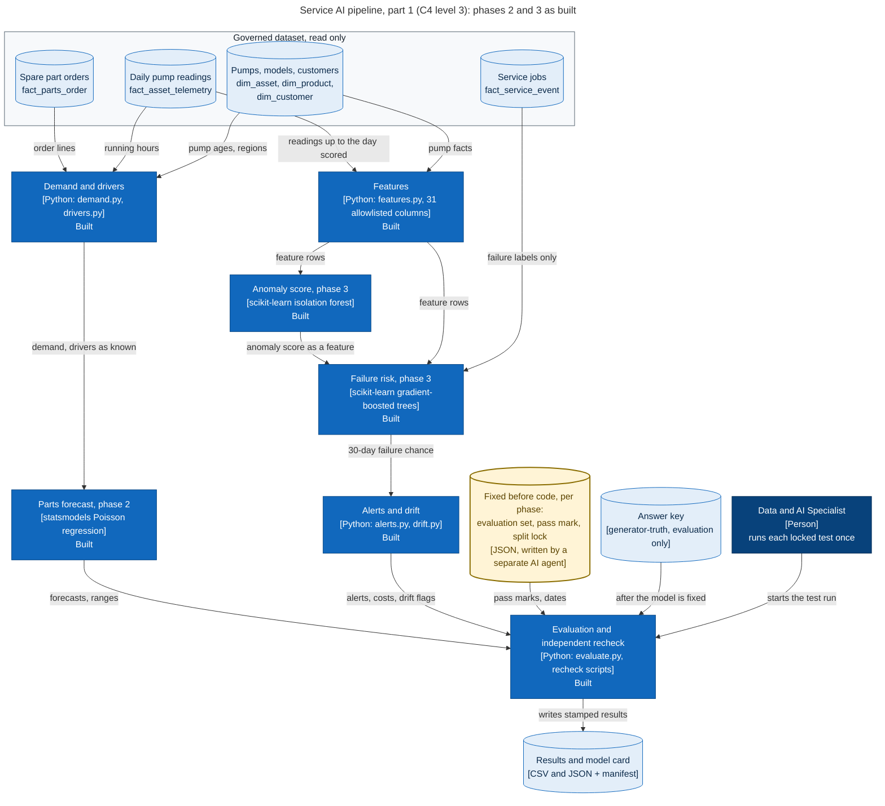
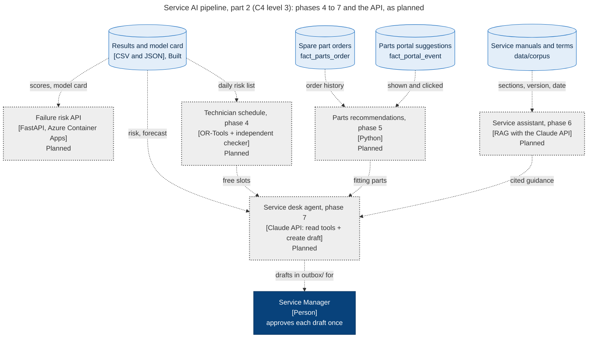

# Solution architecture

Fjordvik needs one platform that takes in its sites', enterprise resource planning (ERP) and service data, checks it,
holds it once, and serves the same figures to its reports, a Claude connector and its
service AI. This page first explains the concepts and methods behind all of Fjordvik's
architecture drawings, then shows the platform in the C4 model: the system in its
context (level 1), its containers (level 2) and the service AI's components (level 3).
It then sets out the interfaces between parts, the environments, operations, and where the
project stands against the data product delivery map. It is station 02 of that map.

Why the platform exists is in the [business case](business-case.md); what it must do is in
[requirements.md](requirements.md); the choices behind it are in the
[decision log](decision-log.md); the threats it faces are in the
[threat model](threat-model.md); the data it holds is in [data-model.md](data-model.md).

> **Synthetic data only.** Fjordvik Manufacturing Oy is a fictional company, and this is a
> portfolio project. No real company, client or person is described; roles are job titles,
> not people. The emission factors are **illustrative**, not cited.

## Concepts and methods

Fjordvik's architecture is described in 25 drawings across four documents: this one, the
[data model](data-model.md), the [requirements](requirements.md) and the
[threat model](threat-model.md). Each drawing answers one question for one kind of reader,
at one level of detail. This section explains the ideas behind them and how they were
made, so the drawings can be read without prior knowledge of the notations.

Every external system in the drawings is simulated: the data generator in `data` writes
what each one would send, in its shape.

### The kinds of drawing

| Kind of drawing | The question it answers | Method | Drawings |
| --- | --- | --- | --- |
| System context | Who uses the platform, and which other systems does it depend on? | C4 model, level 1 | System context |
| Containers | Which applications and data stores make up the platform, and how do they connect? | C4 model, level 2 | Containers |
| Components | What are the building blocks inside one container? | C4 model, level 3 | Service AI pipeline, parts 1 and 2 |
| Conceptual model | Which business things does the data describe, and how do they relate? | Boxes and labelled arrows that read as sentences | Conceptual model |
| Data flow | Where does each kind of data start, who owns it, and what carries it into the tables? | Data flow diagram, level 1 | Data flow, parts 1 and 2 |
| Data model | What does each table hold, and how do the tables join? | Entity relationship diagram drawn as a star schema | One star per fact table, and how the dimensions link |
| Stakeholder map | Who supplies the data, and who uses the results? | Grouped roles around the platform | Stakeholder map |
| Trust boundaries | Where does data or control pass between parties that trust each other to different degrees? | Threat model with trust zones | Trust boundaries |

### The C4 model

The C4 model, created by Simon Brown ([c4model.com](https://c4model.com/)), describes
software at four zoom levels, like a map: **context** (the whole system as one box, with
its users and neighbouring systems), **containers** (the applications and data stores
inside it), **components** (the building blocks inside one container) and **code** (classes
and functions). Fjordvik draws the first three. The code level is left out, as the C4
guidance suggests, because the code itself shows it more accurately. A reader with two
minutes looks at level 1; someone working on one part goes down to level 3.

### Data flow diagrams

A data flow diagram follows data rather than systems. It uses four elements: an
**external entity** (who owns and sends the data), a **process** (a step that moves or
changes it, numbered P1 to P11), a **data store** (where it rests) and a **data flow** (a
labelled arrow). Its one strict rule is that data always passes through a process: it never
moves straight from an owner to a table, or from one table to another. Level 1 means each
process is shown as one step, without its inner detail.

### Data models and star schemas

The tables follow a **star schema**, the design Microsoft recommends for Power BI: each
**fact table** records events to add up (sales, readings, emissions) and sits in the middle
of a star of **dimension tables**, the things facts are filtered and grouped by (month,
site, product). Each fact table has a stated **grain**: what one row holds, such as "one row
per month, site and source". A **primary key (PK)** picks out exactly one row of a table; a
**foreign key (FK)** holds the key of a row in another table, so the two can be joined. The
lines use **crow's foot** notation: two short bars mean exactly one row, and a circle with
three prongs means zero, one or many. Every line therefore reads "one row here matches any
number of rows there".

### Trust boundaries

A **trust boundary** is where data or control passes between parties that trust each other
to different degrees, for example from a site's spreadsheet into the platform, or from
Claude into the connector. Threat modelling guidance from OWASP (the Open Worldwide
Application Security Project) and Microsoft draws each zone of equal trust inside a dashed
line; every arrow that crosses a line is a point to check. The threat model checks each
crossing against STRIDE: spoofing, tampering, repudiation, information disclosure, denial
of service and elevation of privilege.

### Status words and lines

Every drawing uses the same words and styles, so a reader learns them once. This example
shows each one as it appears in the drawings:

| Status word in the box | Meaning | Box style |
| --- | --- | --- |
| Built | Runs and is tested in this repository | Solid blue fill |
| Designed | A written design, not running anywhere | White, long-dashed blue border |
| Planned | A later phase or step with a pass mark or a decision, no code yet | Grey, dotted border |
| Gap | Nothing designed yet | White, dotted red border |

| Line | Meaning |
| --- | --- |
| Solid line | Runs in this repository today (in the context and stakeholder drawings, which show no status: part of the design) |
| Dotted line | Does not run yet; the Designed, Planned or Gap box at one of its ends says why |

The status word is written in every box, so the drawings read in black and white. Every
box names its type and technology in square brackets, and every line says what it does in
the direction it points.

### How the drawings were made

- **Written as text.** Each drawing is written in Mermaid, a text format that GitHub draws
  inside Markdown files. The drawings live in the repository beside the code, change
  through the same review as the code, and keep a full history.
- **Checked against the C4 checklist.** Each drawing has a title stating its type and scope,
  a key, the type and technology of every box, a label on every line that matches its
  direction, and every abbreviation explained.
- **Laid out to be read.** Keys sit in a table under each drawing rather than inside it,
  which keeps the drawings narrow. Wide drawings were reorganised to read at page width
  where possible, and crossing lines were kept to a minimum, because crossings are the
  layout feature that most harms understanding (Purchase, 1997, a peer-reviewed study of
  how people read graphs). Only two line styles are used, on purpose: Mermaid can give a
  single line its own style only by its position number, which breaks unseen when a line
  is added.
- **Readable without sight.** Each drawing carries a short title and description for screen
  readers, as the Web Content Accessibility Guidelines (WCAG) 2.2 require for images.
- **Kept current.** The context and container drawings are the intended design: they change
  only through a [decision record](decision-log.md), in the same change as the code. The
  data model drawings were drawn from the tables' column headers on 25 November 2026, and
  Jinny's review of 26 November found every drawn column in its table; no script keeps
  them in step, so a new column is added to
  its drawing by hand. Under each drawing, or once under a set of drawings such as the
  data model stars, "Last updated" gives the date it was last revised and the commit of
  the code and data it was checked against.

## Level 1: system context

Who uses the platform, and which systems it depends on.

| Key | Meaning |
| --- | --- |
| Dark blue box | Person, by job title |
| Blue box | The software system in scope |
| Grey box | External system |
| Solid line | Part of the design (status is in the containers drawing) |
| Abbreviations | ERP: enterprise resource planning. CRM: customer relationship management. MCP: Model Context Protocol. ECB: European Central Bank |

Last updated: 25 November 2026, commit `f5b1aef`.

## Level 2: containers

The applications and data stores inside the platform, the technology of each, and how
they connect.

| Key | Meaning |
| --- | --- |
| Grey box | External source |
| Status words | Built, Designed, Planned, Gap, with the box styles above |
| Cylinder | Data store |
| Solid line | Runs in this repository today |
| Dotted line | Does not run yet |
| Abbreviations | TMDL and PBIR: Power BI's model and report formats. RLS: row-level security. MCP: Model Context Protocol. API: application programming interface |

Last updated: 25 November 2026, commit `f5b1aef`.

| Container | Technology | Status | Part | Notes |
| --- | --- | --- | --- | --- |
| Intake flows and SharePoint lists | Power Automate cloud flows, SharePoint Online | Designed; rules tested offline in Python | power-automate | [Flow design](../power-automate/docs/flow-design.md), [lists](../power-automate/docs/sharepoint-lists.md); building them needs a Microsoft 365 tenant |
| SQL pipeline | DuckDB SQL | Built | data | Stops the load on any failed check |
| Staging database | Not chosen | Designed | data, powerbi | [Refresh design](../powerbi/docs/refresh-design.md#the-route) |
| Production load | Not chosen | Gap | none | No route yet from the SharePoint list, the staging database and the monthly exports into the dataset in production; a thin landing zone in Azure Data Lake Storage would fill it |
| Data generator | Python | Built | data | Demo only: it stands in for every source |
| Governed dataset | CSV files with a SHA-256 manifest | Built | data | The contract every reader depends on |
| Guardrails and tests | Python, pytest, a Claude Code hook, a pre-commit check | Built | guardrails, every part | [GUARDRAILS.md](../GUARDRAILS.md) |
| Semantic model and reports | Power BI Project (TMDL and PBIR), 134 measures, 7 RLS roles | Built; not published | powerbi | Desktop reads the CSV files |
| Claude connector | Python, MCP SDK 2.x, DuckDB | Built; local only | mcp | Stdio, or Streamable HTTP on 127.0.0.1 with OAuth 2.1 sign-in |
| Service AI jobs and results | Python (pandas, statsmodels, scikit-learn) | Built (phases 2 and 3) | service-ai | Each result stamped with data checksum, commit and model version |
| Failure risk API | FastAPI in a container on Azure Container Apps | Planned | service-ai | Read-only (rule A1), cost-capped (C1), deployed from `main` only (G12) |
| Scheduler, recommender, assistant, agent | Google OR-Tools; Python; retrieval-augmented generation (RAG) with Claude; an agent with an outbox | Planned | service-ai | Phases 4 to 7 |

## Level 3: the service AI pipeline

The service AI is where most of the remaining build sits, so it gets its own view: from
the governed dataset through each phase's model to the decisions people take, with the
locks set before any test run and the places where a person approves. Each capability
reads the dataset in place and never writes under `data/` (rule A5).

| Key | Meaning |
| --- | --- |
| Blue box | Component, Built |
| Pale blue cylinder | Data store |
| Amber cylinder | Lock: fixed before any test run |
| Dark blue box | Person |
| Solid line | Runs in this repository today |

Last updated: 25 November 2026, commit `f5b1aef`.

The second part shows what phases 4 to 7 and the failure risk API will build on those
results. Nothing in it exists yet.

| Key | Meaning |
| --- | --- |
| Grey dotted box | Component, Planned |
| Pale blue cylinder | Data store |
| Dark blue box | Person |
| Dotted line | Does not run yet |
| Abbreviations | RAG: retrieval-augmented generation. API: application programming interface |

Last updated: 25 November 2026, commit `f5b1aef`.

The answer key in `data/generator-truth/` is read only by the evaluation step, after the
model is fixed, and never by a model, the connector or an agent (rule D10). The planned
connector tools (asset health, parts forecast, part recommendations, manual search) read the
committed results and stay read-only (rule A1).

### Machine learning operations parts

Kreuzberger, Kühl and Hirschl (2023, IEEE Access) name nine technical parts a machine
learning system needs. Each is shown or ruled out here:

| Part | In Fjordvik today | Status |
| --- | --- | --- |
| Source code repository | One git repository; every result names the commit it ran on | Built |
| Continuous integration and delivery | None: tests run by hand | Gap; [ADR-028](decision-log.md#adr-028-continuous-integration-on-every-push) proposed |
| Workflow orchestration | Scripts run by hand (`scripts/run_forecast.py`, `scripts/run_ml.py`) | Not needed for one-off phase runs; needed once a deployed model retrains on a schedule |
| Feature store | Features rebuilt from the governed dataset on each run, point-in-time tested (rule D11) | Not needed: one model family, small data |
| Model training infrastructure | The laptop, Python with pinned libraries and seeded generators (rule G10) | Built |
| Model registry | Results stamped with model version, commit and data checksum, with a checksum manifest; `results/ml/model_card.json` | Partly built: files, not a registry |
| Machine learning metadata store | `eval/*/split_lock.json`, `eval/*/test_runs.jsonl`, `eval/*/evaluation.json` and the result manifests | Built, as files |
| Model serving | None | Planned: the failure risk API on Azure |
| Monitoring | The phase 3 drift monitor, run offline on the test period | Partly built: live monitoring comes with the API |

## Interfaces and contracts

| # | From | To | Form | Contract and check |
| --- | --- | --- | --- | --- |
| I1 | Site workbook | Intake flow | Excel table "Submission" | Rules R1 to R10, [intake-rules.md](../power-automate/docs/intake-rules.md); the Python reference is tested |
| I2 | Intake flow | SharePoint Emissions list | List rows with factor and tCO2e | [sharepoint-lists.md](../power-automate/docs/sharepoint-lists.md); whole file or nothing |
| I3 | Oracle ERP | SQL pipeline | Monthly ZIP of CSV with a SHA-256 manifest | Manifest check stops the load; [refresh design](../powerbi/docs/refresh-design.md) |
| I4 | SQL pipeline | Governed dataset | `fact_sales`, `fact_data_issue` | Sales plus quarantine equal finance revenue to the cent |
| I5 | Governed dataset | Every reader | Table and column names; row counts and checksums | `data/tests/test_schema.py` (names never renamed, rule D4); each part's `tests/test_data.py` |
| I6 | Governed dataset | Semantic model | CSV through the `DataFolder` parameter | `powerbi/tests/test_data.py` |
| I7 | Claude connector | Claude | MCP tools over stdio or Streamable HTTP | Read-only annotations; OAuth 2.1 and a role check per tool over HTTP (rules A1, A2) |
| I8 | Service AI results | Claude connector (planned tools) | Committed CSV and JSON with a manifest | The layout map names `service-ai/results/` as what mcp reads |
| I9 | Agent | Approve command | Draft in `outbox/` with a version 4 UUID | Applied once, only by a person (rules A3, A4) |
| I10 | Corpus | Search index | Manual chunks with version and date | A changed manual rebuilds its chunks (rule D17) |
| I11 | Finance and HR | Governed dataset | Monthly export | **Not designed** ([data README](../data/README.md#where-the-data-comes-from)) |

## Environments

Today there is one environment: a Windows laptop with synthetic data. Power BI Desktop
reads the CSV files, the connector listens on 127.0.0.1 only, and every part's tests run
without keys or network. Nothing is published.

Proposed target (decision [ADR-026](decision-log.md#adr-026-four-environments-with-separate-credentials), awaiting Reece):

| Environment | Where | Data | Credentials | Purpose |
| --- | --- | --- | --- | --- |
| Development | The laptop | Synthetic | None needed; keys from environment variables for live model runs | Build and test |
| Continuous integration | GitHub Actions on every push | Synthetic | None: tests are keyless | Run every part's tests and the guardrail checks |
| Test | A Microsoft 365 trial tenant and a Power BI test workspace | Synthetic | Separate test accounts | Build the flows, publish the model, run the live tests, user acceptance |
| Production | Fjordvik's own tenant and staging database | Fjordvik's own | Separate; never in this repository | Live use; out of scope for a portfolio project |

ISO/IEC 27001:2022 control 8.31 asks for development, test and production to be kept
apart; the delivery map adds continuous integration as the fourth.

## Security design

Summarised from the [threat model](threat-model.md): synthetic data only; no secrets in
git (keys from environment variables); row-level security in Power BI mirrored by role
checks in the connector; a read-only connector with three guards on its SQL tool; agents
that draft and never act; text from documents treated as data, never instructions; and a
Claude Code hook with guardrail tests that catch common mistakes before they land.

## Non-functional targets

In [requirements.md](requirements.md#non-functional-requirements): correctness against
independent calculations, refresh and visual times, reliability of failed loads,
reproducible models, security, safety, accessibility and maintainability.

## Operations and support

Designed today: a failed SQL check keeps last month's figures; a failed Power BI refresh
emails the owner and four in a row turn the schedule off; every intake run is logged in
IntakeLog with Accepted, Rejected or Failed; open data issues sit in `fact_data_issue`
with an owner and an action; the drift monitor flags a sensor that changes against the
same month in earlier years.

Not designed yet: who supports the platform after handover, at what hours, and how a
technician reports a false alert; when a model is retrained and who approves the new
version; a backup and a tested restore. These belong to stations 06 and 09.

## Where Fjordvik stands on the delivery map

The map has eleven stations, from the business case (00) to continuous improvement (10).
Status on 26 November 2026, at commit `fcf611f`:

| Station | Status | Evidence or gap |
| --- | --- | --- |
| 00 Business case | First edition, not signed | [business-case.md](business-case.md); licence prices missing |
| 01 Discovery and requirements | First edition, G1 not taken | [requirements.md](requirements.md); no workshops; transition requirements new |
| 02 Solution architecture | This page; code-reviewed by Jinny on 26 November 2026, not signed off | Drawings redrawn on 25 November and published as one page ([README](../README.md#architecture-drawings)); environment strategy proposed; production load route not designed |
| 03 Data modelling | Model built; G2 partly met | [data-model.md](data-model.md); generated [data dictionary](data-dictionary.xlsx); history handling proposed |
| 04 Build in slices | Strong, two gaps | Locked pass marks, independent review, saved evidence; no continuous integration, no user demos |
| 05 Migration and cutover | Not started | Reconciliation strong; no runbook, rehearsal, rollback or communication plan |
| 06 Testing stages | Component and system tests only | No user or operational acceptance; nothing published to test |
| 07 Go-live | Not started | Release package and go/no-go not written |
| 08 Hypercare | Not started | |
| 09 Handover | Partial | Handover notes per phase; no runbook with a measured restore time |
| 10 Continuous improvement | Designed for the scorecard only | Quarterly scorecard cycle; no benefits review |

### Next steps for stations 04 and 05

These start once this architecture is agreed:

1. **Continuous integration.** A GitHub Actions workflow that runs every part's tests and
   `guardrails/check.py` on every push, keyless (the 154 live Power BI tests stay manual).
   The layout map has had `.github/workflows/` since 19 November 2026; each workflow edit
   needs Reece's approval (rules G9 and G12).
2. **Demos.** Hold the open portfolio milestone M5: each page reviewed with two Product
   Managers, recorded as acceptance evidence.
3. **Cutover runbook.** One runbook for the move from the central spreadsheet and the
   service planning spreadsheet: steps, owners, timings against the monthly close, and
   go/no-go criteria (transition requirements TR1 to TR6).
4. **Rehearsal.** A clean-room rebuild from a tagged release in an empty folder, which
   the delivery map accepts as the lean cutover rehearsal, with reconciliation to the
   finance totals.
5. **Rollback plan and communication plan.** What happens if the first live close fails,
   and who tells the sites, controllers and technicians, when.

## Change history

- 19 November 2026: first edition, during the architecture pause (Reece asked).
- 25 November 2026: drawings redrawn after Jasila's readability review: keys moved into tables,
  one set of status words (Built, Designed, Planned, Gap) and line meanings, text descriptions
  for screen readers, the containers drawing laid out top to bottom with the planned API (Reece
  asked).
