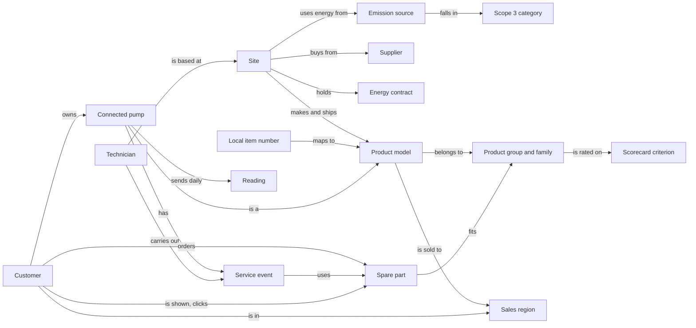
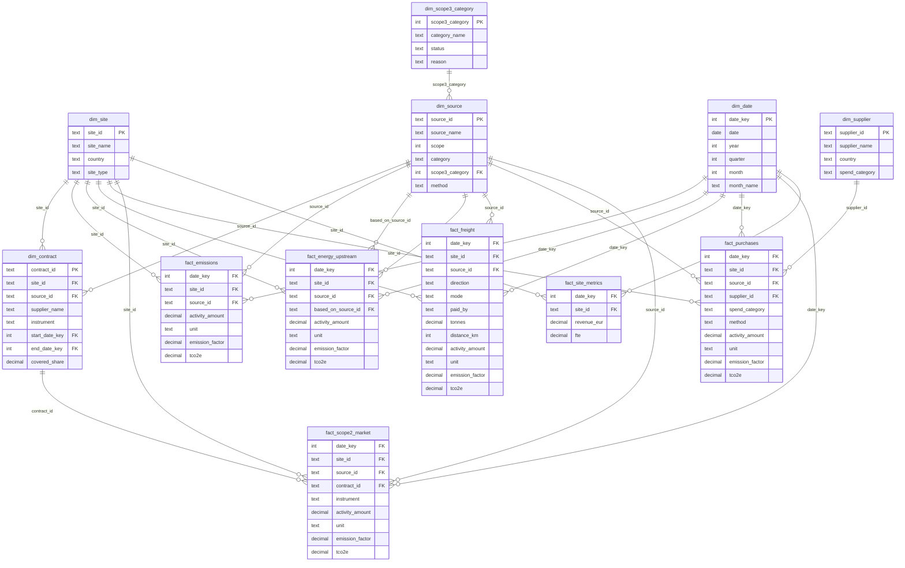
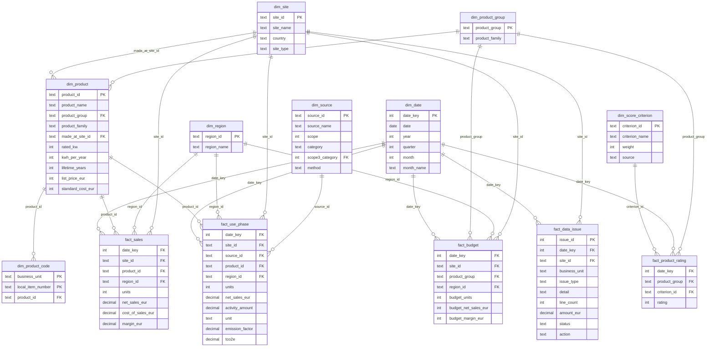
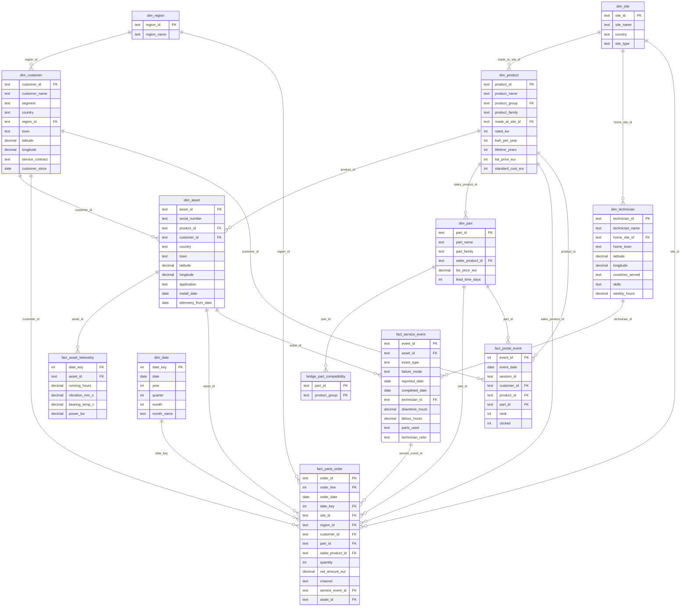

# Data model

What Fjordvik's data means and how it is stored: the business things the platform knows
about, the 31 tables that hold them, how they join, and the grain of each fact. Every
report, Claude tool and service AI model reads this one model, so a wrong key or an
unclear grain would show up everywhere at once. It is station 03 of the data product
delivery map; its gate, G2, is the business approving the model and the data dictionary.

The [data README](../data/README.md#architecture) holds the schema contract and the source
of every table; the [Power BI data dictionary](../powerbi/docs/data-dictionary.md)
describes every table and measure in the semantic model; the choices behind the model are
in the [decision log](decision-log.md).

> **Synthetic data only.** Fjordvik Manufacturing Oy is a fictional company, and this is a
> portfolio project. No real company, client or person is described; customer and
> supplier names are invented. The emission factors are **illustrative**, not cited.

## Conceptual model

The business things, and how they relate, in Fjordvik's own words.

## Logical and physical model

| Layer | Today | In production (designed) |
| --- | --- | --- |
| Logical | A Kimball star schema: dimensions shared across subjects, facts at a declared grain ([ADR-002](decision-log.md#adr-002-a-star-schema)) | The same |
| Physical | 31 CSV files in `data/tables/` with a manifest of row counts and SHA-256 checksums, written only by the generator | A staging database, engine not chosen ([refresh design](../powerbi/docs/refresh-design.md#the-route)) |
| Integrity | Enforced by tests, not by the store: `data/tests/test_schema.py` (names), the data quality tests (unique keys, joins, no negatives, complete monthly grid) and the connector's `data_quality_report` | Primary keys, foreign keys, check and not-null constraints in the database, so a bad write fails at once |
| Types | Inferred from the values below (CSV holds text) | Declared per column |

## Diagrams

Generated on 19 November 2026 from the CSV headers at commit `790589d`, with each key's
target confirmed by the join check below. Types are inferred from the values. They are not
yet regenerated automatically: a test that rebuilds them and fails when they drift is a
follow-up.

### Emissions

### Portfolio

### After-sales service

## Bus matrix

Which dimensions each fact shares. A shared column means two subjects can be read side by
side: date, site and region are the dimensions that conform across emissions, portfolio
and service.

| Fact table | date | site | source | supplier | contract | product | product_group | region | score_criterion | customer | asset | part | technician |
| --- | :---: | :---: | :---: | :---: | :---: | :---: | :---: | :---: | :---: | :---: | :---: | :---: | :---: |
| `fact_asset_telemetry` | X |  |  |  |  |  |  |  |  |  | X |  |  |
| `fact_budget` | X | X |  |  |  |  | X | X |  |  |  |  |  |
| `fact_data_issue` | X | X |  |  |  |  |  |  |  |  |  |  |  |
| `fact_emissions` | X | X | X |  |  |  |  |  |  |  |  |  |  |
| `fact_energy_upstream` | X | X | X |  |  |  |  |  |  |  |  |  |  |
| `fact_freight` | X | X | X |  |  |  |  |  |  |  |  |  |  |
| `fact_parts_order` | X | X |  |  |  | X |  | X |  | X | X | X |  |
| `fact_portal_event` |  |  |  |  |  | X |  |  |  | X |  | X |  |
| `fact_product_rating` | X |  |  |  |  |  | X |  | X |  |  |  |  |
| `fact_purchases` | X | X | X | X |  |  |  |  |  |  |  |  |  |
| `fact_sales` | X | X |  |  |  | X |  | X |  |  |  |  |  |
| `fact_scope2_market` | X | X | X |  | X |  |  |  |  |  |  |  |  |
| `fact_service_event` |  |  |  |  |  |  |  |  |  |  | X |  | X |
| `fact_site_metrics` | X | X |  |  |  |  |  |  |  |  |  |  |  |
| `fact_use_phase` | X | X | X |  |  | X |  | X |  |  |  |  |  |

`fact_service_event` and `fact_portal_event` carry dates but no date key, and
`fact_asset_telemetry`'s date key is a day, so none of the three joins the monthly
calendar (see findings).

## Grain

The grain of every emissions and service table is in the
[data README](../data/README.md#architecture). The portfolio tables are not listed there;
their grain, checked unique in code on 19 November 2026:

| Table | Grain | Rows |
| --- | --- | --- |
| `fact_sales` | One row per month, shipping site, product and region | 3,379 |
| `fact_use_phase` | One row per month, shipping site, product and region of use | 1,940 |
| `fact_budget` | One row per month, shipping site, product group and region | 1,368 |
| `fact_product_rating` | One row per quarter (keyed to its first month), product group and criterion | 720 |
| `fact_data_issue` | One row per problem the SQL found | 4 |
| `dim_product_code` | One row per business unit and local item number | 26 |
| `dim_product` | One row per product model | 24 |
| `dim_product_group` | One row per product group | 10 |
| `dim_region` | One row per sales region | 4 |
| `dim_score_criterion` | One row per scorecard criterion | 6 |

The service grains in the data README were checked the same way: telemetry is unique by
day and pump (582,996 rows), parts orders by order and line (53,654), service and portal
events by event.

## Join coverage

Every foreign key checked against its target on 19 November 2026: distinct values, how
many are found in the target table, and blanks.

All 68 key columns

| From | Column | To | Distinct values | Found in target | Blank allowed |
| --- | --- | --- | --- | --- | --- |
| `bridge_part_compatibility` | `part_id` | `dim_part.part_id` | 52 | 52 (100%) | 0 blank rows |
| `bridge_part_compatibility` | `product_group` | `dim_product_group.product_group` | 8 | 8 (100%) | 0 blank rows |
| `dim_asset` | `customer_id` | `dim_customer.customer_id` | 131 | 131 (100%) | 0 blank rows |
| `dim_asset` | `product_id` | `dim_product.product_id` | 18 | 18 (100%) | 0 blank rows |
| `dim_contract` | `end_date_key` | `dim_date.date_key` | 1 | 0 (0%) | 0 blank rows |
| `dim_contract` | `site_id` | `dim_site.site_id` | 2 | 2 (100%) | 0 blank rows |
| `dim_contract` | `source_id` | `dim_source.source_id` | 1 | 1 (100%) | 0 blank rows |
| `dim_contract` | `start_date_key` | `dim_date.date_key` | 2 | 2 (100%) | 0 blank rows |
| `dim_customer` | `region_id` | `dim_region.region_id` | 2 | 2 (100%) | 0 blank rows |
| `dim_part` | `sales_product_id` | `dim_product.product_id` | 2 | 2 (100%) | 0 blank rows |
| `dim_product` | `made_at_site_id` | `dim_site.site_id` | 3 | 3 (100%) | 0 blank rows |
| `dim_product` | `product_group` | `dim_product_group.product_group` | 10 | 10 (100%) | 0 blank rows |
| `dim_product_code` | `product_id` | `dim_product.product_id` | 24 | 24 (100%) | 0 blank rows |
| `dim_source` | `scope3_category` | `dim_scope3_category.scope3_category` | 7 | 7 (100%) | 6 blank rows |
| `dim_technician` | `home_site_id` | `dim_site.site_id` | 6 | 6 (100%) | 0 blank rows |
| `fact_asset_telemetry` | `asset_id` | `dim_asset.asset_id` | 600 | 600 (100%) | 0 blank rows |
| `fact_asset_telemetry` | `date_key` | `dim_date.date_key` | 1096 | 36 (3%) | 0 blank rows |
| `fact_budget` | `date_key` | `dim_date.date_key` | 36 | 36 (100%) | 0 blank rows |
| `fact_budget` | `product_group` | `dim_product_group.product_group` | 10 | 10 (100%) | 0 blank rows |
| `fact_budget` | `region_id` | `dim_region.region_id` | 4 | 4 (100%) | 0 blank rows |
| `fact_budget` | `site_id` | `dim_site.site_id` | 5 | 5 (100%) | 0 blank rows |
| `fact_data_issue` | `date_key` | `dim_date.date_key` | 4 | 4 (100%) | 0 blank rows |
| `fact_data_issue` | `site_id` | `dim_site.site_id` | 3 | 3 (100%) | 0 blank rows |
| `fact_emissions` | `date_key` | `dim_date.date_key` | 36 | 36 (100%) | 0 blank rows |
| `fact_emissions` | `site_id` | `dim_site.site_id` | 6 | 6 (100%) | 0 blank rows |
| `fact_emissions` | `source_id` | `dim_source.source_id` | 8 | 8 (100%) | 0 blank rows |
| `fact_energy_upstream` | `based_on_source_id` | `dim_source.source_id` | 5 | 5 (100%) | 0 blank rows |
| `fact_energy_upstream` | `date_key` | `dim_date.date_key` | 36 | 36 (100%) | 0 blank rows |
| `fact_energy_upstream` | `site_id` | `dim_site.site_id` | 6 | 6 (100%) | 0 blank rows |
| `fact_energy_upstream` | `source_id` | `dim_source.source_id` | 2 | 2 (100%) | 0 blank rows |
| `fact_freight` | `date_key` | `dim_date.date_key` | 36 | 36 (100%) | 0 blank rows |
| `fact_freight` | `site_id` | `dim_site.site_id` | 5 | 5 (100%) | 0 blank rows |
| `fact_freight` | `source_id` | `dim_source.source_id` | 2 | 2 (100%) | 0 blank rows |
| `fact_parts_order` | `asset_id` | `dim_asset.asset_id` | 492 | 492 (100%) | 50854 blank rows |
| `fact_parts_order` | `customer_id` | `dim_customer.customer_id` | 146 | 146 (100%) | 0 blank rows |
| `fact_parts_order` | `date_key` | `dim_date.date_key` | 36 | 36 (100%) | 0 blank rows |
| `fact_parts_order` | `part_id` | `dim_part.part_id` | 52 | 52 (100%) | 0 blank rows |
| `fact_parts_order` | `region_id` | `dim_region.region_id` | 2 | 2 (100%) | 0 blank rows |
| `fact_parts_order` | `sales_product_id` | `dim_product.product_id` | 2 | 2 (100%) | 0 blank rows |
| `fact_parts_order` | `service_event_id` | `fact_service_event.event_id` | 1992 | 1992 (100%) | 50854 blank rows |
| `fact_parts_order` | `site_id` | `dim_site.site_id` | 2 | 2 (100%) | 0 blank rows |
| `fact_portal_event` | `customer_id` | `dim_customer.customer_id` | 131 | 131 (100%) | 0 blank rows |
| `fact_portal_event` | `part_id` | `dim_part.part_id` | 26 | 26 (100%) | 0 blank rows |
| `fact_portal_event` | `product_id` | `dim_product.product_id` | 18 | 18 (100%) | 0 blank rows |
| `fact_product_rating` | `criterion_id` | `dim_score_criterion.criterion_id` | 6 | 6 (100%) | 0 blank rows |
| `fact_product_rating` | `date_key` | `dim_date.date_key` | 12 | 12 (100%) | 0 blank rows |
| `fact_product_rating` | `product_group` | `dim_product_group.product_group` | 10 | 10 (100%) | 0 blank rows |
| `fact_purchases` | `date_key` | `dim_date.date_key` | 36 | 36 (100%) | 0 blank rows |
| `fact_purchases` | `site_id` | `dim_site.site_id` | 6 | 6 (100%) | 0 blank rows |
| `fact_purchases` | `source_id` | `dim_source.source_id` | 1 | 1 (100%) | 0 blank rows |
| `fact_purchases` | `supplier_id` | `dim_supplier.supplier_id` | 14 | 14 (100%) | 0 blank rows |
| `fact_sales` | `date_key` | `dim_date.date_key` | 36 | 36 (100%) | 0 blank rows |
| `fact_sales` | `product_id` | `dim_product.product_id` | 24 | 24 (100%) | 0 blank rows |
| `fact_sales` | `region_id` | `dim_region.region_id` | 4 | 4 (100%) | 0 blank rows |
| `fact_sales` | `site_id` | `dim_site.site_id` | 5 | 5 (100%) | 0 blank rows |
| `fact_scope2_market` | `contract_id` | `dim_contract.contract_id` | 2 | 2 (100%) | 396 blank rows |
| `fact_scope2_market` | `date_key` | `dim_date.date_key` | 36 | 36 (100%) | 0 blank rows |
| `fact_scope2_market` | `site_id` | `dim_site.site_id` | 6 | 6 (100%) | 0 blank rows |
| `fact_scope2_market` | `source_id` | `dim_source.source_id` | 2 | 2 (100%) | 0 blank rows |
| `fact_service_event` | `asset_id` | `dim_asset.asset_id` | 542 | 542 (100%) | 0 blank rows |
| `fact_service_event` | `technician_id` | `dim_technician.technician_id` | 10 | 10 (100%) | 0 blank rows |
| `fact_site_metrics` | `date_key` | `dim_date.date_key` | 36 | 36 (100%) | 0 blank rows |
| `fact_site_metrics` | `site_id` | `dim_site.site_id` | 6 | 6 (100%) | 0 blank rows |
| `fact_use_phase` | `date_key` | `dim_date.date_key` | 36 | 36 (100%) | 0 blank rows |
| `fact_use_phase` | `product_id` | `dim_product.product_id` | 18 | 18 (100%) | 0 blank rows |
| `fact_use_phase` | `region_id` | `dim_region.region_id` | 3 | 3 (100%) | 0 blank rows |
| `fact_use_phase` | `site_id` | `dim_site.site_id` | 3 | 3 (100%) | 0 blank rows |
| `fact_use_phase` | `source_id` | `dim_source.source_id` | 1 | 1 (100%) | 0 blank rows |

### Findings

1. **Every key resolves**, apart from the two below. Blanks are by design:
   `fact_parts_order.service_event_id` and `asset_id` are blank on orders not tied to a
   service job (50,854 of 53,654 lines); `fact_scope2_market.contract_id` is blank where
   the residual mix applies; `dim_source.scope3_category` is blank for scope 1 and 2
   sources.
2. **Telemetry has no calendar.** `fact_asset_telemetry.date_key` holds 1,096 days;
   `dim_date` holds 36 months, so only first-of-month days match. `fact_service_event`
   and `fact_portal_event` have dates and no key. Proposal: a new daily date table
   ([ADR-029](decision-log.md#adr-029-a-daily-date-table-for-the-service-data)).
3. **Contract end dates sit past the calendar.** Both contracts end on 1 December 2027
   (`end_date_key` 20271201), after the last month in `dim_date`. That is right for a
   contract; the keys are dates, not joins, and the diagram draws no line for them.
4. **Parts fit 8 of the 10 product groups.** The two left out, Spare parts and Service
   kits, are themselves parts, so nothing fits them. No gap.

## History handling

Every dimension is overwritten in place today (slowly changing dimension type 1): a change
rewrites the past. That is right for names and codes, and wrong for a few attributes past
figures depend on:

| Attribute | Why history matters | Proposed handling |
| --- | --- | --- |
| `dim_customer.service_contract` | A customer moving from Basic to Premium changes how many preventive visits were due | Type 2: a row per contract period with valid-from and valid-to dates |
| `dim_technician.skills`, `weekly_hours` | Phase 4 must plan from data as it stood ("as at" dates, rule D16) | Type 2 |
| `dim_asset` town and location | A moved pump's travel cost changes | Type 2 when moves start; none in the data today |
| Emission factors | One factor per source for the whole period; a new factor would rewrite past emissions | Yearly factor versions, already a [next step](learning-guide.md#next-steps) |
| Product specification, prices | Stable in the data | Type 1 |

This is a proposal, [ADR-027](decision-log.md#adr-027-history-handling-for-dimensions),
for Reece to decide. Any change is a new column or table (names never change, rule D4)
made through the generator, and moving an existing checksum needs Reece's yes (rule D5).

## Gate G2

| Check | Status |
| --- | --- |
| Conceptual model agreed with users | First edition above; not reviewed with users |
| Logical and physical model | Built and tested |
| Data dictionary and grain statements | Power BI dictionary generated; grain for every table, now including the portfolio tables |
| Bus matrix | Above |
| History handling decided | Proposed (ADR-027) |
| Wireframes approved | The 17 report pages exist ([report pages](../powerbi/docs/report-pages.md)); review with users is open (portfolio milestone M5) |
| Business approval | **Not given.** Reece approves as the stand-in for the data owners |

## Change history

- 19 November 2026: first edition, during the architecture pause (Reece asked).
