# Data model

What Fjordvik's data means and how it is stored: the business things the platform knows
about, the 31 tables that hold them, how they join, and the grain of each fact. Every
report, Claude tool and service AI model reads this one model, so a wrong key or an
unclear grain would show up everywhere at once. It is station 03 of the data product
delivery map; its gate, G2, is the business approving the model and the data dictionary.

The [data README](../data/README.md#architecture) holds the schema contract and the source
of every table; the [Power BI data dictionary](../powerbi/docs/data-dictionary.md)
describes every table and measure in the semantic model; the choices behind the model are
in the [decision log](decision-log.md).

> **Synthetic data only.** Fjordvik Manufacturing Oy is a fictional company, and this is a
> portfolio project. No real company, client or person is described; customer and
> supplier names are invented. The emission factors are **illustrative**, not cited.

## Conceptual model

The business things, and how they relate, in Fjordvik's own words.

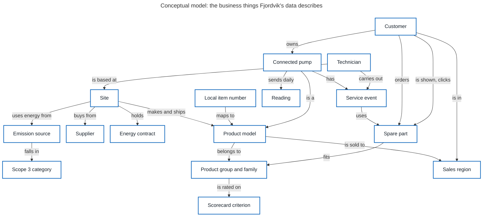

| Key | Meaning |
| --- | --- |
| Box | A business thing Fjordvik's data describes |
| Line | Reads as a sentence from box to box, in the direction of the arrow |

Last updated: 25 November 2026, commit `f5b1aef`.

## Data flow: where each table's data comes from

Two data flow diagrams show where Fjordvik's data starts, what kind of data it is, who owns
it, how often it arrives, and the process that carries it into the governed tables. Part 1
follows what the six sites send; part 2 follows what group functions, service systems and
outside publishers send. They use data flow diagram notation: data moves only through a
numbered process, never straight from an owner to a table or from one table to another.
The full source list, with each system, is in the
[data README](../data/README.md#where-the-data-comes-from).

In this repository the data generator in `data/` stands in for every source, so a process
marked Gap still has its tables filled with synthetic data.

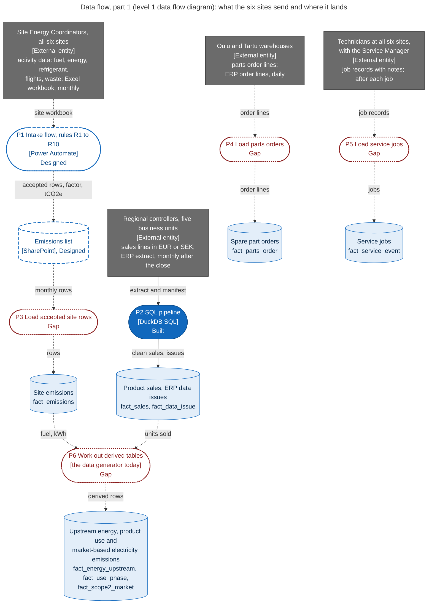

| Key | Meaning |
| --- | --- |
| Grey box | External entity: who owns and sends the data, what kind it is, its format and how often |
| Rounded box, P1 to P6 | Process, with its status: Built, Designed or Gap |
| Cylinder | Data store: pale blue for a governed table, white dashed for a designed store |
| Solid line | Runs in this repository today |
| Dotted line | Does not run yet |
| Abbreviations | ERP: enterprise resource planning. SEK: Swedish kronor |

Last updated: 25 November 2026, commit `f5b1aef`.

The plants report eight sources a month, the warehouses seven and the head office five. Five
business units ship sales; the head office books none. `fact_scope2_market` also needs the
energy contracts from part 2.

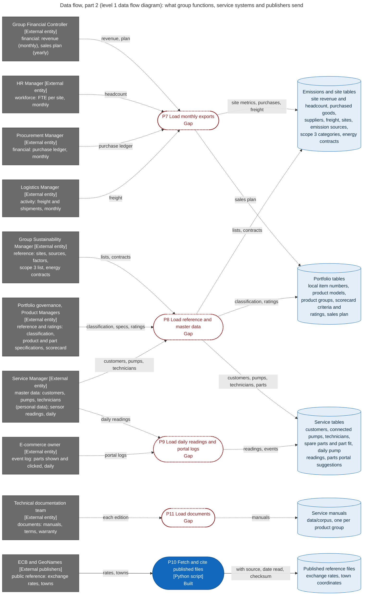

| Key | Meaning |
| --- | --- |
| Grey box | External entity: who owns and sends the data, what kind it is and how often |
| Rounded box, P7 to P11 | Process, with its status: Built or Gap |
| Pale blue cylinder | Governed tables or files |
| Solid line | Runs in this repository today |
| Dotted line | Does not run yet |
| Abbreviations | FTE: full-time equivalent employees. ECB: European Central Bank |

Last updated: 25 November 2026, commit `f5b1aef`.

The emission factors also feed the intake flow (P1 in part 1). The SQL pipeline (P2 in part
1) reads the exchange rates; the town coordinates place customers, pumps and technicians.
Only P2 and P10 run today; every other process needs designing before production; a landing
zone in Azure Data Lake Storage would be where their data lands first.

### Kinds of data and who owns them

| Kind of data | Examples | Owners | How often | Proposed classification for a live deployment |
| --- | --- | --- | --- | --- |
| Activity data | Fuel, energy, refrigerant, flights, waste, freight | Site Energy Coordinators, Logistics Manager | Monthly | Internal |
| Financial | Revenue, sales and cost, purchases, sales plan | Group Financial Controller, regional controllers, Procurement Manager | Monthly; plan yearly | Confidential |
| Workforce | FTE per site | HR Manager | Monthly | Internal (an aggregate, no names) |
| Reference data | Sites, sources, factors, contracts, product classification and specification, parts catalogue | Group Sustainability Manager, Portfolio governance, Product Managers | When changed | Internal |
| Published reference | Exchange rates, town coordinates | Fetched and cited (Group Financial Controller, Data and AI Specialist) | Monthly; when needed | Public |
| Transactional | Sales order lines, parts order lines | Regional controllers | Daily or monthly | Confidential |
| Master data about customers | Customers, contracts, installed pumps | Service Manager | When changed | Confidential (business names and locations) |
| Master data about people | Technicians' names, home towns, skills, hours | Service Manager, with HR | When changed | Personal data |
| Sensor time series | Daily pump readings | Service Manager | Daily | Internal |
| Event data | Service jobs with technicians' notes, portal clicks | Service Manager, E-commerce owner | Daily or per job | Internal; notes may name people, so treat as personal data |
| Ratings | Quarterly scorecard | Portfolio governance, Product Managers | Quarterly | Internal |
| Documents | Service manuals, terms, warranty | Technical documentation team | Each edition | Internal |

Owners are the roles in the [company profile](company-profile.md#who-owns-which-figures).
The classification column is a proposal for Reece, not a decision: it matters for the
landing zone's folder access, for keeping personal data out of logs (rule D18) and for the
public pages, which show group-level totals only (rule P1). Every figure in this
repository is synthetic, so none of it is personal data today.

## Logical and physical model

| Layer | Today | In production (designed) |
| --- | --- | --- |
| Logical | A Kimball star schema: dimensions shared across subjects, facts at a declared grain ([ADR-002](decision-log.md#adr-002-a-star-schema)) | The same |
| Physical | 31 CSV files in `data/tables/` with a manifest of row counts and SHA-256 checksums, written only by the generator | A staging database, engine not chosen ([refresh design](../powerbi/docs/refresh-design.md#the-route)) |
| Integrity | Enforced by tests, not by the store: `data/tests/test_schema.py` (names), the data quality tests (unique keys, joins, no negatives, complete monthly grid) and the connector's `data_quality_report` | Primary keys, foreign keys, check and not-null constraints in the database, so a bad write fails at once |
| Types | Inferred from the values below (CSV holds text) | Declared per column |

## Diagrams

Each diagram below shows one set of facts Fjordvik records, with the reference tables
it joins. Every box gives the business name and, in brackets, the table name. The
title states what one row holds, and the text under each diagram says what the data is
and what it is for. Only the key columns are drawn; under each fact diagram the other
columns are listed, and the Fields sheet of the [data dictionary](data-dictionary.xlsx)
lists every column of every table. The diagrams were drawn from the tables' column
headers on 25 November 2026, and Jinny's review of 26 November found every drawn column in
its table; no script keeps them in step, so a new column is added to its diagram by hand. Each key
is checked against its target in the join check below. A key under every diagram
explains the boxes, columns and line ends. In the table names, `fact_` marks facts
(events to add up), `dim_` marks dimensions (things to filter and group by) and
`bridge_` links two dimensions many to many.

### Emissions facts

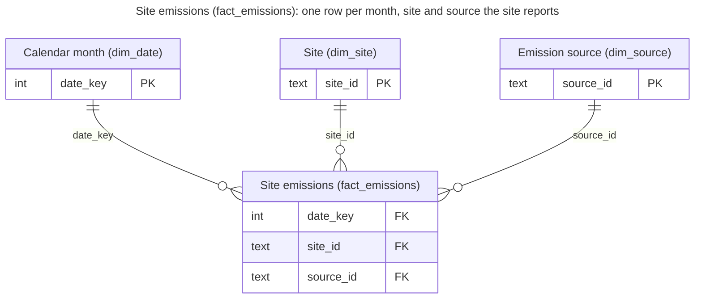

| Key | Meaning |
| --- | --- |
| Box | One table: its business name, with the table name in brackets |
| First column in a box | The kind of value: `text`, `int` (a whole number) or `date` |
| PK | Primary key: the column, or columns together, that pick out exactly one row of the table |
| FK | Foreign key: a column holding the key of a row in another table, so the two tables can be joined |
| Blank key cell | The column is not a key; it is drawn only because it carries a note |
| Last column | A note on that column; blank when there is nothing to add |
| Two short bars at a line's end | Exactly one row at that end |
| Circle and three prongs (a crow's foot) at a line's end | Zero, one or many rows at that end |
| A whole line | Reads as: one row in the table at the bars matches any number of rows in the table at the crow's foot; the label names the column they are joined on |

**What it is.** Each site's monthly energy, fuel, refrigerant, business flights and waste, with the emission factor and the tonnes of carbon dioxide equivalent (tCO2e). **What it is for.** Scope 1, location-based scope 2 and scope 3 categories 5 and 6 in the emissions report and the Claude connector.

Other columns: `activity_amount`, `unit`, `emission_factor`, `tco2e`.

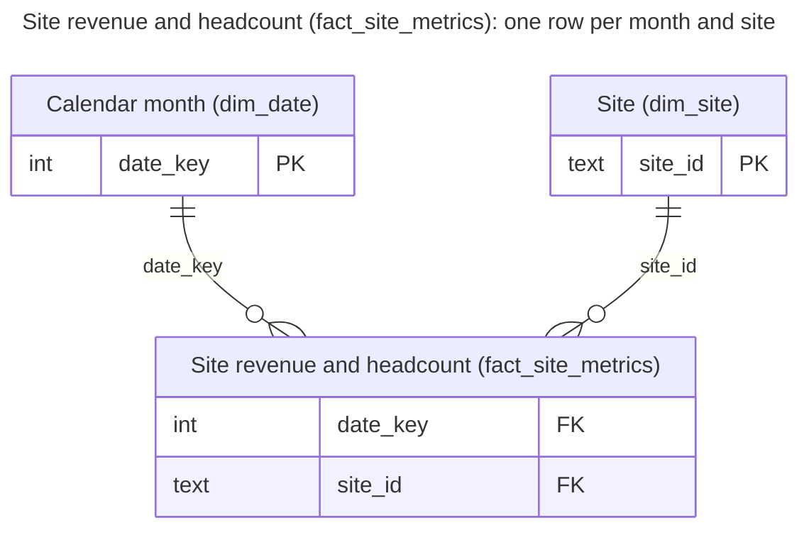

| Key | Meaning |
| --- | --- |
| Box | One table: its business name, with the table name in brackets |
| First column in a box | The kind of value: `text`, `int` (a whole number) or `date` |
| PK | Primary key: the column, or columns together, that pick out exactly one row of the table |
| FK | Foreign key: a column holding the key of a row in another table, so the two tables can be joined |
| Blank key cell | The column is not a key; it is drawn only because it carries a note |
| Last column | A note on that column; blank when there is nothing to add |
| Two short bars at a line's end | Exactly one row at that end |
| Circle and three prongs (a crow's foot) at a line's end | Zero, one or many rows at that end |
| A whole line | Reads as: one row in the table at the bars matches any number of rows in the table at the crow's foot; the label names the column they are joined on |

**What it is.** Each site's revenue after the monthly close and its full-time equivalent employees (FTE). **What it is for.** Emissions per million euros of revenue and per employee, and revenue per employee.

Other columns: `revenue_eur`, `fte`.

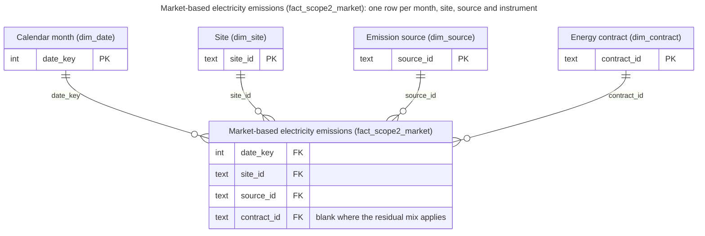

| Key | Meaning |
| --- | --- |
| Box | One table: its business name, with the table name in brackets |
| First column in a box | The kind of value: `text`, `int` (a whole number) or `date` |
| PK | Primary key: the column, or columns together, that pick out exactly one row of the table |
| FK | Foreign key: a column holding the key of a row in another table, so the two tables can be joined |
| Blank key cell | The column is not a key; it is drawn only because it carries a note |
| Last column | A note on that column; blank when there is nothing to add |
| Two short bars at a line's end | Exactly one row at that end |
| Circle and three prongs (a crow's foot) at a line's end | Zero, one or many rows at that end |
| A whole line | Reads as: one row in the table at the bars matches any number of rows in the table at the crow's foot; the label names the column they are joined on |

**What it is.** The same electricity the sites report, worked out with contract factors (guarantees of origin) or each country's residual mix. **What it is for.** Market-based scope 2, reported beside the location-based total and never added to it.

Other columns: `instrument`, `activity_amount`, `unit`, `emission_factor`, `tco2e`.

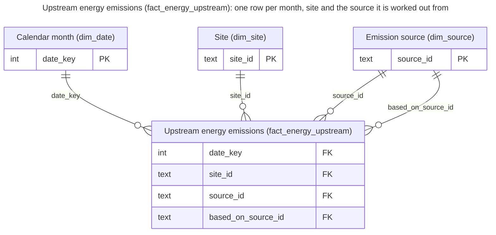

| Key | Meaning |
| --- | --- |
| Box | One table: its business name, with the table name in brackets |
| First column in a box | The kind of value: `text`, `int` (a whole number) or `date` |
| PK | Primary key: the column, or columns together, that pick out exactly one row of the table |
| FK | Foreign key: a column holding the key of a row in another table, so the two tables can be joined |
| Blank key cell | The column is not a key; it is drawn only because it carries a note |
| Last column | A note on that column; blank when there is nothing to add |
| Two short bars at a line's end | Exactly one row at that end |
| Circle and three prongs (a crow's foot) at a line's end | Zero, one or many rows at that end |
| A whole line | Reads as: one row in the table at the bars matches any number of rows in the table at the crow's foot; the label names the column they are joined on |

**What it is.** Emissions from producing the fuels and electricity the sites use, including grid losses, worked out from site emissions. **What it is for.** Scope 3 category 3.

Other columns: `activity_amount`, `unit`, `emission_factor`, `tco2e`.

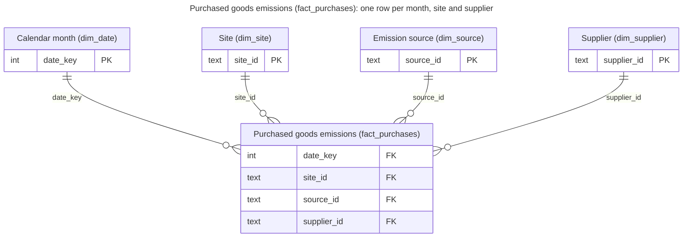

| Key | Meaning |
| --- | --- |
| Box | One table: its business name, with the table name in brackets |
| First column in a box | The kind of value: `text`, `int` (a whole number) or `date` |
| PK | Primary key: the column, or columns together, that pick out exactly one row of the table |
| FK | Foreign key: a column holding the key of a row in another table, so the two tables can be joined |
| Blank key cell | The column is not a key; it is drawn only because it carries a note |
| Last column | A note on that column; blank when there is nothing to add |
| Two short bars at a line's end | Exactly one row at that end |
| Circle and three prongs (a crow's foot) at a line's end | Zero, one or many rows at that end |
| A whole line | Reads as: one row in the table at the bars matches any number of rows in the table at the crow's foot; the label names the column they are joined on |

**What it is.** Spend with each supplier by spend category, with a spend-based emission factor. **What it is for.** Scope 3 category 1, purchased goods and services.

Other columns: `spend_category`, `method`, `activity_amount`, `unit`, `emission_factor`, `tco2e`.

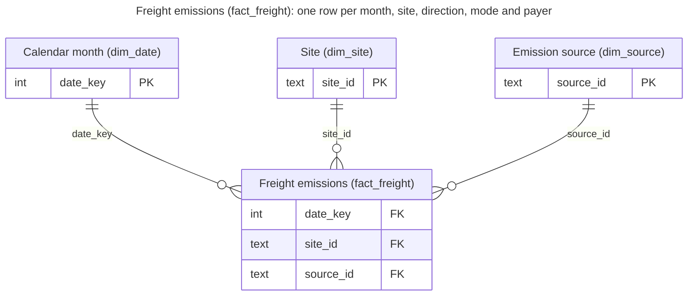

| Key | Meaning |
| --- | --- |
| Box | One table: its business name, with the table name in brackets |
| First column in a box | The kind of value: `text`, `int` (a whole number) or `date` |
| PK | Primary key: the column, or columns together, that pick out exactly one row of the table |
| FK | Foreign key: a column holding the key of a row in another table, so the two tables can be joined |
| Blank key cell | The column is not a key; it is drawn only because it carries a note |
| Last column | A note on that column; blank when there is nothing to add |
| Two short bars at a line's end | Exactly one row at that end |
| Circle and three prongs (a crow's foot) at a line's end | Zero, one or many rows at that end |
| A whole line | Reads as: one row in the table at the bars matches any number of rows in the table at the crow's foot; the label names the column they are joined on |

**What it is.** Tonnes moved, distance and transport mode, and who paid for the freight. **What it is for.** Scope 3 categories 4 (freight Fjordvik pays for) and 9 (freight customers pay for).

Other columns: `direction`, `mode`, `paid_by`, `tonnes`, `distance_km`, `activity_amount`, `unit`, `emission_factor`, `tco2e`.

### Portfolio facts

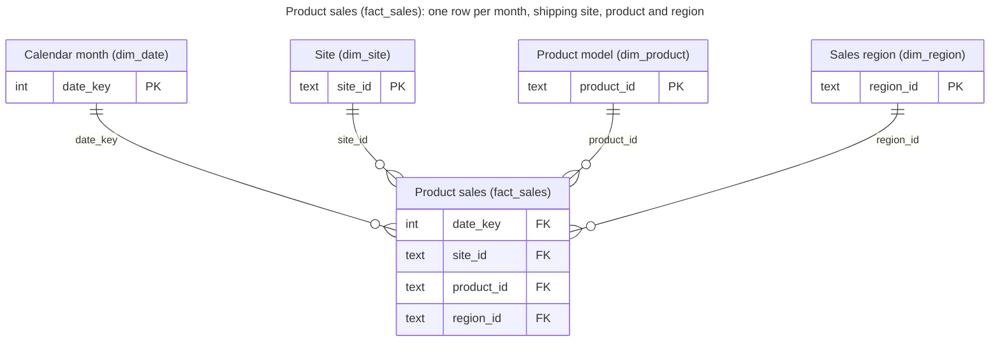

| Key | Meaning |
| --- | --- |
| Box | One table: its business name, with the table name in brackets |
| First column in a box | The kind of value: `text`, `int` (a whole number) or `date` |
| PK | Primary key: the column, or columns together, that pick out exactly one row of the table |
| FK | Foreign key: a column holding the key of a row in another table, so the two tables can be joined |
| Blank key cell | The column is not a key; it is drawn only because it carries a note |
| Last column | A note on that column; blank when there is nothing to add |
| Two short bars at a line's end | Exactly one row at that end |
| Circle and three prongs (a crow's foot) at a line's end | Zero, one or many rows at that end |
| A whole line | Reads as: one row in the table at the bars matches any number of rows in the table at the crow's foot; the label names the column they are joined on |

**What it is.** Invoiced units, net sales, cost of sales and margin, cleaned by SQL from the ERP extract. **What it is for.** The portfolio report (price, volume and mix; portfolio balance) and the connector's sales tool; it reconciles to finance revenue to the cent.

Other columns: `units`, `net_sales_eur`, `cost_of_sales_eur`, `margin_eur`.

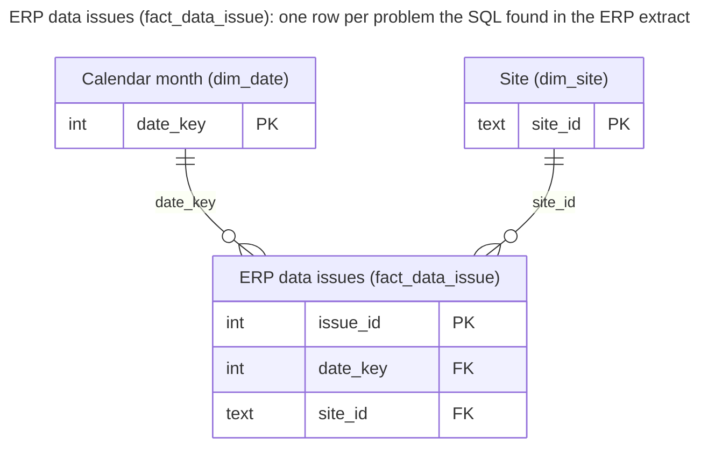

| Key | Meaning |
| --- | --- |
| Box | One table: its business name, with the table name in brackets |
| First column in a box | The kind of value: `text`, `int` (a whole number) or `date` |
| PK | Primary key: the column, or columns together, that pick out exactly one row of the table |
| FK | Foreign key: a column holding the key of a row in another table, so the two tables can be joined |
| Blank key cell | The column is not a key; it is drawn only because it carries a note |
| Last column | A note on that column; blank when there is nothing to add |
| Two short bars at a line's end | Exactly one row at that end |
| Circle and three prongs (a crow's foot) at a line's end | Zero, one or many rows at that end |
| A whole line | Reads as: one row in the table at the bars matches any number of rows in the table at the crow's foot; the label names the column they are joined on |

**What it is.** Each problem the SQL found in the ERP extract (duplicates, a missing currency, unmapped item numbers), with the value held back and the action for its owner. **What it is for.** The data quality page and the reconciliation to finance.

Other columns: `business_unit`, `issue_type`, `detail`, `line_count`, `amount_eur`, `status`, `action`.

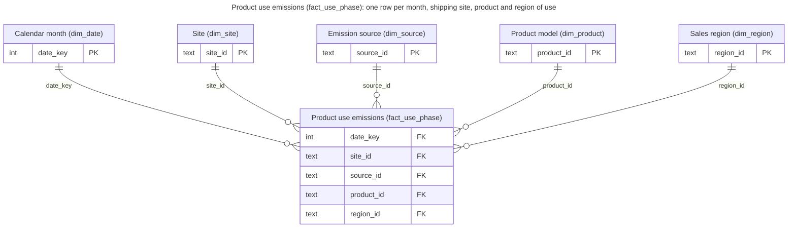

| Key | Meaning |
| --- | --- |
| Box | One table: its business name, with the table name in brackets |
| First column in a box | The kind of value: `text`, `int` (a whole number) or `date` |
| PK | Primary key: the column, or columns together, that pick out exactly one row of the table |
| FK | Foreign key: a column holding the key of a row in another table, so the two tables can be joined |
| Blank key cell | The column is not a key; it is drawn only because it carries a note |
| Last column | A note on that column; blank when there is nothing to add |
| Two short bars at a line's end | Exactly one row at that end |
| Circle and three prongs (a crow's foot) at a line's end | Zero, one or many rows at that end |
| A whole line | Reads as: one row in the table at the bars matches any number of rows in the table at the crow's foot; the label names the column they are joined on |

**What it is.** The lifetime electricity of the pumps sold, times the grid factor of the region where they are used. **What it is for.** Scope 3 category 11, use of sold products, by product and region.

Other columns: `units`, `net_sales_eur`, `activity_amount`, `unit`, `emission_factor`, `tco2e`.

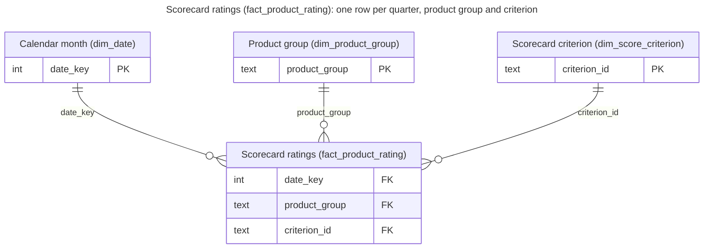

| Key | Meaning |
| --- | --- |
| Box | One table: its business name, with the table name in brackets |
| First column in a box | The kind of value: `text`, `int` (a whole number) or `date` |
| PK | Primary key: the column, or columns together, that pick out exactly one row of the table |
| FK | Foreign key: a column holding the key of a row in another table, so the two tables can be joined |
| Blank key cell | The column is not a key; it is drawn only because it carries a note |
| Last column | A note on that column; blank when there is nothing to add |
| Two short bars at a line's end | Exactly one row at that end |
| Circle and three prongs (a crow's foot) at a line's end | Zero, one or many rows at that end |
| A whole line | Reads as: one row in the table at the bars matches any number of rows in the table at the crow's foot; the label names the column they are joined on |

**What it is.** Each quarter's 1 to 10 rating for every product group on every scorecard criterion. **What it is for.** The quarterly portfolio scorecard.

Other columns: `rating`.

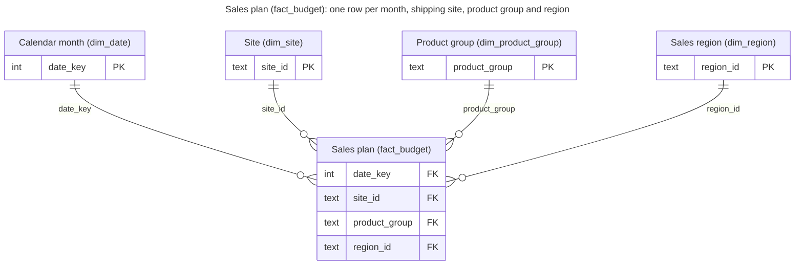

| Key | Meaning |
| --- | --- |
| Box | One table: its business name, with the table name in brackets |
| First column in a box | The kind of value: `text`, `int` (a whole number) or `date` |
| PK | Primary key: the column, or columns together, that pick out exactly one row of the table |
| FK | Foreign key: a column holding the key of a row in another table, so the two tables can be joined |
| Blank key cell | The column is not a key; it is drawn only because it carries a note |
| Last column | A note on that column; blank when there is nothing to add |
| Two short bars at a line's end | Exactly one row at that end |
| Circle and three prongs (a crow's foot) at a line's end | Zero, one or many rows at that end |
| A whole line | Reads as: one row in the table at the bars matches any number of rows in the table at the crow's foot; the label names the column they are joined on |

**What it is.** Planned units, net sales and margin from the yearly sales plan. **What it is for.** Sales against budget in the portfolio report.

Other columns: `budget_units`, `budget_net_sales_eur`, `budget_margin_eur`.

### After-sales service facts

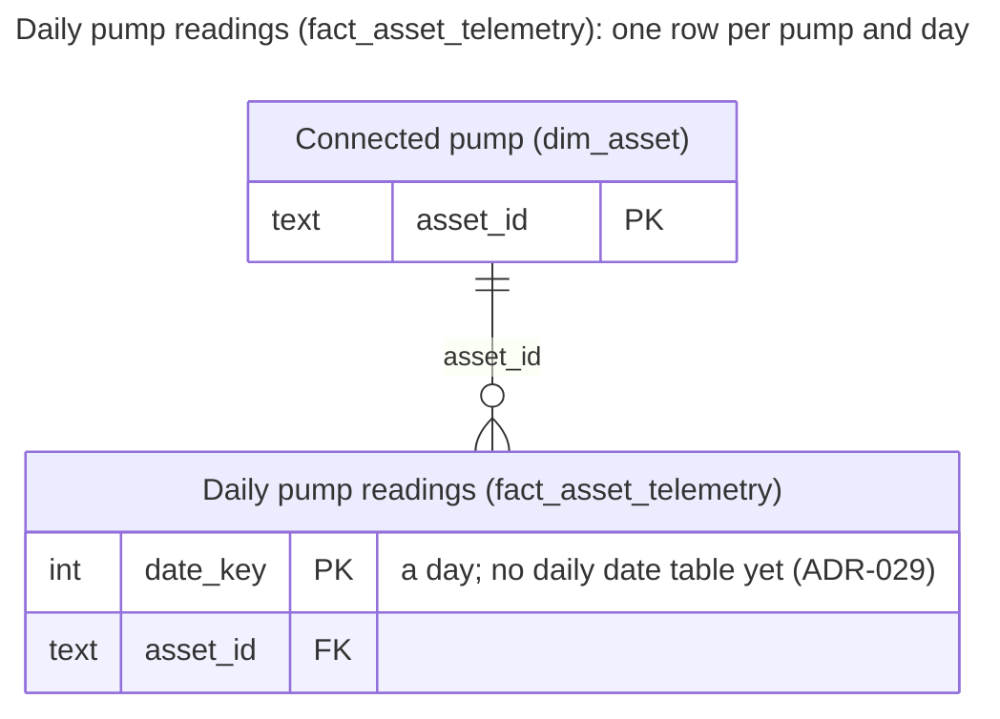

| Key | Meaning |
| --- | --- |
| Box | One table: its business name, with the table name in brackets |
| First column in a box | The kind of value: `text`, `int` (a whole number) or `date` |
| PK | Primary key: the column, or columns together, that pick out exactly one row of the table |
| FK | Foreign key: a column holding the key of a row in another table, so the two tables can be joined |
| Blank key cell | The column is not a key; it is drawn only because it carries a note |
| Last column | A note on that column; blank when there is nothing to add |
| Two short bars at a line's end | Exactly one row at that end |
| Circle and three prongs (a crow's foot) at a line's end | Zero, one or many rows at that end |
| A whole line | Reads as: one row in the table at the bars matches any number of rows in the table at the crow's foot; the label names the column they are joined on |

**What it is.** Running hours, vibration, bearing temperature and power reported once a day by each connected pump's drive. **What it is for.** The failure risk model's features and the parts forecast's drivers.

Other columns: `running_hours`, `vibration_mm_s`, `bearing_temp_c`, `power_kw`.

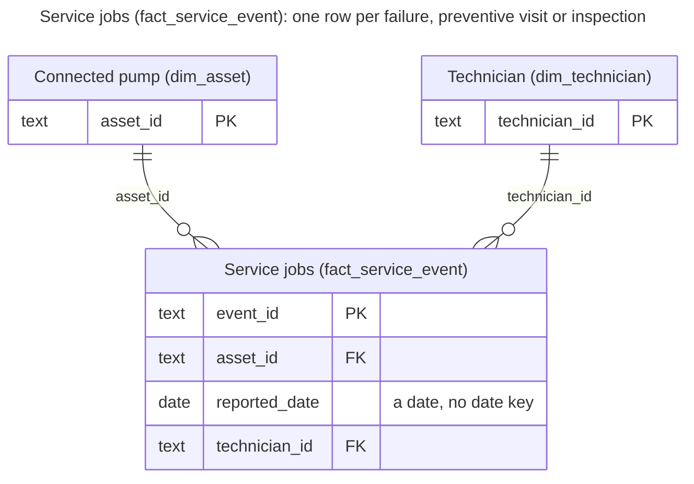

| Key | Meaning |
| --- | --- |
| Box | One table: its business name, with the table name in brackets |
| First column in a box | The kind of value: `text`, `int` (a whole number) or `date` |
| PK | Primary key: the column, or columns together, that pick out exactly one row of the table |
| FK | Foreign key: a column holding the key of a row in another table, so the two tables can be joined |
| Blank key cell | The column is not a key; it is drawn only because it carries a note |
| Last column | A note on that column; blank when there is nothing to add |
| Two short bars at a line's end | Exactly one row at that end |
| Circle and three prongs (a crow's foot) at a line's end | Zero, one or many rows at that end |
| A whole line | Reads as: one row in the table at the bars matches any number of rows in the table at the crow's foot; the label names the column they are joined on |

**What it is.** Each failure, preventive visit and inspection, with downtime, labour, parts used and the technician's note. **What it is for.** The failure model's labels and the service measures (failure share, downtime); later the visit schedule.

Other columns: `event_type`, `failure_mode`, `completed_date`, `downtime_hours`, `labour_hours`, `parts_used`, `technician_note`.

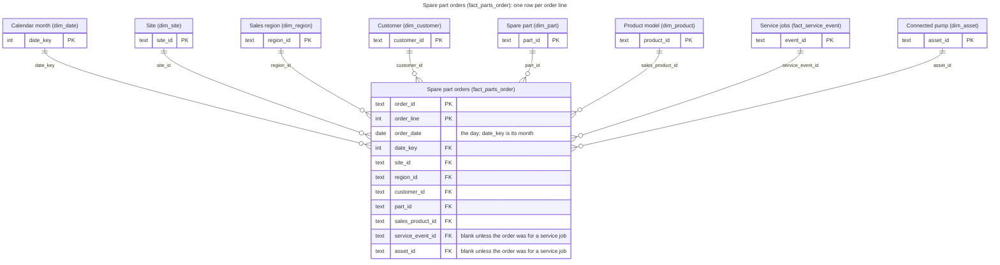

| Key | Meaning |
| --- | --- |
| Box | One table: its business name, with the table name in brackets |
| First column in a box | The kind of value: `text`, `int` (a whole number) or `date` |
| PK | Primary key: the column, or columns together, that pick out exactly one row of the table |
| FK | Foreign key: a column holding the key of a row in another table, so the two tables can be joined |
| Blank key cell | The column is not a key; it is drawn only because it carries a note |
| Last column | A note on that column; blank when there is nothing to add |
| Two short bars at a line's end | Exactly one row at that end |
| Circle and three prongs (a crow's foot) at a line's end | Zero, one or many rows at that end |
| A whole line | Reads as: one row in the table at the bars matches any number of rows in the table at the crow's foot; the label names the column they are joined on |

**What it is.** Every order line for spare parts and service kits from the Oulu and Tartu warehouses; the lines add up to product sales for parts and kits. **What it is for.** The parts demand forecast and, later, parts recommendations.

Other columns: `quantity`, `net_amount_eur`, `channel`.

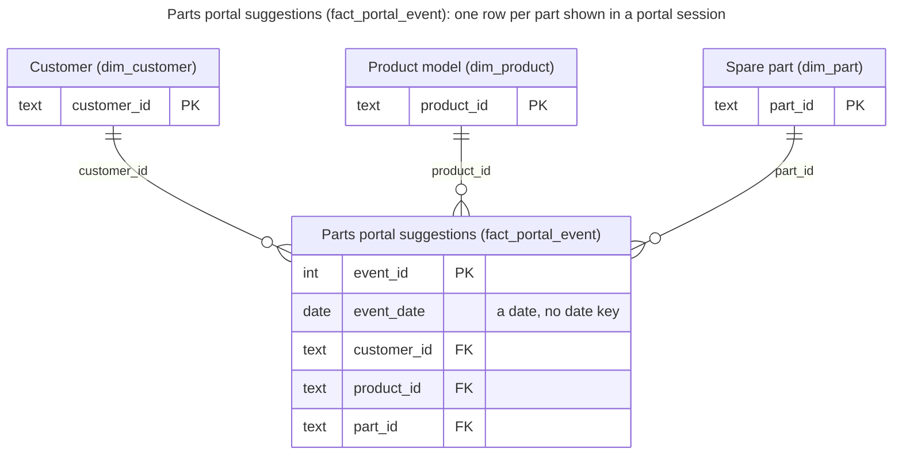

| Key | Meaning |
| --- | --- |
| Box | One table: its business name, with the table name in brackets |
| First column in a box | The kind of value: `text`, `int` (a whole number) or `date` |
| PK | Primary key: the column, or columns together, that pick out exactly one row of the table |
| FK | Foreign key: a column holding the key of a row in another table, so the two tables can be joined |
| Blank key cell | The column is not a key; it is drawn only because it carries a note |
| Last column | A note on that column; blank when there is nothing to add |
| Two short bars at a line's end | Exactly one row at that end |
| Circle and three prongs (a crow's foot) at a line's end | Zero, one or many rows at that end |
| A whole line | Reads as: one row in the table at the bars matches any number of rows in the table at the crow's foot; the label names the column they are joined on |

**What it is.** Each part the parts portal showed a customer, and whether the customer clicked it. **What it is for.** Training and testing parts recommendations.

Other columns: `session_id`, `rank`, `clicked`.

### How the dimensions link

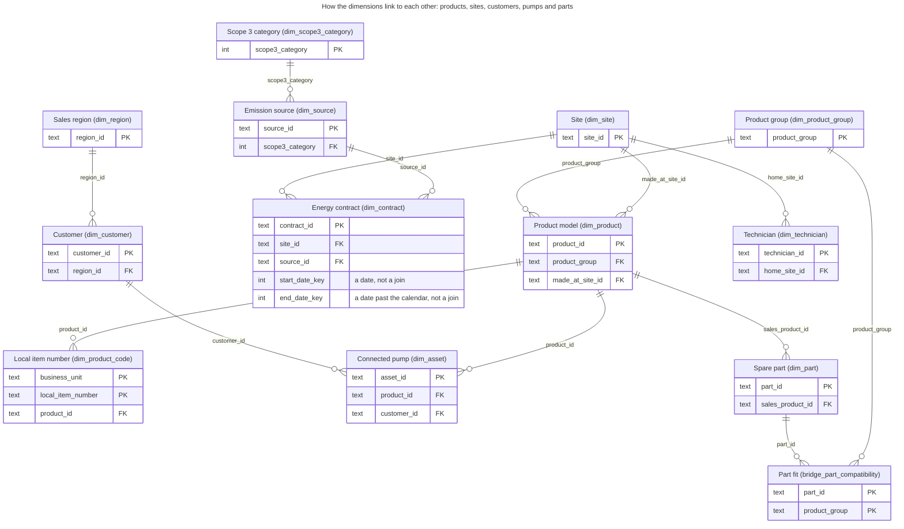

| Key | Meaning |
| --- | --- |
| Box | One table: its business name, with the table name in brackets |
| First column in a box | The kind of value: `text`, `int` (a whole number) or `date` |
| PK | Primary key: the column, or columns together, that pick out exactly one row of the table |
| FK | Foreign key: a column holding the key of a row in another table, so the two tables can be joined |
| Blank key cell | The column is not a key; it is drawn only because it carries a note |
| Last column | A note on that column; blank when there is nothing to add |
| Two short bars at a line's end | Exactly one row at that end |
| Circle and three prongs (a crow's foot) at a line's end | Zero, one or many rows at that end |
| A whole line | Reads as: one row in the table at the bars matches any number of rows in the table at the crow's foot; the label names the column they are joined on |

| Business name | Table | What it is | What it is for |
| --- | --- | --- | --- |
| Calendar month | `dim_date` | Each reporting month, January 2023 to December 2025. | Groups every monthly figure by month, quarter and year. |
| Site | `dim_site` | The six sites: three plants, two warehouses and the head office. | Filters figures by site and country; the country security roles act on it. |
| Emission source | `dim_source` | Each emission source with its scope and category. | Groups emissions by scope, source and scope 3 category. |
| Scope 3 category | `dim_scope3_category` | All 15 Greenhouse Gas Protocol scope 3 categories, each with a status and reason. | Shows which categories are counted and why the others are not. |
| Supplier | `dim_supplier` | Each supplier with its country and spend category. | Groups purchased goods emissions by supplier. |
| Energy contract | `dim_contract` | Each electricity contract with its guarantees of origin, dates and share of electricity covered. | Works out market-based electricity emissions. |
| Product model | `dim_product` | The 24 product models with rated power, yearly electricity use, lifetime, list price and standard cost. | Groups sales; its specification drives product use emissions. |
| Product group | `dim_product_group` | The 10 product groups and the family each belongs to. | The level the scorecard, the sales plan and parts fit work at. |
| Sales region | `dim_region` | The four sales regions: Nordics, Baltics, Western Europe and Rest of world. | Filters sales; the region security roles act on it. |
| Local item number | `dim_product_code` | Each business unit's local item number, mapped to one global product. | Lets the SQL map ERP sales to products; unmapped numbers are held back. |
| Scorecard criterion | `dim_score_criterion` | The six scorecard criteria and the weight Fjordvik gives each. | Weights the quarterly ratings into one score. |
| Customer | `dim_customer` | The 150 customers with segment, location and service contract. | Groups service jobs, orders and portal activity by customer. |
| Connected pump | `dim_asset` | The 600 connected pumps with model, owner, location and install date. | Links readings and service jobs to a pump, its model and its customer. |
| Spare part | `dim_part` | The 52 spare parts and kits with family, list price and lead time. | Groups parts orders and portal suggestions. |
| Technician | `dim_technician` | The 12 technicians with home base, countries, skills and weekly hours. | Shows who did each job; the scheduler's capacity. |
| Part fit | `bridge_part_compatibility` | Which spare parts fit which product groups. | Stops the portal suggesting a part that does not fit. |

Last updated: 25 November 2026, commit `f5b1aef`.

These are the reference tables every set of facts above is filtered and grouped by.

## Bus matrix

Which dimensions each fact shares. A shared column means two subjects can be read side by
side: date, site and region are the dimensions that conform across emissions, portfolio
and service.

| Fact table | date | site | source | supplier | contract | product | product_group | region | score_criterion | customer | asset | part | technician |
| --- | :---: | :---: | :---: | :---: | :---: | :---: | :---: | :---: | :---: | :---: | :---: | :---: | :---: |
| `fact_asset_telemetry` | X |  |  |  |  |  |  |  |  |  | X |  |  |
| `fact_budget` | X | X |  |  |  |  | X | X |  |  |  |  |  |
| `fact_data_issue` | X | X |  |  |  |  |  |  |  |  |  |  |  |
| `fact_emissions` | X | X | X |  |  |  |  |  |  |  |  |  |  |
| `fact_energy_upstream` | X | X | X |  |  |  |  |  |  |  |  |  |  |
| `fact_freight` | X | X | X |  |  |  |  |  |  |  |  |  |  |
| `fact_parts_order` | X | X |  |  |  | X |  | X |  | X | X | X |  |
| `fact_portal_event` |  |  |  |  |  | X |  |  |  | X |  | X |  |
| `fact_product_rating` | X |  |  |  |  |  | X |  | X |  |  |  |  |
| `fact_purchases` | X | X | X | X |  |  |  |  |  |  |  |  |  |
| `fact_sales` | X | X |  |  |  | X |  | X |  |  |  |  |  |
| `fact_scope2_market` | X | X | X |  | X |  |  |  |  |  |  |  |  |
| `fact_service_event` |  |  |  |  |  |  |  |  |  |  | X |  | X |
| `fact_site_metrics` | X | X |  |  |  |  |  |  |  |  |  |  |  |
| `fact_use_phase` | X | X | X |  |  | X |  | X |  |  |  |  |  |

`fact_service_event` and `fact_portal_event` carry dates but no date key, and
`fact_asset_telemetry`'s date key is a day, so none of the three joins the monthly
calendar (see findings).

## Grain

The grain of every emissions and service table is in the
[data README](../data/README.md#architecture). The portfolio tables are not listed there;
their grain, checked unique in code on 19 November 2026:

| Table | Grain | Rows |
| --- | --- | --- |
| `fact_sales` | One row per month, shipping site, product and region | 3,379 |
| `fact_use_phase` | One row per month, shipping site, product and region of use | 1,940 |
| `fact_budget` | One row per month, shipping site, product group and region | 1,368 |
| `fact_product_rating` | One row per quarter (keyed to its first month), product group and criterion | 720 |
| `fact_data_issue` | One row per problem the SQL found | 4 |
| `dim_product_code` | One row per business unit and local item number | 26 |
| `dim_product` | One row per product model | 24 |
| `dim_product_group` | One row per product group | 10 |
| `dim_region` | One row per sales region | 4 |
| `dim_score_criterion` | One row per scorecard criterion | 6 |

The service grains in the data README were checked the same way: telemetry is unique by
day and pump (582,996 rows), parts orders by order and line (53,654), service and portal
events by event.

## Join coverage

Every foreign key checked against its target on 19 November 2026: distinct values, how
many are found in the target table, and blanks.

All 68 key columns

| From | Column | To | Distinct values | Found in target | Blank allowed |
| --- | --- | --- | --- | --- | --- |
| `bridge_part_compatibility` | `part_id` | `dim_part.part_id` | 52 | 52 (100%) | 0 blank rows |
| `bridge_part_compatibility` | `product_group` | `dim_product_group.product_group` | 8 | 8 (100%) | 0 blank rows |
| `dim_asset` | `customer_id` | `dim_customer.customer_id` | 131 | 131 (100%) | 0 blank rows |
| `dim_asset` | `product_id` | `dim_product.product_id` | 18 | 18 (100%) | 0 blank rows |
| `dim_contract` | `end_date_key` | `dim_date.date_key` | 1 | 0 (0%) | 0 blank rows |
| `dim_contract` | `site_id` | `dim_site.site_id` | 2 | 2 (100%) | 0 blank rows |
| `dim_contract` | `source_id` | `dim_source.source_id` | 1 | 1 (100%) | 0 blank rows |
| `dim_contract` | `start_date_key` | `dim_date.date_key` | 2 | 2 (100%) | 0 blank rows |
| `dim_customer` | `region_id` | `dim_region.region_id` | 2 | 2 (100%) | 0 blank rows |
| `dim_part` | `sales_product_id` | `dim_product.product_id` | 2 | 2 (100%) | 0 blank rows |
| `dim_product` | `made_at_site_id` | `dim_site.site_id` | 3 | 3 (100%) | 0 blank rows |
| `dim_product` | `product_group` | `dim_product_group.product_group` | 10 | 10 (100%) | 0 blank rows |
| `dim_product_code` | `product_id` | `dim_product.product_id` | 24 | 24 (100%) | 0 blank rows |
| `dim_source` | `scope3_category` | `dim_scope3_category.scope3_category` | 7 | 7 (100%) | 6 blank rows |
| `dim_technician` | `home_site_id` | `dim_site.site_id` | 6 | 6 (100%) | 0 blank rows |
| `fact_asset_telemetry` | `asset_id` | `dim_asset.asset_id` | 600 | 600 (100%) | 0 blank rows |
| `fact_asset_telemetry` | `date_key` | `dim_date.date_key` | 1096 | 36 (3%) | 0 blank rows |
| `fact_budget` | `date_key` | `dim_date.date_key` | 36 | 36 (100%) | 0 blank rows |
| `fact_budget` | `product_group` | `dim_product_group.product_group` | 10 | 10 (100%) | 0 blank rows |
| `fact_budget` | `region_id` | `dim_region.region_id` | 4 | 4 (100%) | 0 blank rows |
| `fact_budget` | `site_id` | `dim_site.site_id` | 5 | 5 (100%) | 0 blank rows |
| `fact_data_issue` | `date_key` | `dim_date.date_key` | 4 | 4 (100%) | 0 blank rows |
| `fact_data_issue` | `site_id` | `dim_site.site_id` | 3 | 3 (100%) | 0 blank rows |
| `fact_emissions` | `date_key` | `dim_date.date_key` | 36 | 36 (100%) | 0 blank rows |
| `fact_emissions` | `site_id` | `dim_site.site_id` | 6 | 6 (100%) | 0 blank rows |
| `fact_emissions` | `source_id` | `dim_source.source_id` | 8 | 8 (100%) | 0 blank rows |
| `fact_energy_upstream` | `based_on_source_id` | `dim_source.source_id` | 5 | 5 (100%) | 0 blank rows |
| `fact_energy_upstream` | `date_key` | `dim_date.date_key` | 36 | 36 (100%) | 0 blank rows |
| `fact_energy_upstream` | `site_id` | `dim_site.site_id` | 6 | 6 (100%) | 0 blank rows |
| `fact_energy_upstream` | `source_id` | `dim_source.source_id` | 2 | 2 (100%) | 0 blank rows |
| `fact_freight` | `date_key` | `dim_date.date_key` | 36 | 36 (100%) | 0 blank rows |
| `fact_freight` | `site_id` | `dim_site.site_id` | 5 | 5 (100%) | 0 blank rows |
| `fact_freight` | `source_id` | `dim_source.source_id` | 2 | 2 (100%) | 0 blank rows |
| `fact_parts_order` | `asset_id` | `dim_asset.asset_id` | 492 | 492 (100%) | 50854 blank rows |
| `fact_parts_order` | `customer_id` | `dim_customer.customer_id` | 146 | 146 (100%) | 0 blank rows |
| `fact_parts_order` | `date_key` | `dim_date.date_key` | 36 | 36 (100%) | 0 blank rows |
| `fact_parts_order` | `part_id` | `dim_part.part_id` | 52 | 52 (100%) | 0 blank rows |
| `fact_parts_order` | `region_id` | `dim_region.region_id` | 2 | 2 (100%) | 0 blank rows |
| `fact_parts_order` | `sales_product_id` | `dim_product.product_id` | 2 | 2 (100%) | 0 blank rows |
| `fact_parts_order` | `service_event_id` | `fact_service_event.event_id` | 1992 | 1992 (100%) | 50854 blank rows |
| `fact_parts_order` | `site_id` | `dim_site.site_id` | 2 | 2 (100%) | 0 blank rows |
| `fact_portal_event` | `customer_id` | `dim_customer.customer_id` | 131 | 131 (100%) | 0 blank rows |
| `fact_portal_event` | `part_id` | `dim_part.part_id` | 26 | 26 (100%) | 0 blank rows |
| `fact_portal_event` | `product_id` | `dim_product.product_id` | 18 | 18 (100%) | 0 blank rows |
| `fact_product_rating` | `criterion_id` | `dim_score_criterion.criterion_id` | 6 | 6 (100%) | 0 blank rows |
| `fact_product_rating` | `date_key` | `dim_date.date_key` | 12 | 12 (100%) | 0 blank rows |
| `fact_product_rating` | `product_group` | `dim_product_group.product_group` | 10 | 10 (100%) | 0 blank rows |
| `fact_purchases` | `date_key` | `dim_date.date_key` | 36 | 36 (100%) | 0 blank rows |
| `fact_purchases` | `site_id` | `dim_site.site_id` | 6 | 6 (100%) | 0 blank rows |
| `fact_purchases` | `source_id` | `dim_source.source_id` | 1 | 1 (100%) | 0 blank rows |
| `fact_purchases` | `supplier_id` | `dim_supplier.supplier_id` | 14 | 14 (100%) | 0 blank rows |
| `fact_sales` | `date_key` | `dim_date.date_key` | 36 | 36 (100%) | 0 blank rows |
| `fact_sales` | `product_id` | `dim_product.product_id` | 24 | 24 (100%) | 0 blank rows |
| `fact_sales` | `region_id` | `dim_region.region_id` | 4 | 4 (100%) | 0 blank rows |
| `fact_sales` | `site_id` | `dim_site.site_id` | 5 | 5 (100%) | 0 blank rows |
| `fact_scope2_market` | `contract_id` | `dim_contract.contract_id` | 2 | 2 (100%) | 396 blank rows |
| `fact_scope2_market` | `date_key` | `dim_date.date_key` | 36 | 36 (100%) | 0 blank rows |
| `fact_scope2_market` | `site_id` | `dim_site.site_id` | 6 | 6 (100%) | 0 blank rows |
| `fact_scope2_market` | `source_id` | `dim_source.source_id` | 2 | 2 (100%) | 0 blank rows |
| `fact_service_event` | `asset_id` | `dim_asset.asset_id` | 542 | 542 (100%) | 0 blank rows |
| `fact_service_event` | `technician_id` | `dim_technician.technician_id` | 10 | 10 (100%) | 0 blank rows |
| `fact_site_metrics` | `date_key` | `dim_date.date_key` | 36 | 36 (100%) | 0 blank rows |
| `fact_site_metrics` | `site_id` | `dim_site.site_id` | 6 | 6 (100%) | 0 blank rows |
| `fact_use_phase` | `date_key` | `dim_date.date_key` | 36 | 36 (100%) | 0 blank rows |
| `fact_use_phase` | `product_id` | `dim_product.product_id` | 18 | 18 (100%) | 0 blank rows |
| `fact_use_phase` | `region_id` | `dim_region.region_id` | 3 | 3 (100%) | 0 blank rows |
| `fact_use_phase` | `site_id` | `dim_site.site_id` | 3 | 3 (100%) | 0 blank rows |
| `fact_use_phase` | `source_id` | `dim_source.source_id` | 1 | 1 (100%) | 0 blank rows |

### Findings

1. **Every key resolves**, apart from the two below. Blanks are by design:
   `fact_parts_order.service_event_id` and `asset_id` are blank on orders not tied to a
   service job (50,854 of 53,654 lines); `fact_scope2_market.contract_id` is blank where
   the residual mix applies; `dim_source.scope3_category` is blank for scope 1 and 2
   sources.
2. **Telemetry has no calendar.** `fact_asset_telemetry.date_key` holds 1,096 days;
   `dim_date` holds 36 months, so only first-of-month days match. `fact_service_event`
   and `fact_portal_event` have dates and no key. A new daily date table will fix this:
   Reece accepted it on 26 November 2026
   ([ADR-029](decision-log.md#adr-029-a-daily-date-table-for-the-service-data)), and it
   is not built yet.
3. **Contract end dates sit past the calendar.** Both contracts end on 1 December 2027
   (`end_date_key` 20271201), after the last month in `dim_date`. That is right for a
   contract; the keys are dates, not joins, and the dimension diagram shows them as plain
   dates.
4. **Each table is a fact or a dimension, never both.** The prefix says which; `bridge_part_compatibility` is the one bridge, linking parts to the product groups they fit.
5. **Parts fit 8 of the 10 product groups.** The two left out, Spare parts and Service
   kits, are themselves parts, so nothing fits them. No gap.

## History handling

Every dimension is overwritten in place today (slowly changing dimension type 1): a change
rewrites the past. That is right for names and codes, and wrong for a few attributes past
figures depend on:

| Attribute | Why history matters | Handling (ADR-027) |
| --- | --- | --- |
| `dim_customer.service_contract` | A customer moving from Basic to Premium changes how many preventive visits were due | Type 2: a row per contract period with valid-from and valid-to dates |
| `dim_technician.skills`, `weekly_hours` | Phase 4 must plan from data as it stood ("as at" dates, rule D16) | Type 2 |
| `dim_asset` town and location | A moved pump's travel cost changes | Type 2 when moves start; none in the data today |
| Emission factors | One factor per source for the whole period; a new factor would rewrite past emissions | Yearly factor versions, already a [next step](learning-guide.md#next-steps) |
| Product specification, prices | Stable in the data | Type 1 |

Reece accepted this on 26 November 2026
([ADR-027](decision-log.md#adr-027-history-handling-for-dimensions)). It is not built yet.
Each change is a new column or table (names never change, rule D4) made through the
generator, and moving an existing checksum needs Reece's yes (rule D5). Phase 4 needs the
technician and customer history first (rule D16).

## Gate G2

| Check | Status |
| --- | --- |
| Conceptual model agreed with users | First edition above; not reviewed with users |
| Logical and physical model | Built and tested |
| Data dictionary and grain statements | Power BI dictionary generated; grain for every table, now including the portfolio tables |
| Bus matrix | Above |
| History handling decided | Accepted on 26 November 2026 (ADR-027); not built yet |
| Wireframes approved | The 17 report pages exist ([report pages](../powerbi/docs/report-pages.md)); review with users is open (portfolio milestone M5) |
| Business approval | **Given on 26 November 2026** by Reece, as the stand-in for the data owners, with the gaps in this table recorded: the conceptual model and the report pages have not been reviewed with users, and the history handling and daily date table are accepted but not built |

## Change history

- 19 November 2026: first edition, during the architecture pause (Reece asked).
- 25 November 2026: two data flow drawings (what the six sites send; what group functions, service
  systems and publishers send) and a table of the kinds of data and their owners (Reece asked).
- 25 November 2026: after Jasila's readability review, the three entity relationship diagrams
  became one keys-only star per fact table plus a dimension diagram; the data flow drawings use
  data flow diagram notation (every flow through a numbered process); keys moved into tables;
  text descriptions added for screen readers (Reece asked).
- 26 November 2026: history handling (ADR-027) and the daily date table (ADR-029) accepted by
  Reece; neither is built yet.
- 26 November 2026: gate G2 given by Reece as the stand-in for the data owners, with its gaps
  recorded in the gate table.
