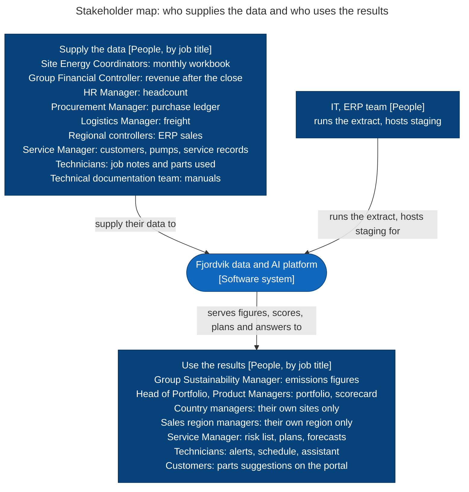

# Discovery and requirements

Who Fjordvik's data and AI platform serves, what each of them needs from it, and the
requirements that follow, in the four classes the International Institute of Business
Analysis (IIBA) uses: business, stakeholder, solution (functional and non-functional) and
transition. It is station 01 of the data product delivery map; its gate, G1, is the
decision to go on to design. The [business case](business-case.md) says why;
[architecture.md](architecture.md) says how.

Most of the reporting side was built before this page was written, so many requirements
below point to the test that already proves them. Where a requirement has no test yet, it
says so.

> **Synthetic data only.** Fjordvik Manufacturing Oy is a fictional company, and this is a
> portfolio project. No real company, client or person is described; roles are job titles,
> not people. The emission factors are **illustrative**, not cited.

## Stakeholder map

| Key | Meaning |
| --- | --- |
| Dark blue box | People, by job title |
| Blue rounded box | The platform |
| Solid line | Part of the design |
| Abbreviations | ERP: enterprise resource planning |

Last updated: 25 November 2026, commit `a997951`.

The table below gives each role's interest, influence and needs.

| Role | Interest | Influence | What they need | How they take part |
| --- | --- | --- | --- | --- |
| Group Sustainability Manager | High | High (sponsor, emissions) | Correct figures with a reason for every gap | Signs off factors and the scope 3 list |
| Head of Portfolio | High | High (sponsor, portfolio) | One portfolio view that reconciles to finance | Signs off the classification and scorecard |
| Service Manager | High | High (sponsor, service AI) | Fewer failures, planned visits, parts in stock | Owns the service data and approves agent drafts |
| Site Energy Coordinators (6) | Medium | Low | A simple upload and a clear message when a file is wrong | Upload monthly; act on rejection emails |
| Regional controllers | Medium | Medium | Their sales loaded once, correctly | Sign off reconciliation per region |
| Portfolio governance | Medium | Medium | Unmapped item numbers listed, not guessed | Map new codes within a week |
| Product Managers | High | Medium | Answers to their questions without an analyst | Rate the scorecard; test pages |
| Country managers (3) | Medium | Low | Their own sites, nothing else | Read through row-level security |
| Sales region managers (4) | Medium | Low | Their region's sales, margin and use-phase emissions | Read through row-level security |
| Technicians (12) | High | Low | A short, trusted job list and cited manual answers | Test the assistant; give feedback on alerts |
| Customers (150) | Low | Low | Parts that fit their pump | Use the portal |
| IT (ERP team) | Low | High (controls the extract) | A supported extraction route, no direct load on the ERP | Run the monthly extract; host staging |
| E-commerce owner | Medium | Medium | Suggestions that sell and never show an unfit part | Owns the portal and its logs |

The roles are from the [company profile](company-profile.md#who-owns-which-figures) and
the [portfolio project plan](portfolio-project-plan.md#roles). No discovery workshops were
held: the needs below were written from those documents, so G1 records that gap.

## Use cases

| # | As a | I want | So that | Acceptance (where it is tested or will be) |
| --- | --- | --- | --- | --- |
| U1 | Site Energy Coordinator | to upload my workbook and hear within the run what is wrong | I fix it the same day | A rejected file adds no rows and emails the rules it failed (`power-automate/tests/test_intake.py`) |
| U2 | Group Sustainability Manager | one location-based total with market-based scope 2 beside it | I report both methods without double counting | `Reconciliation Difference (tCO2e)` is zero; live measure tests (`powerbi/tests`) |
| U3 | Group Sustainability Manager | every scope 3 category listed with a status and reason | exclusions are justified | All 15 categories listed with a reason, and a missing reason is caught (`mcp/tests/test_queries.py`, `test_quality.py`) |
| U4 | Country manager | my own sites' figures only | I manage my sites | Country roles tested live (`powerbi/tests/test_measures_live.py`) |
| U5 | Product Manager | price, volume and mix against last year and budget | I explain margin change | Prior-year margin plus effects equals this year's margin (`powerbi/tests`) |
| U6 | Portfolio governance | unmapped item numbers listed with their value | I map them before they distort figures | Quarantined lines in `fact_data_issue`; sales plus quarantine equal finance (`data/tests`) |
| U7 | Group analyst | to ask Claude a plain-language question about the data | I get an answer without writing SQL | Every tool reconciles with an independent calculation (`mcp/tests/test_queries.py`) |
| U8 | Service Manager | a monthly parts forecast with a range per family and warehouse | stock is held before failures | Phase 2 pass marks ([learning notes](learning/service-ai.md#phase-2-forecasting-spare-parts-demand)) |
| U9 | Service Manager | a daily list of pumps likely to fail within 30 days | a technician goes first | Phase 3 pass marks ([learning notes](learning/service-ai.md#phase-3-predicting-pump-failures)) |
| U10 | Service Manager | a weekly visit plan within skills, hours and time windows | travel is lowest and nothing is broken | Phase 4 pass mark (not started) |
| U11 | Customer | parts suggestions that fit my pump | I order the right part | Phase 5 pass mark (not started) |
| U12 | Technician | an answer from the manual with its section | I fix the pump without phoning a colleague | Phase 6 pass mark (not started) |
| U13 | Service desk | a drafted work order, parts reservation and email from an alert or email | I approve instead of typing | Phase 7 pass mark (not started) |

## Requirements

Identifiers: BR business, SR stakeholder, FR functional, NFR non-functional, TR
transition.

### Business requirements

| # | Requirement | Source |
| --- | --- | --- |
| BR1 | One governed dataset that every report, tool and model reads | [Business case](business-case.md#the-problems) |
| BR2 | Emissions figures for scope 1, both scope 2 methods and every scope 3 category, monthly, with each exclusion justified | Business case |
| BR3 | Portfolio figures that reconcile to finance revenue to the cent | Business case; [portfolio plan](portfolio-project-plan.md#goal) |
| BR4 | Move after-sales service from reactive to planned, each capability beating a simple rule before use | Business case, hypotheses H1 to H6 |

### Stakeholder requirements

| # | Requirement | Stakeholders |
| --- | --- | --- |
| SR1 | Each person sees only the sites or region their role allows | Country managers, sales region managers |
| SR2 | A rejected file says exactly what to fix | Site Energy Coordinators |
| SR3 | Nothing an AI drafts is applied without a person's approval | Service Manager, service desk |
| SR4 | Every page and answer says the period it covers and when it was refreshed | All report readers |
| SR5 | Answers cite their source; "not found" when the sources don't cover it | Technicians, group analyst |

### Functional requirements

Each part's README lists its functions and the tests that prove them. The headline
functions:

| # | Requirement | Part | Status |
| --- | --- | --- | --- |
| FR1 | Check each site file against ten written rules (R1 to R10); load the whole file or nothing | power-automate | Rules built and tested offline; flows not built in a tenant |
| FR2 | Clean the ERP extract: manifest, duplicates, currency, classification, reconciliation | data (`sql/`) | Built, 9 planted-problem tests |
| FR3 | Prove the dataset unedited with SHA-256 checksums before any part relies on it | every part | Built (`tests/test_data.py`) |
| FR4 | Two Power BI reports on one model, seven row-level security roles | powerbi | Built; not published |
| FR5 | Read-only Claude tools, with role checks over HTTP | mcp | Built; local only |
| FR6 to FR12 | The seven service AI capabilities | service-ai | 2 of 7 built (forecast, failure risk) |

### Non-functional requirements

Grouped by the quality characteristics of ISO/IEC 25010:2023. A target marked
"proposed" is a choice for Reece to confirm, not a measured fact.

| # | Characteristic | Target | How it is checked | Status |
| --- | --- | --- | --- | --- |
| NFR1 | Functional suitability (correctness) | Every Power BI measure and MCP tool equals an independent Python calculation from the raw files | `powerbi/tests/test_measures_live.py`, `mcp/tests/test_queries.py` | Met |
| NFR2 | Functional suitability (correctness) | Sales plus quarantined lines equal finance revenue to the cent in every site-month | `data/sql` reconciliation check | Met |
| NFR3 | Performance efficiency | A scheduled refresh completes within the Power BI Service limit of two hours on shared capacity | [refresh design](../powerbi/docs/refresh-design.md) | Not tested: model not published |
| NFR4 | Performance efficiency | Common report visuals render in under 5 seconds, Microsoft's guidance ([research note](../powerbi/docs/research/power-bi-issues-2026-10-16.md)) | A timed run against the published model | Proposed; not tested |
| NFR5 | Performance efficiency | `run_sql` returns at most 1,000 rows | `mcp/tests/test_sql_guard.py` | Met |
| NFR6 | Reliability | A failed check stops the load and the reports keep last month's figures | `data/sql` checks; intake "whole file or nothing" | Met offline |
| NFR7 | Reliability | Training twice on the same data gives the same metrics; each result names its data checksum, commit and model version | service-ai rule G10 tests | Met for phases 2 and 3 |
| NFR8 | Security | Every MCP tool is read-only and, over HTTP, checks the signed-in role on the server; access tokens expire after one hour | `mcp/tests/test_http_auth.py`, `test_server.py` | Met |
| NFR9 | Security | No secret in git; keys from environment variables only | `guardrails/check.py` | Met |
| NFR10 | Security | No AI component writes outside its own `outbox/` and state files | service-ai tests from phase 6 | Not started |
| NFR11 | Safety | No planted instruction is ever followed, in at least 20 planted instructions run 3 times each | Phase 6 and 7 evaluations | Not started |
| NFR12 | Interaction capability (accessibility) | All report text at a contrast of at least 4.5:1 | Report theme; [phase 2 handover](handover/2026-10-31-fjordvik-phase2-portfolio.md) | Met |
| NFR13 | Maintainability | Everything as text in git; every part's tests run without keys or network | Every part's tests | Met |
| NFR14 | Flexibility (installability) | Runs on a Windows laptop with free software and no account | [README](../README.md#how-to-run-it-on-your-own-computer) | Met |
| NFR15 | Reliability (recoverability) | A restore from backup is tested and its time recorded in the runbook | Operational acceptance (station 06) | Proposed; no backup design yet |

### Transition requirements

The IIBA class most often missing from data product briefs. None was written before the
build; these are the first edition.

| # | Requirement | Status |
| --- | --- | --- |
| TR1 | Load the history: January 2023 to November 2025 into the SharePoint Emissions list before the first live month | Seed workbooks built (`power-automate/sharepoint/seed`) |
| TR2 | Run the central spreadsheet and the intake flow side by side for at least one monthly close, and reconcile the two | Proposed; not planned |
| TR3 | Move service history from the planning spreadsheet into the service records before alerts go live, with a count reconciled to the spreadsheet | Proposed; not planned |
| TR4 | Train Site Energy Coordinators on the upload and the rejection email; Product Managers and regional users on the reports; technicians on alerts and the assistant | [User guide](portfolio-user-guide.md) written for the portfolio report only |
| TR5 | Retire the copies of the central spreadsheet once TR2 reconciles | Proposed |
| TR6 | Fit the cutover to the monthly close: ERP close on working day 3, extract on working day 4 | Schedule in the [refresh design](../powerbi/docs/refresh-design.md#schedule) |

## Data inventory and profiling

The inventory of every source, its owner, system and frequency is in the
[data README](../data/README.md#where-the-data-comes-from). The join check in
[data-model.md](data-model.md#join-coverage) profiles every key: all foreign keys resolve,
apart from two findings recorded there.

Not done: a check of the synthetic totals against a comparable manufacturer's published
figures. No record of one was found in the repository.

## Metric dictionary

- **Reporting measures:** the [Power BI data dictionary](../powerbi/docs/data-dictionary.md)
  and the [measure guide](../powerbi/docs/measure-guide.md) define all 134 measures.
- **Service measures**, defined here for the business case and the quarterly review:

| Measure | Definition | Unit |
| --- | --- | --- |
| Failure share | `fact_service_event` rows with `event_type` Failure, divided by all rows, by year of `reported_date` | % |
| Median downtime per failure | Median `downtime_hours` of Failure rows | Hours |
| Preventive share | Preventive rows divided by all rows | % |
| Portal share of parts value | `net_amount_eur` where `channel` is Portal, divided by all `fact_parts_order` value | % |
| Forecast skill | Mean absolute scaled error (MASE) against seasonal naive, per warehouse and horizon | Ratio |
| Failure ranking | Average precision of the 30-day failure score, as a multiple of the dummy model's | Ratio |

## Metric catalogue: plants and business

Fjordvik needs dashboards that track how its plants and the business run, not only
emissions and reporting (Reece, 19 November 2026). Before any dashboard is built, each
candidate metric is listed here with its definition, whether it is actual (a figure
Fjordvik records) or derived (worked out from actual figures), the data it needs, its
owner and its status. Under the permanent rules a metric is **active** only when every
input it needs is recorded; otherwise it is **dormant** and stays off the dashboards. No
estimate, default or typed-in rate fills a gap. Checked against the column names and
units in `data/tables` at commit `f036850`, 19 November 2026.

Where each metric is shown (Power BI, an HTML dashboard or both) is decided
per metric once the dashboard approach is agreed.

### Plant metrics (per site, per month)

| Metric | Definition | Type | Data | Owner | Status |
| --- | --- | --- | --- | --- | --- |
| Electricity use | Purchased electricity, kWh | Actual | `fact_emissions`, source S05 | Site Energy Coordinator | Active |
| Heat and gas use | District heating and natural gas, kWh | Actual | `fact_emissions`, S06 and S01 | Site Energy Coordinator | Active |
| Liquid fuel use | Diesel and liquefied petroleum gas (LPG), litres | Actual | `fact_emissions`, S02 and S03 | Site Energy Coordinator | Active |
| Total energy use | All energy in kWh, fuels included | Derived | Litres of diesel and LPG need a cited net calorific value per fuel; none is in the dataset | Group Sustainability Manager | **Dormant** until a cited value is added |
| Refrigerant leakage | Refrigerant topped up, kg | Actual | `fact_emissions`, S04 | Site Energy Coordinator | Active |
| Waste to landfill | Tonnes | Actual | `fact_emissions`, S08 | Site Energy Coordinator | Active |
| Scope 1 and 2 emissions | Activity times emission factor, tCO2e | Derived | `fact_emissions`, `fact_scope2_market`; factors are illustrative | Group Sustainability Manager | Active (illustrative) |
| Revenue | Revenue after the monthly close, EUR | Actual | `fact_site_metrics.revenue_eur` | Group Financial Controller | Active; the head office books none |
| Headcount | Full-time equivalent employees (FTE) | Actual | `fact_site_metrics.fte` | HR Manager | Active |
| Revenue per FTE | Revenue divided by FTE, EUR per FTE (FTE averaged over months, not summed) | Derived | `fact_site_metrics` | Group Financial Controller | Active |
| Emissions intensity | tCO2e per million EUR revenue and per FTE | Derived | Existing measures | Group Sustainability Manager | Active (illustrative) |
| Net sales and margin by shipping site | EUR and margin % | Actual | `fact_sales` (five shipping sites; not the head office) | Regional controllers | Active |
| Sales against budget | Net sales and margin against the sales plan | Actual | `fact_sales`, `fact_budget` | Group Financial Controller | Active |
| Electricity per unit shipped | kWh divided by units shipped from the site | Derived | `fact_emissions` S05, `fact_sales.units` | Site Energy Coordinator | Active, with a caveat: units mix a 1 kW booster set with a large process pump, so compare a site only with itself over time |
| Units produced | Units made at each plant | Actual | Not recorded: the dataset holds units shipped, not produced | Plant managers | **Dormant** |
| Overall equipment effectiveness (OEE) | Availability times performance times quality | Derived | Needs machine run time, planned time, rate and good-part counts; none recorded | Plant managers | **Dormant** |
| Scrap or first-pass yield | Good units against units started | Actual | Not recorded | Plant managers | **Dormant** |
| Safety: lost-time injury frequency rate | Lost-time injuries per million hours worked | Derived | Not recorded | HR Manager | **Dormant** |
| On-time delivery | Orders shipped by the promised date | Derived | Not recorded: no promised dates | Regional controllers | **Dormant** |
| Stock levels and turns | Stock on hand and cost of sales over average stock | Derived | Not recorded: no stock table | Logistics Manager | **Dormant** |

### Business and service metrics

| Metric | Definition | Type | Data | Owner | Status |
| --- | --- | --- | --- | --- | --- |
| Net sales, margin, price, volume and mix | As in the portfolio report | Actual and derived | `fact_sales`, `fact_budget` | Head of Portfolio | Active |
| Portfolio scorecard | Weighted 1 to 10 ratings per product group | Actual | `fact_product_rating`, `dim_score_criterion` | Portfolio governance | Active |
| Failure share | Failure events over all service events | Derived | `fact_service_event` | Service Manager | Active |
| Median downtime per failure | Hours | Actual | `fact_service_event.downtime_hours` | Service Manager | Active |
| Failures by mode | Count of failures per `failure_mode` | Actual | `fact_service_event` | Service Manager | Active |
| Mean time between failures | Pump operating days divided by failures, per product group | Derived | `fact_service_event`, `dim_asset.telemetry_from_date` | Service Manager | Active |
| Technician utilisation | Labour hours on jobs over contracted hours, per week | Derived | `fact_service_event.labour_hours`, `dim_technician.weekly_hours` | Service Manager | Active, with a caveat: travel time is not recorded, so it understates the working day |
| First-time fix rate | Failures not followed by a repeat visit for the same fault | Derived | Needs Fjordvik's own definition of a repeat (the window and what counts as the same fault) | Service Manager | **Dormant** until Fjordvik defines it |
| Service contract mix | Customers by contract (none, Basic, Premium) | Actual | `dim_customer.service_contract` | Service Manager | Active |
| Parts revenue by channel | EUR by EDI, email, phone, portal, technician | Actual | `fact_parts_order` | E-commerce owner | Active |
| Portal suggestion click rate | Suggestions clicked over suggestions shown | Derived | `fact_portal_event` | E-commerce owner | Active |
| Forecast skill | Mean absolute scaled error (MASE) per warehouse | Derived | `service-ai/results/forecast` | Service Manager | Active |
| Failure model ranking and cost | Average precision against the dummy model; alert cost against visiting all or none | Derived | `service-ai/results/ml` | Service Manager | Active |

Eight of the 33 metrics are dormant. Each needs Fjordvik to start recording something
(production counts, machine states, injuries, promised dates, stock), a cited value
(calorific values), or a definition only Fjordvik can set (a repeat visit). Adding them to
the synthetic data is a generator change in `data`, decided one by one, never a default.

## Change readiness

Not assessed. The delivery map's change and training workstream starts at discovery. Open
items: who tells the technicians that alerts are coming, who answers their questions, and
how a technician reports a false alert. These belong in the cutover plan (station 05).

## Gate G1

| Check | Status |
| --- | --- |
| Signed metric dictionary | Reporting: generated and tested. Service measures: first edition above, not signed |
| Success measures and kill criteria | In the [business case](business-case.md#hypotheses-and-kill-criteria) |
| Discovery workshops held | No. Needs written from the company profile and plans |
| Decision to go on to design | **Not yet taken.** Reece decides |

## Change history

- 19 November 2026: first edition, during the architecture pause (Reece asked).
- 19 November 2026: metric catalogue for plants and the business added (Reece asked).
