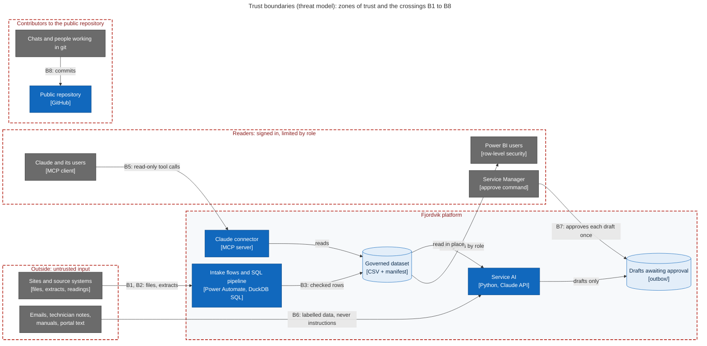

# Threat model

What could go wrong with Fjordvik's data and AI platform through misuse, mistakes or
attack, what already stops it, and what is still open. Fjordvik's figures feed its
customers' footprints and its service plans, and from phase 6 its service AI reads
emails and notes that anyone can write, so a wrong figure or a followed instruction costs
money and trust. This is the security design and threat model of station 02 of the
delivery map; the containers it names are in [architecture.md](architecture.md#level-2-containers).

> **Synthetic data only.** Fjordvik Manufacturing Oy is a fictional company, and this is a
> portfolio project. No real company, client or person is described. The emission factors
> are **illustrative**, not cited.

## Method

Each trust boundary (where data or control crosses from one owner to another) is checked
against STRIDE: spoofing, tampering, repudiation, information disclosure, denial of service
and elevation of privilege. Each threat names the control in place, the rule or test
behind it, and what is still open. Rule identifiers are from [GUARDRAILS.md](../GUARDRAILS.md)
and the service AI [phase rules](../service-ai/docs/phase-rules.md).

| Key | Meaning |
| --- | --- |
| Dashed red outline | A trust boundary around a zone of the same trust |
| B1 to B8 on a line | A line that crosses a trust boundary; each has its own section below |
| Blue box | Part of the Fjordvik platform or repository |
| Pale blue cylinder | Data store |
| Grey box | A person, party or source outside the platform's trust |
| Abbreviations | MCP: Model Context Protocol |

Last updated: 25 November 2026, commit `f5b1aef`.

B3 sits inside the platform zone: it is the step from checked intake to the governed
dataset, which only the generator or the checked load may cross (rule D3).

## Threats by boundary

### B1: site workbooks into the intake flow

| STRIDE | Threat | Control in place | Open |
| --- | --- | --- | --- |
| Spoofing | A file uploaded for the wrong site | Rule R2: every row's `site_id` must be the site named in the file name | Who may upload to which site folder is a SharePoint permission, not yet designed |
| Tampering | Wrong units (MWh for kWh), duplicated rows, missing sources | Rules R1 to R10; planted problems each fail their rule (`power-automate/tests/test_intake.py`) | None offline; the flow itself is not built |
| Repudiation | A site disputes what it sent | IntakeLog records every run and its status; the file is kept in Processed or Rejected | Retention period not set |
| Denial of service | A month never arrives | The day-5 reminder flow chases sites with no accepted file | |

### B2: ERP extract into the SQL pipeline

| STRIDE | Threat | Control in place | Open |
| --- | --- | --- | --- |
| Tampering | A file altered, re-sent or missing | SHA-256 manifest check; exact-duplicate removal; nothing loads if a check fails | |
| Tampering | A month with no currency, or kronor read as euros | Currency must match the ledger; the ledger currency fills a blank and is logged | |
| Information disclosure | Extract files in shared storage | Production storage and access are not designed | Storage access design (staging database, object storage) |

### B3: into the governed dataset

| STRIDE | Threat | Control in place | Open |
| --- | --- | --- | --- |
| Tampering | Someone edits a table by hand | Checksums in `manifest.json`, checked by every part's tests; the Claude Code hook and permission rules deny edits (rule D3); `test_reproducible.py` | The production load route is not designed, so its controls are not either |
| Tampering | A column renamed and a reader silently breaks | `test_schema.py` (rule D4) | |

### B4: the dataset to Power BI and its users

| STRIDE | Threat | Control in place | Open |
| --- | --- | --- | --- |
| Information disclosure | A country or region manager sees other sites | Seven static row-level security roles, tested live; region roles also deny site figures | Members are assigned only once published; membership approval is in the [certification checklist](../powerbi/docs/certification-checklist.md) |
| Elevation of privilege | A workspace member bypasses row-level security | Not covered: row-level security filters only people with the Viewer role; workspace Admins, Members and Contributors see everything ([research note](../powerbi/docs/research/power-bi-issues-2026-10-16.md), from Microsoft's documentation) | Workspace role design for the test and production environments |

### B5: the Claude connector

| STRIDE | Threat | Control in place | Open |
| --- | --- | --- | --- |
| Spoofing | Someone calls the HTTP server as another role | OAuth 2.1 with PKCE (Proof Key for Code Exchange), audience-bound one-hour tokens, expired tokens refused (`mcp/tests/test_http_auth.py`) | The sign-in page is a demo with no password; a production identity provider is needed before it leaves 127.0.0.1 (rule A2 needs Reece's yes) |
| Information disclosure | Free SQL reads around a role's filter | `run_sql` for the group analyst role only; every tool checks the role on the server (rule A2) | |
| Tampering | SQL that writes, reads files or reaches the network | One `SELECT` only, file and network access switched off and locked, bound parameters (rule A1; `test_sql_guard.py`) | |
| Denial of service | A query that returns the whole dataset | Results capped at 1,000 rows | No time limit per query |
| Information disclosure | Error messages leak internals | Unexpected errors return a generic message | |

### B6: untrusted text into the service AI (phases 6 and 7)

| STRIDE | Threat | Control in place | Open |
| --- | --- | --- | --- |
| Elevation of privilege | Prompt injection: an email, technician note, manual or portal text tells the model to act | Text reaches the model only inside labelled tool results; tools, recipients and approval steps are fixed in code (rule A6); at least 20 planted instructions, each run 3 times, must never be followed | Tests start in phase 6 |
| Tampering | An answer cites a section that does not say it | Each citation carries a quote that code finds word for word in the cited section (rule A7) | Tests start in phase 6 |
| Information disclosure | Retrieval returns a document a role may not see | Retrieval filters by role before ranking (rule A2) | |
| Information disclosure | The answer key leaks into a model | `generator-truth` read only by the evaluation step; leakage tests per model (rules D10, D12, M2) | |

### B7: agent drafts and approval

| STRIDE | Threat | Control in place | Open |
| --- | --- | --- | --- |
| Elevation of privilege | The agent applies its own draft | Draft only; the agent's role cannot write an approval record; only a human-run approve command applies (rules A3, A11) | Tests start in phase 7 |
| Tampering | A draft applied twice, for example after a timeout | Unique version 4 UUID request ID under a unique constraint (rule A4) | |
| Repudiation | No record of what the agent did | Every tool call logged with time, role, tool, inputs, request ID and result, append-only (rule A12) | |
| Denial of service | An agent loops | Stops after a set number of steps (rule A11) | The step limit is not set yet |

### B8: people and chats working in the public repository

| STRIDE | Threat | Control in place | Open |
| --- | --- | --- | --- |
| Information disclosure | A key, password or `.env` file committed | Keys from environment variables only; `check.py` scans for secret patterns; the hook and permission rules deny reading `.env` (rule D8) | |
| Information disclosure | A real company, client or person named | Rule D2, with a private list of names checked by `check.py` | |
| Tampering | A guardrail weakened by an AI coding agent | Only the guardrails maintainer edits guardrail files; fingerprints in `GUARDRAILS.sha256`; the hook asks Reece (rule G9); pre-commit check | |
| Tampering | A hook bypassed | Never `--no-verify`; only Reece changes hook settings (rule G2) | |

## Open items, in priority order

1. A production identity provider and workspace role design before anything leaves the laptop
   (B4, B5).
2. The production load route and its storage access (B2, B3).
3. A per-query time limit on `run_sql` (B5).
4. The agent's step limit and the planted-instruction evaluations, written before phase 6
   (B6, B7).
5. SharePoint upload permissions per site and a retention period for intake files (B1).

## Change history

- 19 November 2026: first edition, during the architecture pause (Reece asked).
- 25 November 2026: trust boundaries drawn as dashed zones, with a key table and a text
  description (Jasila's readability review; Reece asked).
