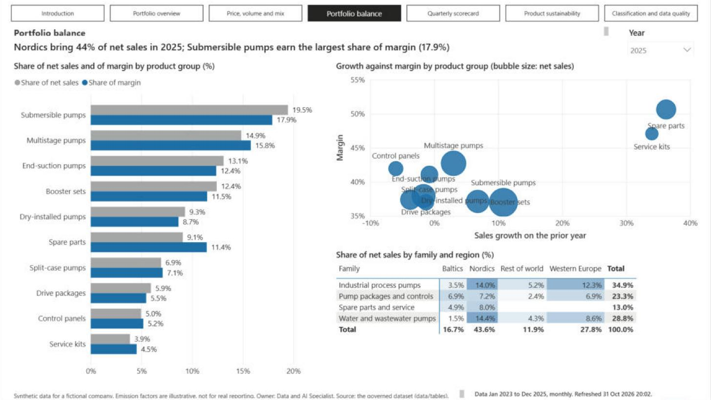
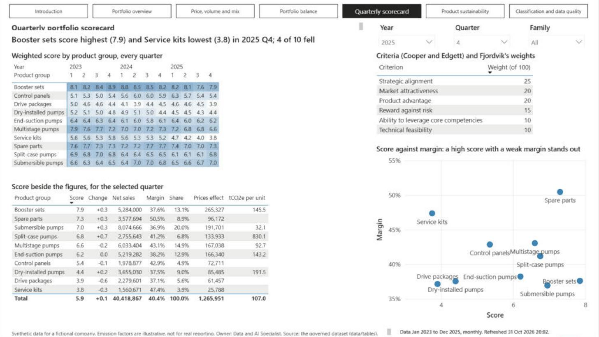

# Fjordvik Power BI: one trusted view of the emissions figures

Fjordvik Manufacturing Oy, a maker of electric pumps and pump systems
([company profile](../docs/company-profile.md)), needs one trusted view of its monthly
greenhouse gas figures for its Group Sustainability Manager, its country managers and the
customers who ask for its footprint: totals by scope, site and country, scope 2 both
location-based and market-based, the scope 3 categories it counts and why it leaves the
others out, emissions per employee and per euro of revenue, and honest year-on-year
change; and, for product management, volume, price, mix, margin, portfolio balance,
use-phase emissions per product and a quarterly scorecard, from sales that reconcile to
finance, against last year and against budget. One Power BI semantic model and two reports
on it provide it: an emissions report (10 pages) for the sustainability team and a
portfolio report (7 pages) for the portfolio team. Country managers see only
their own sites, and every Data Analysis Expressions (DAX) measure is reconciled against
an independent Python calculation by automated tests. The model is saved as a Power BI
Project (PBIP): plain text files in git, written in Tabular Model Definition Language
(TMDL) and the Power BI enhanced report format (PBIR), so every change can be reviewed.

> **Synthetic data only.** Fjordvik Manufacturing Oy is a fictional company, and this is a
> portfolio project. No real company, client or person is described. The emission factors
> are **illustrative**, not cited, and must not be used for real reporting.


**[See all 17 pages of both reports, full size](docs/report-pages.md).**

## Problem

Fjordvik's charts used to be built by hand from copies of a central spreadsheet. Each
report redid the calculations, so two reports could disagree, and nobody could say which
version a chart used. When Tartu Warehouse opened in July 2024, a plain comparison of
totals made the company's growth look larger than it was. A country manager saw every
country or nothing. Management needs a model it can certify: under version control, with
measures that reconcile, clear rules for who sees what, and documentation a reviewer can
check.

## Approach

- **Model as code.** The whole model (tables, relationships, measures, security roles)
  and the report pages are text files, so every change shows up as a readable git diff.
- **A star schema** on the shared Fjordvik dataset: 22 tables with single-direction
  relationships, plus two small calculated tables that hold no figures (`dim_bridge_step`,
  the steps of the margin waterfall, and `dim_refresh`, the time of the last refresh).
  `dim_scope3_category` filters `dim_source`, which filters every emission table.
- **134 measures** in one `_Measures` table, grouped in display folders (Emissions,
  Market-based scope 2, Value chain, Sales, Budget, Price, volume and mix, Bridge, Portfolio
  balance, Product sustainability, Scorecard, Intensity, Activity, Time comparison, Data
  quality, Text), each with a description; every number measure has a format string.
- **Two reports, one model** (31 October 2026, after a design review against Microsoft's
  Power BI guidance and the International Business Communication Standards (IBCS)):
  `FjordvikEmissions.pbip` and `FjordvikPortfolio.pbip` read the same semantic model, so a
  figure is defined once and both audiences see the same number.
- **One year at a time.** Every Year slicer is single-select and opens on the latest full
  year (2025), and a choice on one page carries to every page of the report (Year, Country
  and Region slicers are synced); charts by month, quarter or year ignore it and keep all
  three years. With
  "All" years selected, cards used to add three years together and the prior-year
  comparisons broke.
- **Every headline number has its comparison** underneath: the same months a year earlier
  and the change on them (percentage points for a rate), and on the portfolio pages the
  budget and the variance on it.
- **Page titles say the message.** Under each page name, a sentence worked out from the
  data by a text measure ("Emissions fell 2.2% in 2025; use of sold products is 95% of
  the total"), so it never goes stale. A footer on every page gives the caveat, the owner,
  the period the data covers and the last refresh time.
- **A report theme** (`StaticResources/RegisteredResources/Fjordvik.json`) sets every title,
  label and axis text to 4.5:1 contrast or more on white, at 10 points or larger; the
  defaults measured about 1.5:1 for titles. One colour system: scopes, countries and sites
  keep their colours, families and energy carriers have their own, previous periods are
  grey, and a variance is green or red and always carries a sign. The three scatter charts
  have dashed company-average lines (measures), splitting them into quadrants.
- **Portfolio tables:** `dim_product` in a global hierarchy (`dim_product_group`: family
  and group), `dim_region`, `fact_sales` cleaned by SQL from the simulated ERP extract,
  `fact_budget` (Fjordvik's plan by month, site, product group and region), `fact_data_issue`,
  `fact_use_phase` (category 11), and the scorecard's `dim_score_criterion` and
  `fact_product_rating`.
- **Price, volume and mix** follow the ACCA F5 sales variances with the same months a year
  earlier as the standard, product by product; prior-year margin plus the effects equals
  this year's margin exactly. The page draws it as a waterfall from prior-year margin
  through sales prices, mix, delivery volumes (quantity), variable costs (cost per unit) and
  not comparable to this year's margin. Every step is labelled above its bar, however short:
  an invisible line runs along the top of the steps, and its labels show each step's value
  through a dynamic format string. The bridge table's mix and quantity are worked out
  within each product group, so every row and every column adds up; a note under it gives
  the mix between groups that the company-level waterfall also holds.
- **Location-based totals, market-based beside them.** `Total Emissions (tCO2e)` adds
  the four location-based emission tables. `Total Emissions Market-based (tCO2e)`
  swaps location-based scope 2 for market-based scope 2; the two are never added. The Activity measures give each source in the unit the sites report
  it in (kWh, litres, kg, passenger-km, tonnes).
- **Grain handled explicitly.** Full-time equivalent employees (FTE) is a level, so
  `Average FTE` sums sites within each month and averages the months; summing FTE over a
  year would make emissions per FTE twelve times too small.
- **Like-for-like year-on-year change.** Only site-months with emissions in both years
  count. Without this, Tartu Warehouse (opened July 2024) shows +138.3% for 2025 instead of
  +13.2%, and the company shows +4.5% instead of +3.5%. The What changed page shows both
  views side by side, with `Emissions Change Including New Sites` beside the like-for-like
  measure.
- **No date-table shortcut.** The date table has one row per month, which Power BI will
  not mark as a date table (it needs every day). The prior-year measure shifts month keys
  in plain DAX instead of using `SAMEPERIODLASTYEAR`.
- **Row-level security (RLS).** Three country roles (Finland, Sweden, Estonia) filter
  `dim_site`; four sales region roles filter `dim_region` and deny the site emission and
  finance tables, so a region manager sees only their region's sales.
- **Refresh design** for the Power BI Service: [docs/refresh-design.md](docs/refresh-design.md).
- **In-model reconciliation.** `Reconciliation Difference (tCO2e)` compares stored tCO2e
  with activity times factor, row by row, on the Data quality page.
- **Governance documents:** [naming conventions](docs/naming-conventions.md), a generated
  [data dictionary](docs/data-dictionary.md), and a
  [certification checklist](docs/certification-checklist.md).






## Architecture

```
checksums checked by tests/test_data.py ──> ../data/tables/*.csv  (the shared dataset)
                                                    │  Power Query, en-US locale
                                                    ▼
FjordvikEmissions.SemanticModel/definition/   TMDL: tables, relationships, measures, roles
FjordvikEmissions.Report/definition/          PBIR: emissions report, 10 pages, 149 visuals
FjordvikPortfolio.Report/definition/          PBIR: portfolio report, 7 pages, 96 visuals
                                              (both written by build_report.py, with the theme)
                                                    │
               Power BI Desktop (local engine) <────┘
                       ▲
  tests/test_measures_live.py ──run_dax.ps1──┘  154 DAX queries, compared with tests/expected.py
```

Emissions report (`FjordvikEmissions.pbip`):

| Page | Question it answers | Shows |
| --- | --- | --- |
| Introduction | What is this report? | The company and its six sites, who owns the figures, what each page answers, how to read the figures |
| Overview | How much does Fjordvik emit, and where? | Total and scope 1, 2 and 3 emissions and per FTE, each with 2024 and the change; monthly trend; emissions by site with and without the use of the products each plant made |
| Emissions breakdown | What are the emissions made of? | Emissions by source, scope and country; all scopes by month, and scopes 1 and 2 on their own scale |
| Value chain (scope 3) | Which scope 3 categories are counted, and why not the rest? | Scope 3 and each category counted, by category, purchases by spend category, freight by mode and payer (categories 4 and 9), and all 15 categories with status and reason |
| Scope 2 methods | How do location-based and market-based scope 2 compare? | Both methods by year and site, the difference between them, share of electricity with guarantees of origin, the contracts (months shown as months), market-based scope 2 by instrument |
| Intensity and growth | Is Fjordvik getting cleaner as it grows? | Per FTE (all scopes, and scopes 1 and 2) and per million euros, with 2024; monthly trends; revenue and headcount; like-for-like change by site |
| Energy and activity | What did the sites use? | Energy, fuel, refrigerant, flights and waste in their own units; energy by month; electricity by site (Tampere's solar panels from July 2024); an activity table by site |
| What changed | Why did emissions move on the prior year? | Like-for-like change against change including new sites, a waterfall of change by site for the selected year, change by site and year (2024 grey, 2025 dark) |
| Sites | How do the six sites compare? | Per site: emissions, scopes 1 and 2, per FTE both ways, per million euros, like-for-like change; operational emissions by site and year |
| Data quality | Do the figures reconcile? | Reconciliation difference (location-based and market-based), rows and sites reporting by year, rows by site and year |

Portfolio report (`FjordvikPortfolio.pbip`):

| Page | Question it answers | Shows |
| --- | --- | --- |
| Introduction | What is this report? | The portfolio, who owns the figures, what each page answers, how to read the figures |
| Portfolio overview | What do we sell and earn, against last year and budget? | Net sales, margin, margin % and units, each with 2024 and budget; sales by month and family; sales against budget by family; a table of every family and group with prior year, budget and the variances |
| Price, volume and mix | Why did margin move against last year? | The margin waterfall; the bridge by family and by product group, adding up both ways |
| Portfolio balance | Where do sales and margin come from, and what grows? | Share of sales beside share of margin by group; growth against margin by group (bubble size net sales); share of sales by family and region, shaded |
| Quarterly scorecard | How does each product group score? | Weighted score by group for every quarter, shaded; criteria and weights; the score and its change on the prior quarter beside the figures; score against margin |
| Product sustainability | What do the products emit in use? | Category 11 in total, per unit and per thousand euros, with 2024; by group and region; margin against emissions per euro; each product |
| Classification and data quality | What did the ERP data get wrong? | Open issues, sales held back and the reconciliation; issues with actions for the data owner; the classification |

Every page has the page buttons of its report along the top, a title sentence from the
data, and the footer. Every chart's title says what it shows and its unit.

## How to run

You need Power BI Desktop (free, Microsoft Store) and Python 3.10 or newer with pytest.

1. Clone the repository. If it is not at `C:\Users\reece\Projects\fjordvik` (this folder is `powerbi`),
   change the `DataFolder` value in
   `FjordvikEmissions.SemanticModel/definition/expressions.tmdl` (or in Desktop:
   **Transform data > Edit parameters**) to your clone's shared `data\tables` folder.
2. Open `FjordvikEmissions.pbip` (emissions) or `FjordvikPortfolio.pbip` (portfolio) in
   Power BI Desktop; both open the same model. It opens without data; select **Refresh now**
   on the yellow bar. Open one at a time.
3. Run the tests:

```bash
python -m pytest
```

The offline tests always run. The 154 live measure tests run when Power BI Desktop has the
model open and refreshed (either report); otherwise they are skipped.

To change either report, edit `scripts/build_report.py` and run it; to refresh the data
dictionary after a model change, run `scripts/build_data_dictionary.py`. Close Desktop
**without saving** before regenerating files it has open.

## Test evidence

```
python -m pytest -q
727 passed in 6.06s
```

(31 October 2026, Power BI Desktop open and refreshed; raw output in
`evidence/pytest-labels-sync-live-2026-10-31.txt`.)

| Test file | What it proves |
| --- | --- |
| `test_measures_live.py` (154) | Since the redesign also: where each waterfall label sits (blank for the two totals), the company averages under a product group filter, budget and the variances on it (and the Nordics role sees only its budget), every bridge step and the waterfall's totals and base, mix and quantity within groups (they add to the volume effect), the mix between groups, the score of the prior quarter and its change, open issues, operational emissions per FTE, the market-minus-location difference, sales growth, and the exact words of card context lines, page titles, the contract months and the footer. Before it: every measure, run as DAX against the open model, matches an independent Python calculation from the CSVs: sales, margin and average price; every bridge effect for the company, a family and a month with a quarantined line (not comparable); shares; use-phase per unit and per euro; the weighted score; sales reconciliation; each region role (own sales only, blank site figures); market-based scope 2 and total (zero for Gothenburg's electricity, blank under a scope 1 filter), guarantee of origin kWh and share, each scope 3 category measure, spend, tonne-km and emissions per thousand euros, totals under a scope 3 category filter (blank for category 11), RLS on the new tables; totals by year, scope, site and country; the scope and source measures under a conflicting filter (blank); reconciliation; revenue, average FTE and both intensities; blank per-euro intensity for the head office; prior year (blank for 2023); like-for-like change for the company, for Tartu and across all years; change including new sites (Tartu's first year counts in full; blank for 2023); each activity measure in its own unit; row and site counts; and each security role, including that the Sweden role sees nothing when filtered to Finland |
| `test_model_files.py` (570) | Table and column names match the shared schema; every measure has a description and display folder, and every number measure a format string and its unit in its name; measures divide with `DIVIDE()` and contain no typed-in rates (only unit conversions, the date-key shift and zero); three country roles; in both reports, every field a visual uses exists in the model, page and visual names follow the PBIR rules, every page has page buttons, a footer with the synthetic-data caveat and the theme, every Year slicer opens on one year, and every link between visuals names visuals that exist; the report files are exactly what `build_report.py` writes |
| `test_docs.py`, `test_data.py` (3) | The data dictionary matches the model; the shared data matches its manifest's checksums, and `DataFolder` points at it |

The tests were checked by planting mistakes: a typed-in factor (`* 0.95`) in a measure and
a misspelt measure name in a visual were both caught. During the redesign the live tests
caught two faults before any page showed them: DAX's `FORMAT` does not scale by trailing
commas (thousands and millions are now divided first), and `Before` is a reserved word. Writing the like-for-like test
exposed a fault in the first version of the change measure, which compared Tartu's
12 months of 2025 with its 6 months of 2024.


## Ownership

| Role | Who (fictional) |
| --- | --- |
| Business owner, emissions report | Fjordvik Group Sustainability Manager |
| Business owner, portfolio report | Head of Portfolio |
| Technical owner | Data and AI Specialist |

## Limitations

- **Not published.** Endorsement, certification, scheduled refresh and RLS membership
  live in the Power BI Service; the [certification checklist](docs/certification-checklist.md)
  shows what would be reviewed.
- **Local file source.** The data comes from CSV files through a folder parameter. A
  production model would read a database or lakehouse, with a gateway for refresh.
- **Monthly grain** and illustrative emission factors (see the
  [data README](../data/README.md)).
- **Scope 3 is incomplete.** Categories 2, 7 and 12 are not yet calculated and category 11
  leaves out Rest of world; the Value chain page lists each with its reason.
- **The bridge mixes units** across families at company level (pumps and spare parts), so
  the company mix and delivery volumes steps are large and offset; the note under the bridge
  table gives the shift between groups. Pick one family for a cleaner mix.
- **The budget is by product group**, so it is blank for a single product and the same for
  every product of a group.
- **Plan only, no forecast**: actual against budget and prior year; a year-end forecast
  needs data Fjordvik does not hold yet.
- **Incremental refresh is designed, not built**: it needs a database source.
- **Live tests need Desktop open.** In a team, the same DAX queries would run in CI
  (continuous integration) against a published model through the XMLA endpoint.

## Next steps

- Publish to a Power BI workspace, assign RLS members, and run the live tests against the
  XMLA endpoint.
- Add a Power Automate flow that refreshes the model after each monthly data load
  (the `power-automate` folder).

## Licence

Code: MIT ([LICENSE](LICENSE)). Data: Creative Commons Attribution 4.0 (CC BY 4.0)
([data/LICENSE-DATA.md](../data/LICENSE-DATA.md)).
