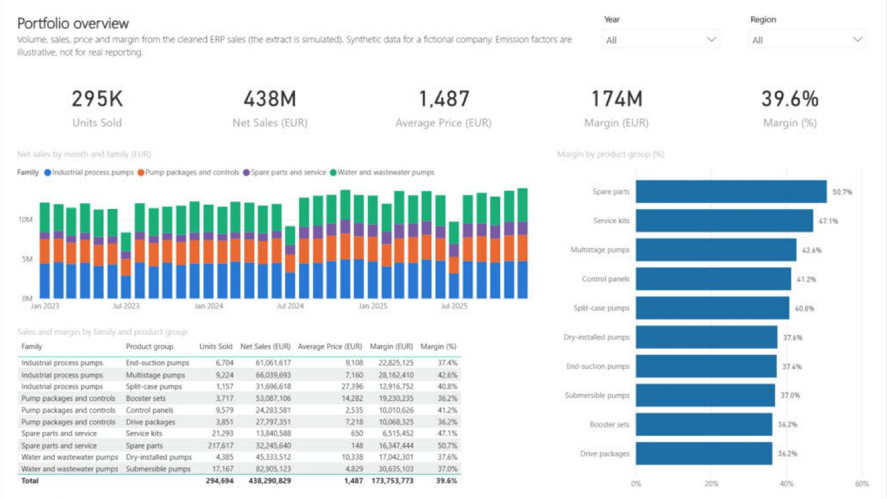
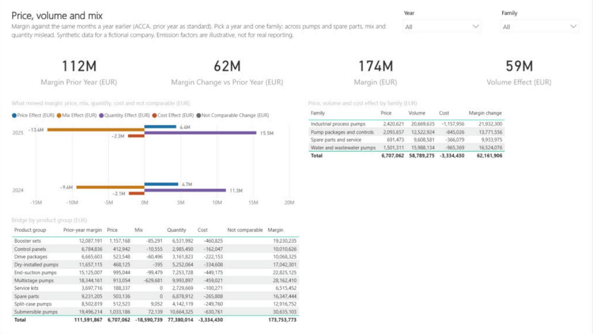
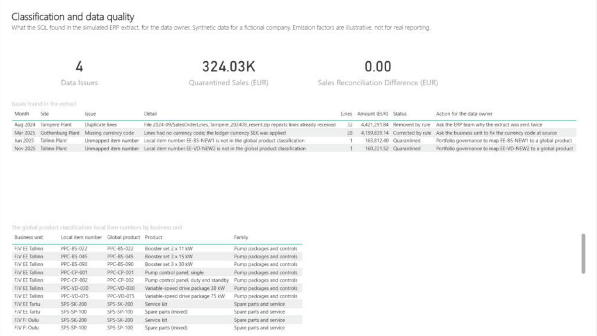

# Fjordvik Power BI: one trusted view of the emissions figures

Fjordvik Manufacturing Oy, a maker of electric pumps and pump systems
([company profile](../docs/company-profile.md)), needs one trusted view of its monthly
greenhouse gas figures for its Group Sustainability Manager, its country managers and the
customers who ask for its footprint: totals by scope, site and country, scope 2 both
location-based and market-based, the scope 3 categories it counts and why it leaves the
others out, emissions per employee and per euro of revenue, and honest year-on-year
change; and, for product management, volume, price, mix, margin, portfolio balance,
use-phase emissions per product and a quarterly scorecard, from sales that reconcile to
finance. This Power BI semantic model and 16-page report provide it. Country managers see only
their own sites, and every Data Analysis Expressions (DAX) measure is reconciled against
an independent Python calculation by automated tests. The model is saved as a Power BI
Project (PBIP): plain text files in git, written in Tabular Model Definition Language
(TMDL) and the Power BI enhanced report format (PBIR), so every change can be reviewed.

> **Synthetic data only.** Fjordvik Manufacturing Oy is a fictional company, and this is a
> portfolio project. No real company, client or person is described. The emission factors
> are **illustrative**, not cited, and must not be used for real reporting.


## Problem

Fjordvik's charts used to be built by hand from copies of a central spreadsheet. Each
report redid the calculations, so two reports could disagree, and nobody could say which
version a chart used. When Tartu Warehouse opened in July 2024, a plain comparison of
totals made the company's growth look larger than it was. A country manager saw every
country or nothing. Management needs a model it can certify: under version control, with
measures that reconcile, clear rules for who sees what, and documentation a reviewer can
check.

## Approach

- **Model as code.** The whole model (tables, relationships, measures, security roles)
  and the report pages are text files, so every change shows up as a readable git diff.
- **A star schema** on the shared Fjordvik dataset: six dimensions (date, site, source,
  scope 3 category, supplier, contract) and six fact tables (site emissions, site
  metrics, market-based scope 2, upstream energy, purchases, freight), with
  single-direction relationships. `dim_scope3_category` filters `dim_source`, which
  filters every emission table.
- **Sixty-two measures** in one `_Measures` table, grouped in display folders
  (Emissions, Market-based scope 2, Value chain, Sales, Price, volume and mix, Portfolio
  balance, Product sustainability, Scorecard, Intensity, Activity, Time comparison, Data
  quality), each with a description and a format string.
- **Portfolio tables:** `dim_product` in a global hierarchy (`dim_product_group`: family
  and group), `dim_region`, `fact_sales` cleaned by SQL from the simulated ERP extract,
  `fact_data_issue`, `fact_use_phase` (category 11), and the scorecard's
  `dim_score_criterion` and `fact_product_rating`.
- **Price, volume and mix** follow the ACCA F5 sales variances with the same months a year
  earlier as the standard, product by product; prior-year margin plus the effects equals
  this year's margin exactly. The method is named in each measure's description.
- **Location-based totals, market-based beside them.** `Total Emissions (tCO2e)` adds
  the four location-based emission tables. `Total Emissions Market-based (tCO2e)`
  swaps location-based scope 2 for market-based scope 2; the two are never added. The Activity measures give each source in the unit the sites report
  it in (kWh, litres, kg, passenger-km, tonnes).
- **Grain handled explicitly.** Full-time equivalent employees (FTE) is a level, so
  `Average FTE` sums sites within each month and averages the months; summing FTE over a
  year would make emissions per FTE twelve times too small.
- **Like-for-like year-on-year change.** Only site-months with emissions in both years
  count. Without this, Tartu Warehouse (opened July 2024) shows +138.3% for 2025 instead of
  +13.2%, and the company shows +4.5% instead of +3.5%. The What changed page shows both
  views side by side, with `Emissions Change Including New Sites` beside the like-for-like
  measure.
- **No date-table shortcut.** The date table has one row per month, which Power BI will
  not mark as a date table (it needs every day). The prior-year measure shifts month keys
  in plain DAX instead of using `SAMEPERIODLASTYEAR`.
- **Row-level security (RLS).** Three country roles (Finland, Sweden, Estonia) filter
  `dim_site`; four sales region roles filter `dim_region` and deny the site emission and
  finance tables, so a region manager sees only their region's sales.
- **Refresh design** for the Power BI Service: [docs/refresh-design.md](docs/refresh-design.md).
- **In-model reconciliation.** `Reconciliation Difference (tCO2e)` compares stored tCO2e
  with activity times factor, row by row, on the Data quality page.
- **Governance documents:** [naming conventions](docs/naming-conventions.md), a generated
  [data dictionary](docs/data-dictionary.md), and a
  [certification checklist](docs/certification-checklist.md).





## Architecture

```
checksums checked by tests/test_data.py ──> ../data/tables/*.csv  (the shared dataset)
                                                    │  Power Query, en-US locale
                                                    ▼
FjordvikEmissions.SemanticModel/definition/   TMDL: tables, relationships, measures, roles
FjordvikEmissions.Report/definition/          PBIR: 16 pages, 131 visuals (from build_report.py)
                                                    │
               Power BI Desktop (local engine) <────┘
                       ▲
  tests/test_measures_live.py ──run_dax.ps1──┘  109 DAX queries, compared with tests/expected.py
```

| Page | Question it answers | Shows |
| --- | --- | --- |
| Introduction | What is this report? | The company and its six sites, who owns the figures, what each page answers, how to read the figures; a button for every page |
| Overview | How much does Fjordvik emit, and where? | Total and scope 1, 2 and 3 emissions, emissions per FTE, monthly trend, emissions by site |
| Emissions breakdown | What are the emissions made of? | Scope 1, 2 and 3 stacked by month, each scope's share, emissions by source, by country |
| Value chain (scope 3) | Which scope 3 categories are counted, and why not the rest? | Scope 3 and each category counted, by category, purchases by spend category, freight by mode and payer (categories 4 and 9), and all 15 categories with status and reason |
| Scope 2 methods | How do location-based and market-based scope 2 compare? | Both methods by year and site, both totals, share of electricity with guarantees of origin, the contracts, market-based scope 2 by instrument |
| Intensity and growth | Is Fjordvik getting cleaner as it grows? | Emissions per FTE and per million euros by month, revenue and headcount trends, like-for-like change by site |
| Energy and activity | What did the sites use? | Energy, fuel, refrigerant, flights and waste in their own units; energy by month; electricity by site (Tampere's solar panels from July 2024); an activity table by site |
| What changed | Why did emissions move on the prior year? | Like-for-like change against change including new sites, a 2025 waterfall of change by site, change by site and year |
| Sites | How do the six sites compare? | Per site: emissions, per FTE, per million euros, like-for-like change; scope 2 by month and site |
| Data quality | Do the figures reconcile? | Reconciliation difference (location-based and market-based), row count and sites reporting, by year |
| Portfolio overview | What do we sell, at what price and margin? | Units, net sales, average price, margin and margin %; sales by month and family; margin by group |
| Price, volume and mix | Why did margin move against last year? | Price, mix, quantity, cost and not-comparable effects; effects by family and by group |
| Portfolio balance | Where do sales and margin come from? | Share of sales by family and by family and region; share of margin by group; sales by region |
| Product sustainability | What do the products emit in use? | Category 11 in total, per unit and per thousand euros; by group, region and product |
| Quarterly scorecard | How does each product group score? | Weighted score by group and quarter; criteria and weights; score beside the figures |
| Classification and data quality | What did the ERP data get wrong? | Issues with actions for the data owner; quarantined sales; sales reconciliation; the classification |

Every chart has a title that says what it shows. Scopes, countries and sites keep one
colour on every page; each colour set was checked for colour-blind separation and contrast
on white, and the charts whose site colours are below 3:1 contrast share their page with a
site table.

## How to run

You need Power BI Desktop (free, Microsoft Store) and Python 3.10 or newer with pytest.

1. Clone the repository. If it is not at `C:\Users\reece\Projects\fjordvik` (this folder is `powerbi`),
   change the `DataFolder` value in
   `FjordvikEmissions.SemanticModel/definition/expressions.tmdl` (or in Desktop:
   **Transform data > Edit parameters**) to your clone's shared `data\tables` folder.
2. Open `FjordvikEmissions.pbip` in Power BI Desktop. It opens without data; select
   **Refresh now** on the yellow bar.
3. Run the tests:

```bash
python -m pytest
```

The offline tests always run. The 109 live measure tests run when Power BI Desktop has the
model open and refreshed; otherwise they are skipped.

To change the report, edit `scripts/build_report.py` and run it; to refresh the data
dictionary after a model change, run `scripts/build_data_dictionary.py`. Close Desktop
**without saving** before regenerating files it has open.

## Test evidence

```
python -m pytest -q
371 passed in 3.37s
```

(31 October 2026, Power BI Desktop open and refreshed; raw output in
`evidence/pytest-portfolio-2026-10-31.txt`, live results in
`evidence/live-measures-2026-10-31-portfolio.txt`.)

| Test file | What it proves |
| --- | --- |
| `test_measures_live.py` (109) | Every measure, run as DAX against the open model, matches an independent Python calculation from the CSVs: sales, margin and average price; every bridge effect for the company, a family and a month with a quarantined line (not comparable); shares; use-phase per unit and per euro; the weighted score; sales reconciliation; each region role (own sales only, blank site figures); market-based scope 2 and total (zero for Gothenburg's electricity, blank under a scope 1 filter), guarantee of origin kWh and share, each scope 3 category measure, spend, tonne-km and emissions per thousand euros, totals under a scope 3 category filter (blank for category 11), RLS on the new tables; totals by year, scope, site and country; the scope and source measures under a conflicting filter (blank); reconciliation; revenue, average FTE and both intensities; blank per-euro intensity for the head office; prior year (blank for 2023); like-for-like change for the company, for Tartu and across all years; change including new sites (Tartu's first year counts in full; blank for 2023); each activity measure in its own unit; row and site counts; and each security role, including that the Sweden role sees nothing when filtered to Finland |
| `test_model_files.py` (259) | Table and column names match the shared schema; every measure has a description, format string and display folder, carries its unit in its name, divides with `DIVIDE()`, and contains no typed-in rates (only unit conversions and the date-key shift); three country roles; every field used by a visual exists in the model; page and visual names follow the PBIR rules; the report files are exactly what `build_report.py` writes |
| `test_docs.py`, `test_data.py` (3) | The data dictionary matches the model; the shared data matches its manifest's checksums, and `DataFolder` points at it |

The tests were checked by planting mistakes: a typed-in factor (`* 0.95`) in a measure and
a misspelt measure name in a visual were both caught. Writing the like-for-like test
exposed a fault in the first version of the change measure, which compared Tartu's
12 months of 2025 with its 6 months of 2024.




## Ownership

| Role | Who (fictional) |
| --- | --- |
| Business owner | Fjordvik Group Sustainability Manager |
| Technical owner | Data and AI Specialist |

## Limitations

- **Not published.** Endorsement, certification, scheduled refresh and RLS membership
  live in the Power BI Service; the [certification checklist](docs/certification-checklist.md)
  shows what would be reviewed.
- **Local file source.** The data comes from CSV files through a folder parameter. A
  production model would read a database or lakehouse, with a gateway for refresh.
- **Monthly grain** and illustrative emission factors (see the
  [data README](../data/README.md)).
- **Scope 3 is incomplete.** Categories 2, 7 and 12 are not yet calculated and category 11
  leaves out Rest of world; the Value chain page lists each with its reason.
- **The bridge mixes units** across families at company level (pumps and spare parts), so
  mix and quantity are large and offset; the page asks for one family.
- **Incremental refresh is designed, not built**: it needs a database source.
- **Live tests need Desktop open.** In a team, the same DAX queries would run in CI
  (continuous integration) against a published model through the XMLA endpoint.

## Next steps

- Publish to a Power BI workspace, assign RLS members, and run the live tests against the
  XMLA endpoint.
- Add a Power Automate flow that refreshes the model after each monthly data load
  (the `power-automate` folder).

## Licence

Code: MIT ([LICENSE](LICENSE)). Data: Creative Commons Attribution 4.0 (CC BY 4.0)
([data/LICENSE-DATA.md](../data/LICENSE-DATA.md)).
