# Every page of the Fjordvik Power BI reports

All 17 pages of the two reports, as Power BI Desktop shows them when they open: Year on
2025 (the latest full year), the scorecard on its latest quarter, every other slicer on
all. Select a picture to open it at full size (2,490 by 1,440 pixels). Each picture is a
page of Power BI Desktop's own PDF export (**File > Export > Export to PDF**), turned into
an image at 180 dots per inch, so text and lines stay sharp. Taken on 31 October 2026.

> **Synthetic data only.** Fjordvik Manufacturing Oy is a fictional company, and this is a
> portfolio project. The emission factors are **illustrative**, not cited, and must not be
> used for real reporting.

Both reports read one semantic model, so a figure is defined once. How the reports are
built and tested: [the Power BI README](../README.md).

**Emissions report** (`FjordvikEmissions.pbip`):
[Introduction](#introduction) ·
[Overview](#overview) ·
[Emissions breakdown](#emissions-breakdown) ·
[Value chain (scope 3)](#value-chain-scope-3) ·
[Scope 2 methods](#scope-2-methods) ·
[Intensity and growth](#intensity-and-growth) ·
[Energy and activity](#energy-and-activity) ·
[What changed](#what-changed) ·
[Sites](#sites) ·
[Data quality](#data-quality)

**Portfolio report** (`FjordvikPortfolio.pbip`):
[Introduction](#introduction-1) ·
[Portfolio overview](#portfolio-overview) ·
[Price, volume and mix](#price-volume-and-mix) ·
[Portfolio balance](#portfolio-balance) ·
[Quarterly scorecard](#quarterly-scorecard) ·
[Product sustainability](#product-sustainability) ·
[Classification and data quality](#classification-and-data-quality)

## Emissions report

### Introduction

What the report is, the six sites, who owns the figures, what each page answers and how
to read the figures.

[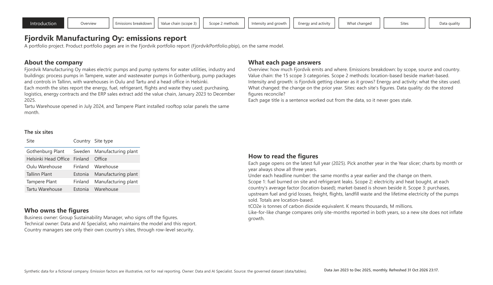](images/pages/emissions-01-introduction.png)

### Overview

How much Fjordvik emits and where: total and scope 1, 2 and 3 emissions and per employee,
each with 2024 and the change; the monthly trend over three years; emissions by site, with
and without the use of the products each plant made.

[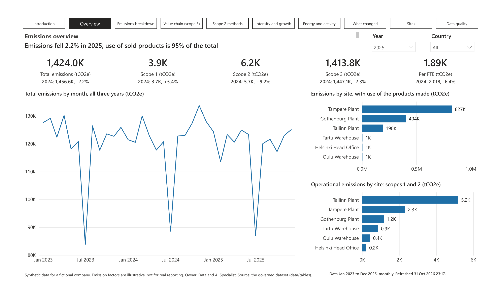](images/pages/emissions-02-overview.png)

### Emissions breakdown

What the emissions are made of: by source, scope and country; all scopes by month, and
scopes 1 and 2 on their own scale.

[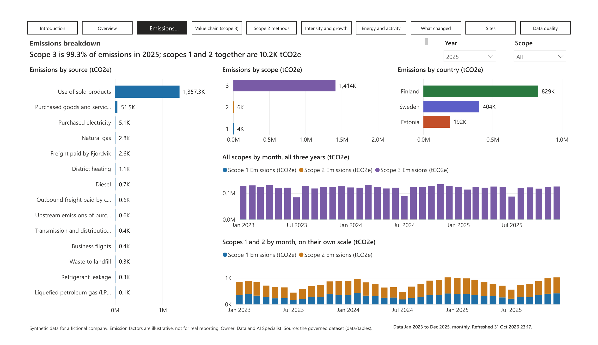](images/pages/emissions-03-breakdown.png)

### Value chain (scope 3)

Which scope 3 categories are counted and why the others are not: each counted category
with 2024, purchases by spend category, freight by mode and payer, and all 15 categories
with their status and reason.

[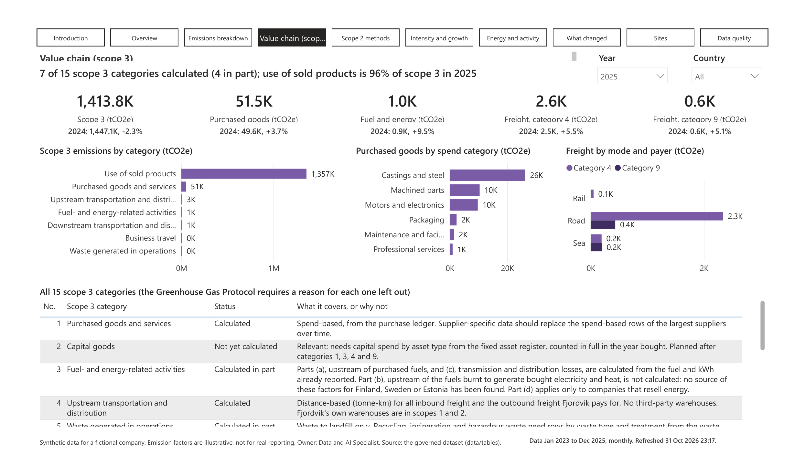](images/pages/emissions-04-value-chain.png)

### Scope 2 methods

Location-based and market-based scope 2 side by side, by year and site; the difference
between them; the share of electricity covered by guarantees of origin; the contracts and
market-based scope 2 by instrument.

[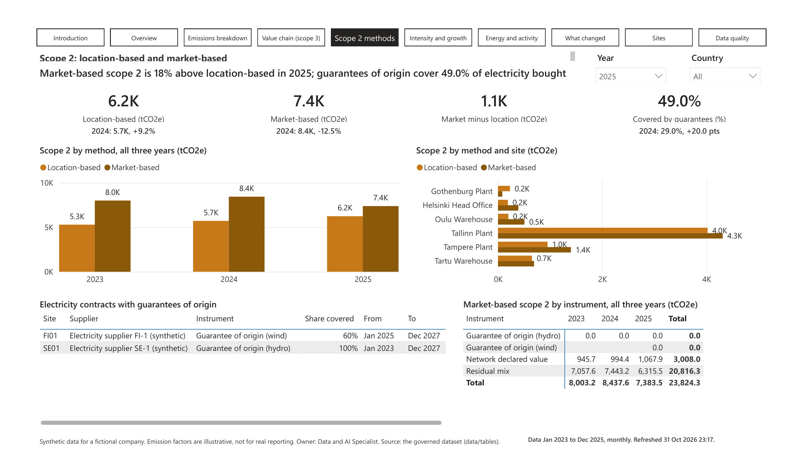](images/pages/emissions-05-scope2-methods.png)

### Intensity and growth

Whether Fjordvik is getting cleaner as it grows: emissions per employee and per million
euros of revenue, with 2024; monthly trends; revenue and headcount; like-for-like change by
site.

[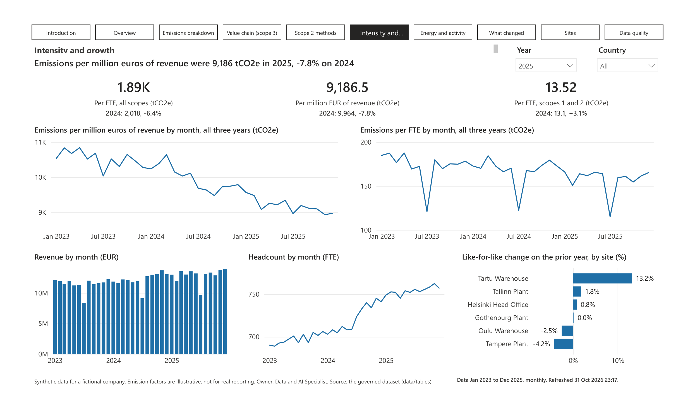](images/pages/emissions-06-intensity-and-growth.png)

### Energy and activity

What the sites used, in their own units, with 2024; energy by month; electricity bought by
site, with Tampere (rooftop solar from July 2024) highlighted; a table by site.

[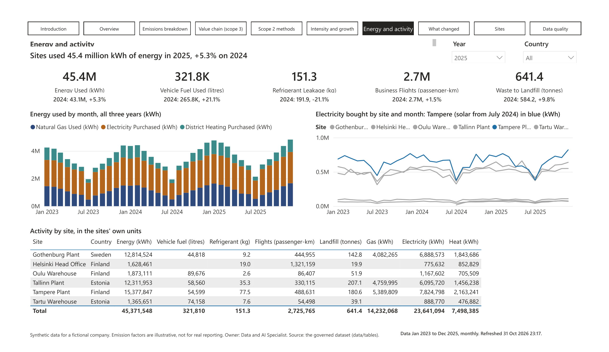](images/pages/emissions-07-energy-and-activity.png)

### What changed

The change on the prior year, like for like and including new sites; a waterfall of the
change by site; the change by site and year.

[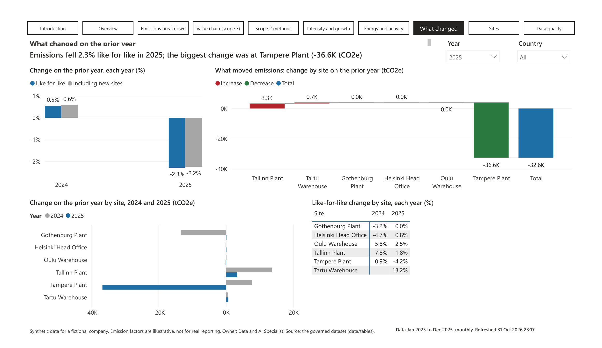](images/pages/emissions-08-what-changed.png)

### Sites

Each site's emissions and intensity, with operational emissions (scopes 1 and 2) beside
the totals that include products made; operational emissions by site over three years.

[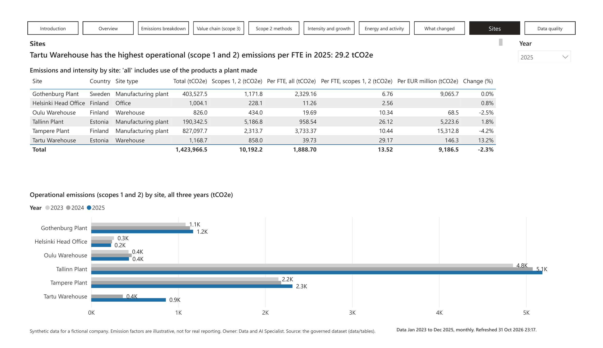](images/pages/emissions-09-sites.png)

### Data quality

Whether the stored figures reconcile: stored against recalculated emissions by year, and
the rows each site reported.

[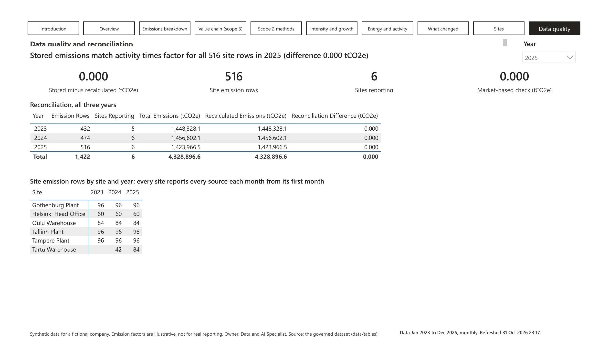](images/pages/emissions-10-data-quality.png)

## Portfolio report

### Introduction

The portfolio, who owns the figures, what each page answers and how to read the figures.

[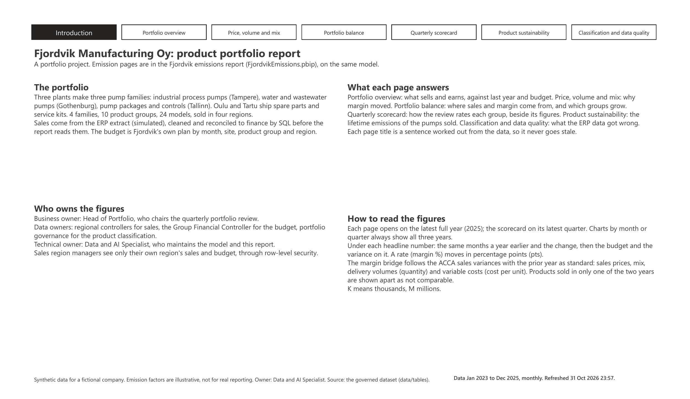](images/pages/portfolio-01-introduction.png)

### Portfolio overview

What Fjordvik sells and earns, against last year and budget: net sales, margin, margin %
and units, each with 2024 and budget; sales by month and family; sales against budget by
family; every family and product group.

[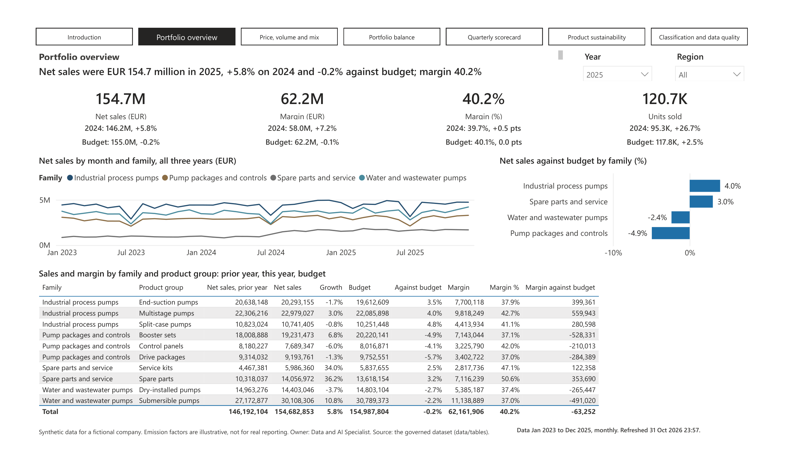](images/pages/portfolio-02-overview.png)

### Price, volume and mix

Why margin moved: a waterfall from last year's margin through sales prices, mix, delivery
volumes and variable costs to this year's margin, each step labelled; the bridge by family
and by product group, adding up both ways.

### Portfolio balance

Where sales and margin come from and what grows: share of sales beside share of margin by
group; growth against margin by group, with the company averages dashed; share of sales by
family and region, shaded.

[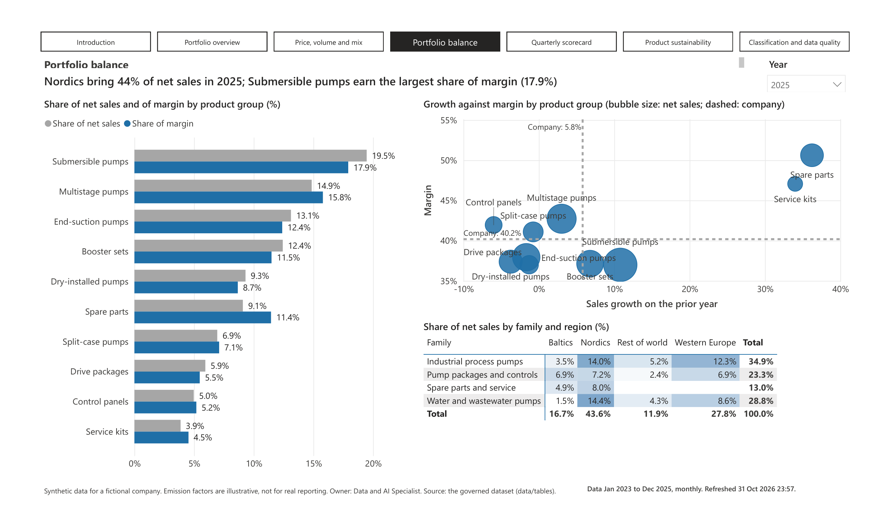](images/pages/portfolio-04-balance.png)

### Quarterly scorecard

How the quarterly review rates each product group: every quarter's weighted score, shaded;
the criteria and Fjordvik's weights; the score and its change beside the figures; score
against margin, with the company averages dashed.

[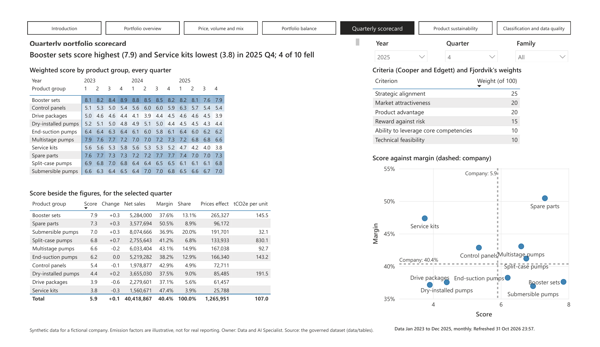](images/pages/portfolio-05-scorecard.png)

### Product sustainability

The lifetime electricity of the pumps sold (scope 3 category 11): in total, per unit and
per thousand euros, with 2024; by group and region of use; margin against emissions per
euro; every product.

[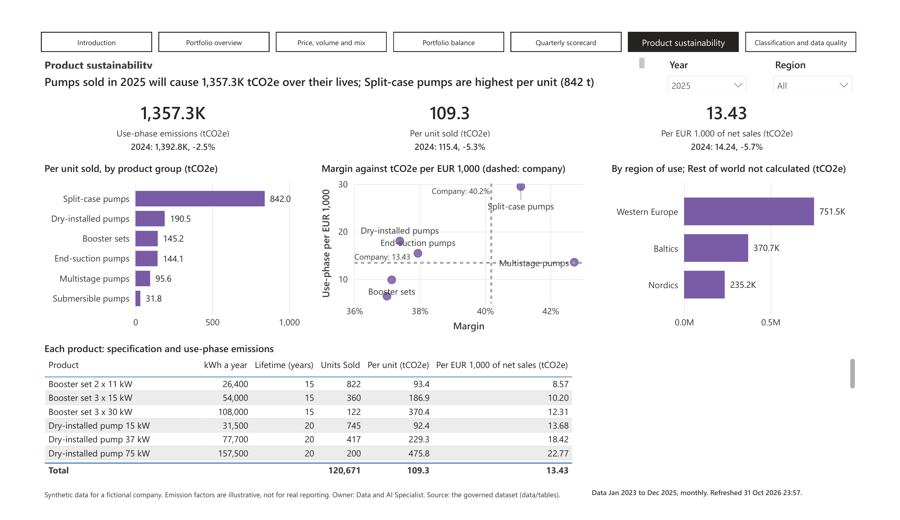](images/pages/portfolio-06-product-sustainability.png)

### Classification and data quality

What the ERP data got wrong: open issues, sales held back and the reconciliation to
finance; every issue with an action for its owner; the global product classification.

[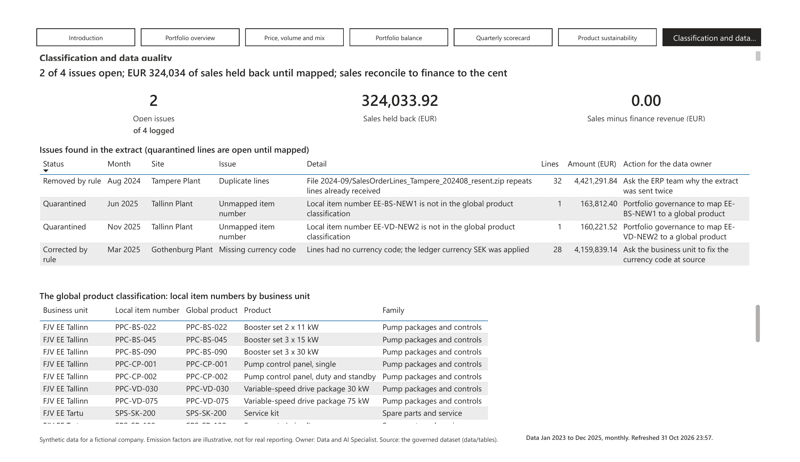](images/pages/portfolio-07-classification.png)
